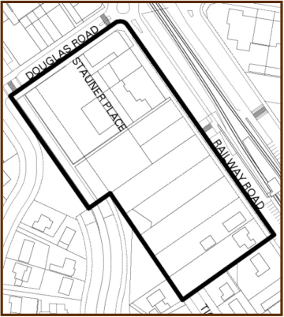

### 2.2 Vision and Objectives

#### Vision and Objectives

Economic studies have indicated that Quakers Hill Centre is unlikely to achieve

full District Centre status in terms of total retail and commercial floorspace.  To

facilitate the economic viability of the centre and to take advantage of the

existing transport and community infrastructure, residential uses are encouraged

within the Centre to establish a vibrant, mixed use ‘urban village’.  In the future,

Quakers Hill should provide a range of residential, retail, commercial and

community uses that will enhance this local centre.  Redevelopment will also

provide the opportunity for  significant improvements to the public domain.

Council’s vision for the future Quakers Hill Urban Village is a centre which has

the following attributes:

(a) a safe and convenient pedestrian environment that encourages walking to

and from the village;

(b) an enhanced public domain with widened footpaths, new public spaces,

street tree planting, and awnings for shelter;

(c) a mixed use centre with active uses such as retail shops, commercial offices

and community uses at ground level with residential units above;

(d) a coherent building scale and form that is compatible with the scale of the

surrounding area;

(e) high quality and sustainable building design that defines the public domain

and provides a high level of residential amenity;

(f) an improved road and traffic network with new access ways and the

implementation of traffic calming and intersection upgrades as required; and

(g) improved amenity along the stormwater channel with pathways and

landscaping, play areas and long term water quality improvements through a

more naturalised watercourse.

### 3

### BLOCK BY BLOCK

### CONTROLS

> [Picture on page 55: a picture, saved as a picture (images/part-d-development-in-the-business-zones-page-55-5.gif, 150 dpi).]
