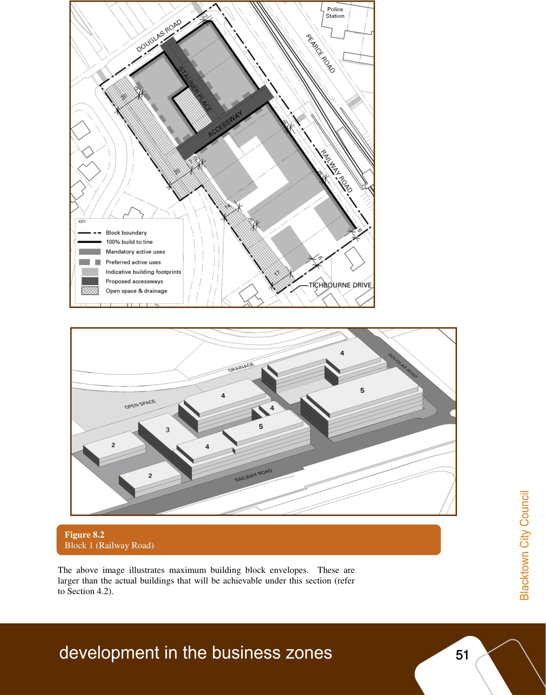

### 3.1 Block 1 – Railway Road

#### Block 1 - Railway Road

The Railway Road Block is bounded by Railway Road, Douglas Road, the

stormwater channel and residential zoned land to the south.  The block contains

retail shops on the corner of Railway and Douglas Roads, informal car parking

areas and scattered stands of trees.  The block also contains the partially formed

street, Stauner Place and associated car park.

#### 3.1.1

#### 3.1.1 Development Outcomes

#### Development outcomes

Development within the Railway Road Block is to facilitate the following

outcomes:

(1) Ground level shops, cafes and commercial premises to activate Railway and

Douglas Roads.  Residential uses above provide a ‘24 / 7’ activity within the

urban village.

(2) Pedestrian amenity is enhanced through widened footpaths, street trees,

awnings, and new street furniture consistent with the existing public domain

improvements.

(3) Stauner Place is extended, linking Douglas Road with a new access way that

links to Railway Road in accordance with Figure 2.  The access ways

provide pedestrian links through the block, additional short stay, kerb -side

parking, and vehicular access to basement car parks.  The Stauner Place

extension is to be ‘exit only’ onto Douglas Road.

(4) The existing Council car park is converted into an urban square as part of the

redevelopment of the adjoining site.  The square is landscaped and new

street furniture is provided that is consistent with the existing public domain

improvements.  The square is defined by retail shops and or community uses

on two sides and is overlooked by residential units providing natural

surveillance of the space.  Short stay public car parking is to be

accommodated within the new access ways.

(5) Building heights and forms are stepped to provide an appropriate transition

between the residential zoned land to the south and Douglas Road, generally

in accordance with Figure 2.

(6) Existing significant vegetation is to be retained within communal open space

areas.

(7) Land along the stormwater channel is dedicated to Council for drainage and

public open space in accordance with Figure 2.   This open space is

landscaped and embellished with seating and walking tracks connecting

Douglas Road, the new access way and Tichborne Avenue.  Such land

dedication and embellishment works may be offset against Section 94

Contributions.

> [Picture on page 56: a picture, saved as a picture (images/part-d-development-in-the-business-zones-page-56-1.gif, 150 dpi).]

#### Figure 8.2

Block 1 (Railway Road)

The above image illustrates maximum building block envelopes.  These are

larger than the actual buildings that will be achievable under this section (refer

to Section 4.2).

#### 3.2
