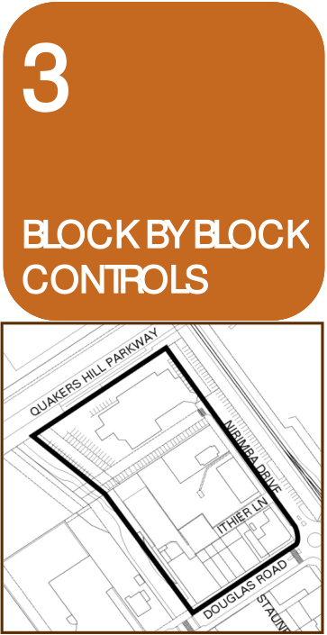
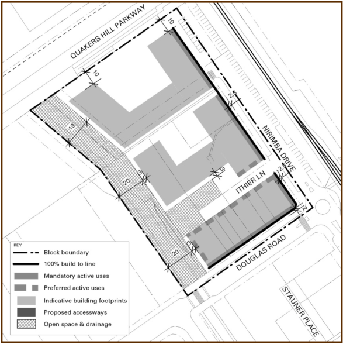
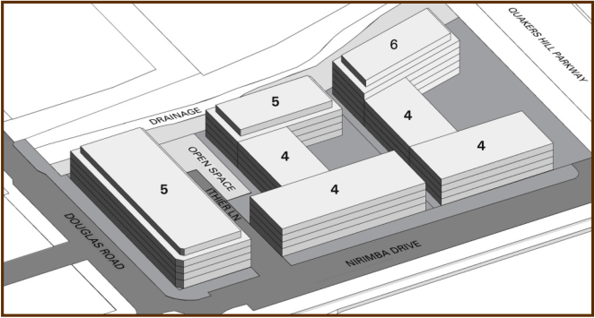

### 3.2 Block 2 – Nirimba Drive

#### Block 2 – Nirimba Drive

The Nirimba Drive Block is bounded by Nirimba Drive, Douglas Road, Quakers

Hill Parkway and the stormwater channel.  It contains the Quakers Inn, the

Telstra Exchange Building and retail shops fronting Douglas Road.

#### 3.2.1

#### 3.2.1 Development Outcomes

> [Picture on page 57: a picture, saved as a picture (images/part-d-development-in-the-business-zones-page-57-9.gif, 150 dpi).]

### 3

### BLOCK BY BLOCK

### CONTROLS

### 3

### BLOCK BY BLOCK

### CONTROLS

### 3

### BLOCK BY BLOCK

### CONTROLS

#### Development Outcomes

Development with the Nirimba Road Block is to facilitate the following

outcomes:

(1) A new landscaped open space be provided adjacent to the stormwater

channel at the end of Ithier Lane, generally in accordance with Figure 3.  A

pedestrian pathway be provided along the stormwater channel linking

Douglas Road and the new open space.  Landscaping along the stormwater

channel at the rear of the Quakers Inn site is to enable ready surveillance of

this area.

(2) Whilst it is expected that the Quakers Inn and Telstra Buildings will remain

in their current form for the foreseeable future, any future development

should achieve the outcomes shown in Figure 3.

(3) Building heights and forms define the street edge and stormwater channel

generally in accordance with Figure 3.

(4) Pedestrian amenity along Douglas Road is improved through widened

footpaths, and installation of awnings.  Pedestrian amenity along Nirimba

Drive is improved through widened footpaths, active uses at ground level

and awnings.

(5) Ithier Lane is extended to provide a pedestrian link to the stormwater

channel and vehicular access to basement car parks.

(6) A new landscaped square is provided at the end of Ithier Place, connecting

to the open space in the drainage channel.

> [Picture on page 57: a picture, saved as a picture (images/part-d-development-in-the-business-zones-page-57-41.gif, 150 dpi).]

> [Picture on page 58: a picture, saved as a picture (images/part-d-development-in-the-business-zones-page-58-1.gif, 150 dpi).]

Figure 3: Block 2 (Nirimba Drive)

#### Figure 8.3

Block 2 (Nirimba Drive)

The above image illustrates maximum building block envelopes.  These are

larger than the actual buildings that will be achievable under this section (refer

to Section 4.2).

#### 3.3
