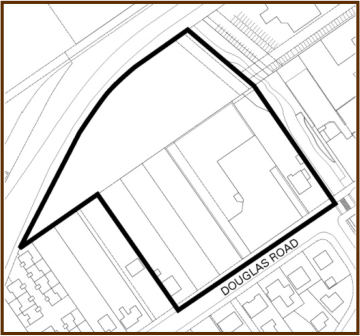
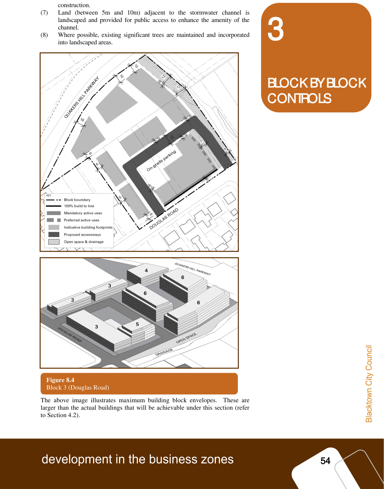

### 3.3 Block 3 – Douglas Road

#### Block 3 – Douglas Road

The Douglas Road Block is bounded by Douglas Road, the stormwater channel,

Quakers Hill Parkway and residential zoned land.  The block is generally vacant

with the exception of the Quakers Hill Plaza – a 2 storey retail and commercial

development fronting Douglas Road.

#### 3.3.1

#### 3.3.1 Development Outcomes

#### Development Outcomes

Development within the Douglas Road Block is to provide the following

outcomes:

(1) The majority of the Douglas Road frontage of the block is activated through

non-residential uses at ground floor built to the street edge.  At least one

tenancy with a floor plate of a minimum of 1,000m2 and suitable for a small

supermarket is to be provided.  An adequate amount of at-grade parking is to

be provided adjacent the retail uses for convenient, short stay parking.

(2) Pedestrian amenity along Douglas Road is improved through widened

footpaths and awnings.

(3) A publicly accessible access way is to be provided through the site to

enhance pedestrian permeability, to provide buildings at the rear of the block

with a ‘street address’ and to provide vehicular access to basement car parks.

The access way is to incorporate pedestrian footpaths and street tree

planting.

(4) The rear of the block is developed for residential uses with buildings set

around a communal landscaped courtyard generally in accordance with

Figure 4.  A range of housing types including terraces, apartments (with

lifts) and shop top housing is to be provided.

(5) Building heights and forms are stepped to provide an appropriate transition

between the adjacent residential land, generally in accordance with Figure

4\.  Buildings fronting Douglas Road are not to overshadow dwelling houses

on the southern side of Douglas Road.

(6) Visual and acoustic impacts associated with the Quakers Hill Parkway

interface are minimised through landscape screening, building design and

> [Picture on page 58: a picture, saved as a picture (images/part-d-development-in-the-business-zones-page-58-42.gif, 150 dpi).]

> [Picture on page 59: a picture, saved as a picture (images/part-d-development-in-the-business-zones-page-59-1.gif, 150 dpi).]

### 3

### BLOCK BY BLOCK

### CONTROLS

#### Figure 8.4

Block 3 (Douglas Road)

construction.

(7) Land (between 5m and 10m) adjacent to the stormwater channel is

landscaped and provided for public access to enhance the amenity of the

channel.

(8) Where possible, existing significant trees are maintained and incorporated

into landscaped areas.

Figure 4: Block 3 (Douglas Road)

The above image illustrates maximum building block envelopes.  These are

larger than the actual buildings that will be achievable under this section (refer

to Section 4.2).

