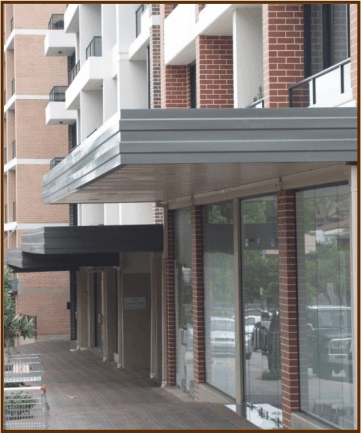
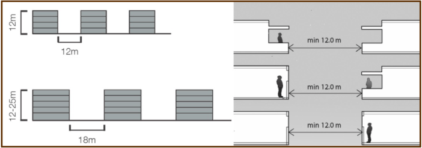

### 4.4 Building Separation and Boundary Setbacks

Objectives

Controls

#### Building Separation and Boundary Setbacks

#### Objectives

(1) To provide visual and acoustic privacy for existing and new residents.

(2) To control overshadowing of adjacent properties and private and shared

open space.

(3) To allow for the provision of usable open space between buildings.

(4) To establish the desired spatial proportions of the street, and to define the

street edge.

(5) To minimise the impact of development on light, air, sun, privacy, views and

outlook for neighbouring properties, including future buildings.

(6) To reduce the impact of the higher levels of buildings as viewed from street

level.

#### Controls

(1) New development is to achieve the boundary setbacks shown at Figures 2 –

4.

(2) All land required for footpath widening is to be dedicated to Council and its

embellishment undertaken at the time of redevelopment.  Such works may

be offset against relevant Section 94 Contributions.

(3) The following building separation requirements apply to all new

development up to 4 storeys (refer to Figure 5);

(i) 12m between habitable rooms and balconies;

(ii) 12m between habitable rooms;

(iii) 12m between balconies;

(iv) 6m between non-habitable rooms.

(v) 6m between non-habitable rooms and balconies.

The following building separation requirements apply to all new

development over 4 storeys:

(i) 18m between habitable rooms and balconies;

(ii) 13m between habitable rooms and balconies/non-habitable rooms;

and

(iii) 9m between non-habitable rooms.

(4) New development is to be setback at least 6m from adjacent residential

zoned land.

### 4

### DETAILED DESIGN

### GUIDELINES

> [Picture on page 62: a picture, saved as a picture (images/part-d-development-in-the-business-zones-page-62-5.gif, 150 dpi).]

#### Figure 8.5

Typical Building Separation Requirements

(5) New development is to achieve the ‘build to lines’ shown at Figures 2 – 4.

The 100% ‘build to line’ applies to the ground floor only of a development

and refers to the alignment of the external face of a building (ie a continuous

building with a zero setback along the street alignment).

> [Picture on page 62: a picture, saved as a picture (images/part-d-development-in-the-business-zones-page-62-12.gif, 150 dpi).]

#### Figure 5: Typical building separation requirements

#### 4.5
