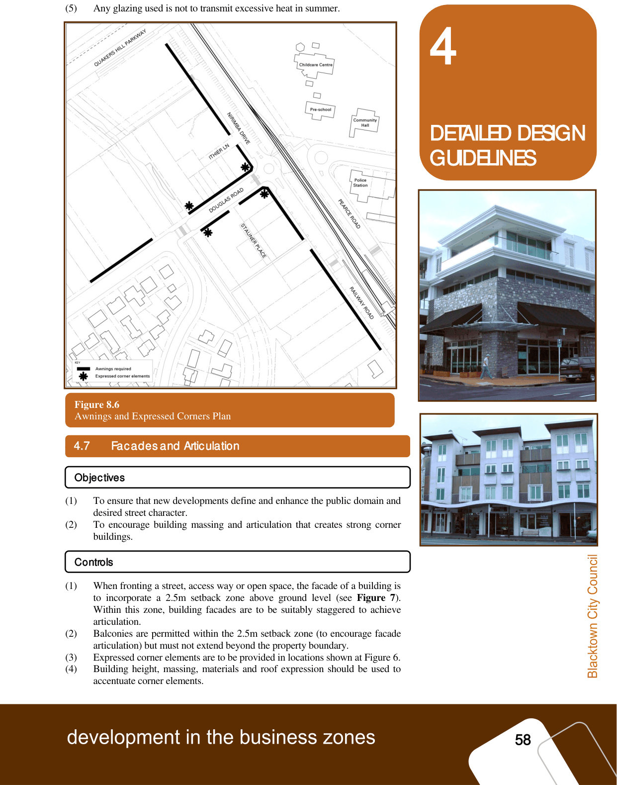

### 4.6 Awnings and Pedestrian Amenity

Objectives

Controls

#### Awnings and pedestrian amenity

#### Objectives

(1) To provide pedestrian amenity and streetscape continuity.

(2) To ensure awnings are designed to acceptable dimensions and materials.

#### Controls

(1) Continuous awnings are required to be provided along the ground floor

street frontage in accordance with Figure 6.

(2) Awnings should be a minimum height of 2.7m (3.2m desirable) above

footpath level and generally consistent in form with adjacent awnings.

(3) Steep pitched awnings should be avoided.

(4) Under awning lighting is to be provided to enhance pedestrian amenity and

safety.

> [Picture on page 63: a picture, saved as a picture (images/part-d-development-in-the-business-zones-page-63-1.gif, 150 dpi).]

### 4

### DETAILED DESIGN

### GUIDELINES

#### Figure 8.6

Awnings and Expressed Corners Plan

(5) Any glazing used is not to transmit excessive heat in summer.

Figure 6: Awnings and expressed corners plan

#### 4.7
