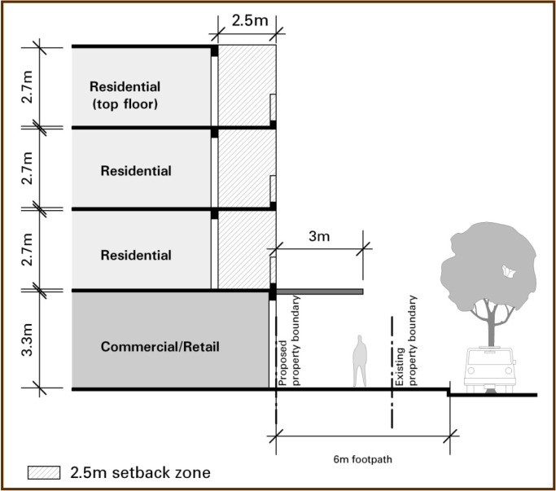
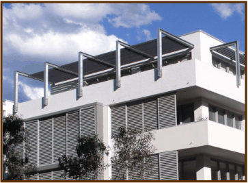

### 4.7 Facades and Articulation

Objectives

Controls

#### Facades and Articulation

#### Objectives

(1) To ensure that new developments define and enhance the public domain and

desired street character.

(2) To encourage building massing and articulation that creates strong corner

buildings.

#### Controls

(1) When fronting a street, access way or open space, the facade of a building is

to incorporate a 2.5m setback zone above ground level (see Figure 7).

Within this zone, building facades are to be suitably staggered to achieve

articulation.

(2) Balconies are permitted within the 2.5m setback zone (to encourage facade

articulation) but must not extend beyond the property boundary.

(3) Expressed corner elements are to be provided in locations shown at Figure 6.

(4) Building height, massing, materials and roof expression should be used to

accentuate corner elements.

### 4

### DETAILED DESIGN

### GUIDELINES

> [Picture on page 64: a picture, saved as a picture (images/part-d-development-in-the-business-zones-page-64-5.gif, 150 dpi).]

> [Picture on page 64: a picture, saved as a picture (images/part-d-development-in-the-business-zones-page-64-6.gif, 150 dpi).]

#### Figure 8.7

The 2.5m setback zone above ground level

Figure 7: The 2.5m setback zone above ground level

#### 4.8
