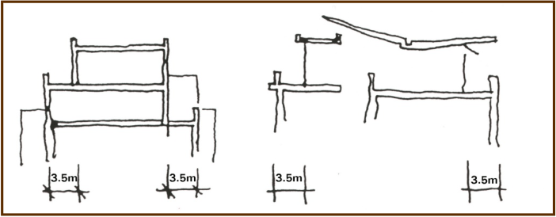
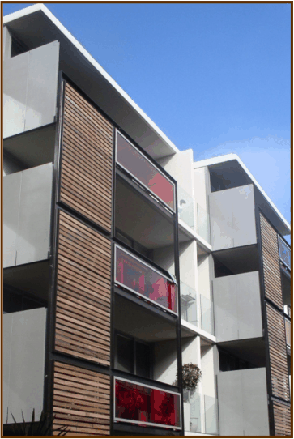

### 4.8 Upper Level Setbacks and Roof Design

#### Upper Level Setbacks and Roof Design

#### Objectives

Objectives

Controls

(1) To reduce the perceived height and bulk of buildings when viewed from the

public domain.

(2) To provide quality roof designs which contribute to the overall design

quality and performance of buildings.

#### Controls

(1) Buildings are to include distinctive roof forms that contribute to the

architectural design of a building.  Elements such as parapets, skillion roofs,

eaves should be utilised where appropriate.

(2) Where illustrated at Figures 2 – 4, the upper most level of a building is to be

setback at least 3.5m from the floor below (see Figure 8).  Lightweight

elements such as pergolas, sunscreens and architectural elements may

encroach within this setback zone.

(3) Roof forms should not result in excessive bulk and overshadowing.

(4) All plant and lift over-runs are to be concealed within roof forms to

minimise visual impact.

(5) The use of roof areas for private / communal open space and gardens is

encouraged.  Such spaces should be designed to minimise privacy impacts

on neighbours.

(6) For development in close proximity to the rail corridor, balconies and

windows are to be designed so as to prevent objects being thrown onto

Railcorp’s facilities.  Refer to the relevant Building Code of Australia

(BCA) standards and the Railcorp Electrical Standards.

> [Picture on page 65: a picture, saved as a picture (images/part-d-development-in-the-business-zones-page-65-3.gif, 150 dpi).]

### 4

### DETAILED DESIGN

### GUIDELINES

> [Picture on page 65: a picture, saved as a picture (images/part-d-development-in-the-business-zones-page-65-7.gif, 150 dpi).]

Figure 8: Indicative upper level setbacks

#### Figure 8.8

Indicative Upper Level Setbacks

#### 4.9
