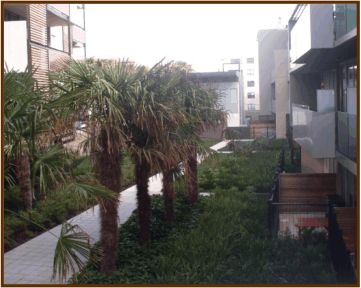

### 4.10 Landscaping and Communal Open Space

Objectives

Controls

### 4

### DETAILED DESIGN

### GUIDELINES

> [Picture on page 66: a picture, saved as a picture (images/part-d-development-in-the-business-zones-page-66-9.gif, 150 dpi).]

#### Landscaping and Communal Open Space

#### Objectives

(1) To ensure a high quality landscape design is provided within developments.

(2) To enhance the amenity, views and outlook within developments.

(3) To provide residents with passive and active communal recreational

opportunities.

#### Controls

(1) All landscaping work is to enhance the existing natural features of the site

and adjoining unfenced areas.

(2) Where possible, existing vegetation is to be retained and incorporated within

the landscape of a site.

(3) All parts of the site not built-upon or paved are to be landscaped with grass,

trees, shrubs and/or other vegetation.  As many trees as possible are to be

retained on the site.

(4) Development is to contribute to water and stormwater efficiency by

integrating landscape design with water and stormwater management, for

example, by:

(i) using plants with low water demand to reduce mains consumption;

(ii) using plants with low fertiliser requirements;

(iii) using plants with high water demand, where appropriate, to reduce

run off from the site;

(iv) utilising permeable surfaces;

(v) using water features; and

(vi) incorporating wetland filter systems.

(5) Unless otherwise advised by Council, landscape design and planting of the

site should include the footpath nature strip.  The developer is to liaise with

Council to provide co-ordination between the site and the streetscape.

(6) Each DA is to be accompanied by a detailed landscape plan including details

of any significant trees requiring removal.  Applicants should note that

Clause 25 (Tree Preservation) of BLEP 1988 states that no tree is to be

lopped or removed without Council’s consent.  A tree survey identifying

trees to be retained or removed to be submitted with any DA.  An arborist’s

report may also be required.

(7) A “tree” is defined in BLEP 1988 as a perennial plant at least 1m high which

would attain a height in excess of 3m if permitted to grow to maturity.

(8) The plan should also indicate:

(i) areas where earth shaping is proposed;

(ii) areas which are to be embellished for purely visual effect;

(iii) areas intended for recreation purposes;

(iv) areas required for the on-site detention of stormwater; and

(v) proposed paving treatment for main entry points and pathways.

(9) Common open space on rooftops must be included in the detailed landscape

strategy and plan.

(10) Common open space is to be provided, generally in the form of central

courtyards.

(11) Deep soil planting zones are required within development sites to facilitate

the accommodation of mature tree planting.

#### 4.11
