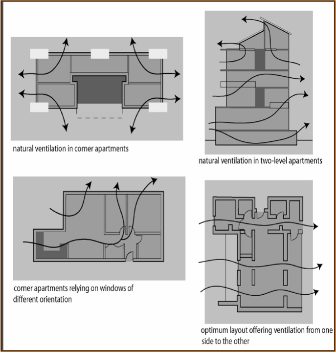

### 4.20 Natural Ventilation

Objectives

### 4

### DETAILED DESIGN

### GUIDELINES

Controls

#### Natural Ventilation

#### Objectives

(1) To ensure that apartments are designed to provide all habitable rooms with

direct access to fresh air and to assist in promoting thermal comfort for

occupants.

(2) To reduce energy consumption by minimising the use of mechanical

ventilation, particularly air conditioning.

#### Controls

(1) Building depths should range between 10m and 18m to support natural

ventilation.

(2) At least 60% of dwellings should be naturally cross ventilated.

(3) Internal layouts should promote natural ventilation as shown at Figure 9.

> [Picture on page 74: a picture, saved as a picture (images/part-d-development-in-the-business-zones-page-74-21.gif, 150 dpi).]

Figure 9: Internal layouts to promote natural ventilation

#### Figure 8.9

Internal Layouts to promote Natural Ventilation

#### 4.21
