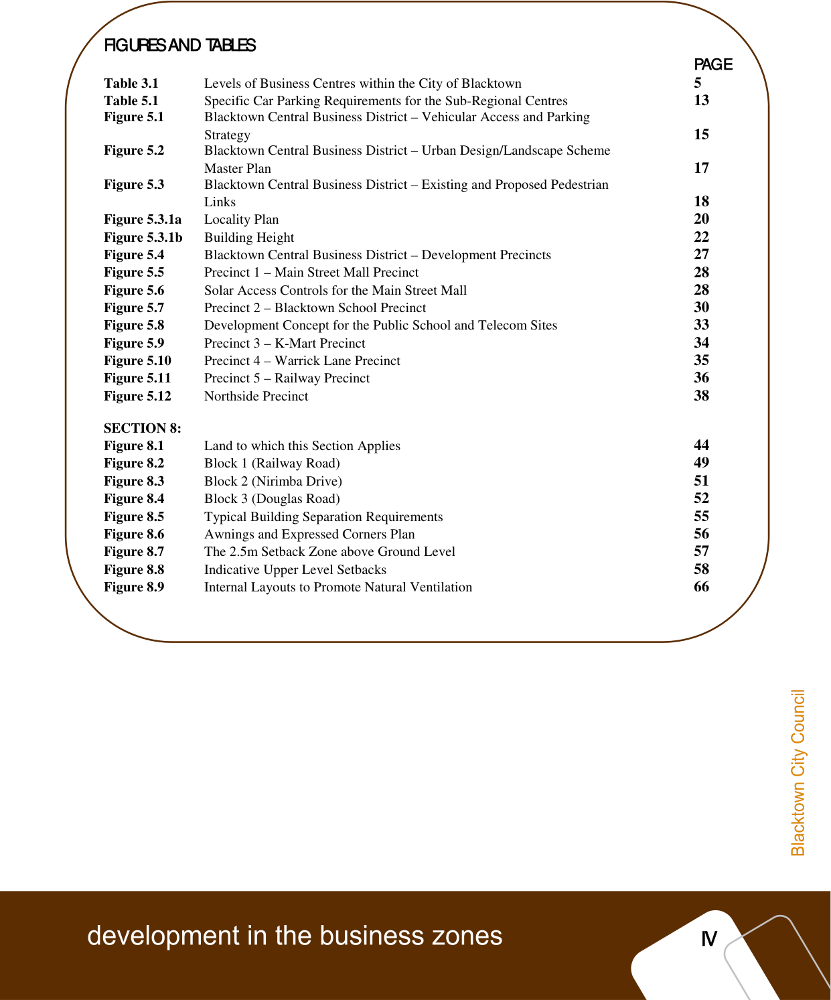

# Blacktown Development Control Plan 2015 - Part D Development in the Business Zones

> This chapter is split into 72 section file(s), one per numbered heading, in the order they appear in the PDF.

Source PDF: [Part-D-Development-in-the-Business-Zones.pdf](Part-D-Development-in-the-Business-Zones.pdf)

DEVELOPMENT IN THE BUSINESS ZONES

| 1.0 1.1 1.2 1.3 1.4 | INTRODUCTION Provisions of Blacktown Local Environmental Plan 1988 Purpose of this section of Blacktown Development Control Plan 2006 Definition Additional Requirements for Development Applications | 1 1 1 1 1 |
|---|---|---|
| 2.0 2.1 2.2 2.3 3.0 3.1 3.2 | THE BUSINESS ZONES The 3(a) General Business Zone The 3(b) Special Business Zone The 3(c) Entertainment and Tourism Zone HIERARCHY OF BUSINESS CENTRES The Blacktown Retail Hierarchy Other Business uses outside the retail Hierarchy 3.2.1 Mixed Business 3.2.2 Minchinbury Cellars 3.2.3 Metwest Professional Offices | 3 3 3 4 5 5 5 5 6 6 |
| 4.0 4.1 4.2 4.3 4.4 | GENERAL GUIDELINES FOR DEVELOPMENT Building Design and Construction Height of Buildings in Local Centres Building Setbacks Landscaping | 7 7 7 7 7 |
| 4.5 4.6 4.7 4.8 | 4.4.1 General Requirements 4.4.2 Tree Planting and Retention Pedestrian Access, Public Spaces and Open Space Vehicular Access and Circulation Service Laneways Car Parking | 7 8 8 9 9 10 |
| 4.9 | 4.8.1 Requirements 4.8.2 Monetary Contribution in Lieu of Parking Provision 4.8.3 Design 4.8.4 Additional Parking Requirements Signs 11 | 10 10 10 10 |
| 4.10 4.11 4.12 | Solar Access Community Facilities Residential Development | 11 11 11 |
| 5.0 5.1 5.2 5.3 | SUB-REGIONAL CENTRES Description Car Parking Blacktown Central Business District – General Requirements | 13 13 13 15 |
| 5.3.1 | Objectives Car Parking Strategy Design Guidelines Pedestrian Access and Open Space Residential/Mixed-use Development – Specific Controls Requirements Height Northern Precinct Southern Precinct Building Quality and Design Front Setbacks Side and Rear Setbacks Minimum Allotment Size or Width of Sites | 15 15 17 19 19 20 20 20 22 22 24 24 24 |

### D

### CONTENTS

### I

### II

| 5.4 | Common Open Space Private Open Space Natural Cross Ventilation and Solar Access Lifts Site Waste Management and Minimisation Design of Waste Facilities and On-going Management Practices Residential requirements Commercial Requirements Development Consents Blacktown Central Business District – Detailed Precinct Plans 5.4.1 Precinct 1 – Main Street Mall Precinct Solar Access Scale of Development Pedestrian Areas and Open Space Landscaping Vehicular Access and Parking Advertising Signs 5.4.2 Precinct 2 – Blacktown School Precinct City Plaza Telecom Site Historical School Building Design of Buildings Treatment of the North Side of the Public School Site Pedestrian Links Landscaping Solar Access Vehicular Access and Parking Development Concept Plan 5.4.3 Precinct 3 – K-Mart Precinct Design Solar Access Vehicular Access and Parking Pedestrian Areas Landscaping 5.4.4 Precinct 4 – Warrick Lane Precinct Pedestrian Areas Solar Access Design and Landscaping Vehicular Access and Parking 5.4.5 Precinct 5 – Railway Precinct Design Pedestrian Areas and Open Space Solar Access Vehicular Access and Parking 5.4.6 Precinct 6 – Northside Precinct | 24 25 25 25 25 25 26 27 27 28 29 29 30 30 30 30 30 31 31 32 32 32 32 33 33 33 33 33 35 35 35 35 36 36 36 37 37 37 37 37 38 38 38 38 39 |
|---|---|---|
| 5.5 | Development in the Vicinity of the 6(a) Public Recreation Zone Visual Amenity Vehicular Access and Parking Mount Druitt Town Centre | 40 40 40 41 |
| 6.0 6.1 6.2 6.3 6.4 | DISTRICT CENTRES Description Seven Hills Centre Plumpton Centre Proposed District Centres | 42 42 42 42 42 |
| 7.0 | NEIGHBOURHOOD CENTRES | 43 |

### III

| 7.1 | Description | 43 |
|---|---|---|
| 7.2 | 7.1.1 Large Neighbourhood Centres 7.1.2 Small Neighbourhood Centres Development Guidelines | 43 43 43 |
| SECTION 8 – QUAKERS HILL URBAN VILLAGE |  | 45 |
| 1.0 1.1 1.2 1.3 1.4 | PRELIMINARY Purpose and Aims of this Section Land to which this Section Applies Date of adoption for this Section How to use this Document | 45 45 45 46 46 |
| 1.5 1.6 | 1.4.1 Definitions 1.4.2 Development Application Checklist Relationship to other Council Planning Documents Blacktown Local Environmental Plan 1988 | 46 46 46 47 |
| 1.7 | State Environmental Planning Policy 65 and the Residential Flat Design Code | 47 |
| 2.0 | CONTEXT AND VISION | 49 |
| 2.1 2.2 | Context 49 Vision and Objectives | 49 |
| 3.0 3.1 | BLOCK BY BLOCK CONTROLS Block 1 - Railway Road | 50 50 |
| 3.2 | 3.1.1 Development outcomes Block 2 – Nirimba Drive | 50 52 |
| 3.3 | 3.2.1 Development Outcomes Block 3 – Douglas Road 3.3.1 Development Outcomes | 52 53 53 |
| 4.0 4.1 4.2 4.3 4.4 4.5 4.6 4.7 4.8 4.9 4.10 4.11 4.12 4.13 4.14 4.15 4.16 4.17 4.18 4.19 4.20 4.21 4.24 | DETAILED DESIGN GUIDELINES Amalgamation and Subdivision Building Form and Height Non-Residential Land Uses Building Separation and Boundary Setbacks Ground Level Active Frontages Awnings and pedestrian amenity Facades and Articulation Upper Level Setbacks and Roof Design Private Open Space and Balconies Landscaping and Communal Open Space Fencing and Walls Signage and Outdoor Advertising Service Lanes & Accessways On-Site Parking Access and Adaptability Dwelling Mix and Internal Amenity Visual and acoustic privacy Safety and Security Solar access and overshadowing Natural Ventilation Energy Efficiency and Sustainability Building Services | 55 55 55 56 56 57 57 58 59 60 61 62 62 63 63 64 65 66 67 68 69 70 73 |
| APPENDIX A - Development Application Checklist |  | 74 |

> [Picture on page 4: a map, saved as a picture (images/part-d-development-in-the-business-zones-page-4-1.gif, 150 dpi); the street names and other small labels are on the picture.]
> Labels printed on the map (copied from the PDF, in no particular order):
> PAGE · 5 · 13 · Strategy · 15 · Master Plan · 17 · Links · 18 · 20 · 22 · 27 · 28 · 28 · 30 · 33 · 34 · 35 · 36 · 38 · 44 · 49 · 51 · 52 · 55 · 56 · 57 · 58 · 66

Table 3.1 Levels of Business Centres within the City of Blacktown

Table 5.1 Specific Car Parking Requirements for the Sub-Regional Centres

Figure 5.1 Blacktown Central Business District – Vehicular Access and Parking

Figure 5.2 Blacktown Central Business District – Urban Design/Landscape Scheme

Figure 5.3 Blacktown Central Business District – Existing and Proposed Pedestrian

Figure 5.3.1a Locality Plan

Figure 5.3.1b Building Height

Figure 5.4 Blacktown Central Business District – Development Precincts

Figure 5.5 Precinct 1 – Main Street Mall Precinct

Figure 5.6 Solar Access Controls for the Main Street Mall

Figure 5.7 Precinct 2 – Blacktown School Precinct

Figure 5.8 Development Concept for the Public School and Telecom Sites

Figure 5.9 Precinct 3 – K-Mart Precinct

Figure 5.10 Precinct 4 – Warrick Lane Precinct

Figure 5.11 Precinct 5 – Railway Precinct

Figure 5.12 Northside Precinct

Figure 8.1 Land to which this Section Applies

Figure 8.2 Block 1 (Railway Road)

Figure 8.3 Block 2 (Nirimba Drive)

Figure 8.4 Block 3 (Douglas Road)

Figure 8.5 Typical Building Separation Requirements

Figure 8.6 Awnings and Expressed Corners Plan

Figure 8.7 The 2.5m Setback Zone above Ground Level

Figure 8.8 Indicative Upper Level Setbacks

Figure 8.9 Internal Layouts to Promote Natural Ventilation

#### FIGURES AND TABLES

## SECTION 8:

### IV

### Amendments to Part D – Development in the Business Zones

### (as of 1 July 2013)

| Amendment | Location | Description | Adoption | Enforcement |
|---|---|---|---|---|
| No. |  |  | Date | Date |
| 4 Part D, section 9 Seven Hills Business Park Deferred 12 Part D, Section 8, Point (5) amended to reference Part R as 23 March 2011 3 May 2011 Section 1.5 amended 12 Part D, Section 8, Section 4.22 Water Management repealed by 23 March 2011 3 May 2011 Section 4.22 Part R as amended 12 Part D, Section 8, Section 4.0 renumbered due to repeal of 23 March 2011 3 May 2011 Section 4.0 Section 4.22 Water Management by Part R as amended 12 Part D, Appendix Deleted points 7 & 8 and replaced with 23 March 2011 3 May 2011 A reference to Part R as amended 14 Part D, 4.13 Insertion of downstream owner’s consent for 30 April 2014 7 April 2014 business development 14 Part D, Appendix Insertion of downstream owner’s consent in 30 April 2014 7 April 2014 A the development application checklist |  |  |  |  |

### V

<!-- sections -->
## Sections

1. [1.0 INTRODUCTION](01-1-0-introduction.md)
2. [1.2 Purpose of this section of Blacktown Development Control Plan](02-1-2-purpose-of-this-section-of-blacktown.md)
3. [1.2 Purpose of this section of Blacktown Development Control](03-1-2-purpose-of-this-section-of-blacktown.md)
4. [1.3 Definition](04-1-3-definition.md)
5. [1.4 Additional Requirements for Development Applications](05-1-4-additional-requirements-for-development.md)
6. [2.0 THE BUSINESS ZONES](06-2-0-the-business-zones.md)
7. [2.1 The 3(a) General Business Zone](07-2-1-the-3-a-general-business-zone.md)
8. [2.2 The 3(b) Special Business Zone](08-2-2-the-3-b-special-business-zone.md)
9. [2.3 The 3(c) Entertainment and Tourism Zone](09-2-3-the-3-c-entertainment-and-tourism-zone.md)
10. [3.1 The Blacktown Retail Hierarchy](10-3-1-the-blacktown-retail-hierarchy.md)
11. [3.2 Other Business Uses Outside the Retail Hierarchy](11-3-2-other-business-uses-outside-the-retail.md)
12. [4.1 Building Design and Construction](12-4-1-building-design-and-construction.md)
13. [4.2 Height of Buildings in Local Centres](13-4-2-height-of-buildings-in-local-centres.md)
14. [4.3 Building Setbacks](14-4-3-building-setbacks.md)
15. [4.4 Landscaping](15-4-4-landscaping.md)
16. [4.5 Pedestrian Access, Public Spaces and Open Space](16-4-5-pedestrian-access-public-spaces-and-open.md)
17. [4.6 Vehicular Access and Circulation](17-4-6-vehicular-access-and-circulation.md)
18. [4.7 Service Laneways](18-4-7-service-laneways.md)
19. [4.8 Car Parking](19-4-8-car-parking.md)
20. [4.9 Signs](20-4-9-signs.md)
21. [4.10 Solar Access](21-4-10-solar-access.md)
22. [4.11 Community Facilities](22-4-11-community-facilities.md)
23. [4.12 Residential Development](23-4-12-residential-development.md)
24. [4.13 Drainage](24-4-13-drainage.md)
25. [5.1 Description](25-5-1-description.md)
26. [5.2 Car Parking](26-5-2-car-parking.md)
27. [5.3 Blacktown Central Business District – General](27-5-3-blacktown-central-business-district.md)
28. [5.4 Blacktown Central Business District – Detailed Precinct](28-5-4-blacktown-central-business-district.md)
29. [5.5 Mount Druitt Town Centre](29-5-5-mount-druitt-town-centre.md)
30. [6.1 Description](30-6-1-description.md)
31. [6.2 Seven Hills Centre](31-6-2-seven-hills-centre.md)
32. [6.3 Plumpton Centre](32-6-3-plumpton-centre.md)
33. [6.4 Proposed District Centres](33-6-4-proposed-district-centres.md)
34. [7.1 Description](34-7-1-description.md)
35. [7.2 Development Guidelines](35-7-2-development-guidelines.md)
36. [1.1 Purpose and Aims of this Section](36-1-1-purpose-and-aims-of-this-section.md)
37. [1.2 Land to which this Section Applies](37-1-2-land-to-which-this-section-applies.md)
38. [1.3 Date of Adoption for this Section](38-1-3-date-of-adoption-for-this-section.md)
39. [1.4 How to use this Document](39-1-4-how-to-use-this-document.md)
40. [1.5 Relationship to Other Council Planning Documents](40-1-5-relationship-to-other-council-planning.md)
41. [1.7 State Environmental Planning Policy 65 and the Residential Flat](41-1-7-state-environmental-planning-policy-65.md)
42. [2.1 Context](42-2-1-context.md)
43. [2.2 Vision and Objectives](43-2-2-vision-and-objectives.md)
44. [3.0 BLOCK BY BLOCK CONTROLS](44-3-0-block-by-block-controls.md)
45. [3.1 Block 1 – Railway Road](45-3-1-block-1-railway-road.md)
46. [3.2 Block 2 – Nirimba Drive](46-3-2-block-2-nirimba-drive.md)
47. [3.3 Block 3 – Douglas Road](47-3-3-block-3-douglas-road.md)
48. [4.0 DETAILED DESIGN GUIDELINES](48-4-0-detailed-design-guidelines.md)
49. [4.1 Amalgamation and Subdivision](49-4-1-amalgamation-and-subdivision.md)
50. [4.2 Building Form and Height](50-4-2-building-form-and-height.md)
51. [4.3 Non-Residential Land Uses](51-4-3-non-residential-land-uses.md)
52. [4.4 Building Separation and Boundary Setbacks](52-4-4-building-separation-and-boundary.md)
53. [4.5 Ground Level Active Frontages](53-4-5-ground-level-active-frontages.md)
54. [4.6 Awnings and Pedestrian Amenity](54-4-6-awnings-and-pedestrian-amenity.md)
55. [4.7 Facades and Articulation](55-4-7-facades-and-articulation.md)
56. [4.8 Upper Level Setbacks and Roof Design](56-4-8-upper-level-setbacks-and-roof-design.md)
57. [4.9 Private Open Space and Balconies](57-4-9-private-open-space-and-balconies.md)
58. [4.10 Landscaping and Communal Open Space](58-4-10-landscaping-and-communal-open-space.md)
59. [4.11 Fencing and Walls](59-4-11-fencing-and-walls.md)
60. [4.12 Signage and Outdoor Advertising](60-4-12-signage-and-outdoor-advertising.md)
61. [4.13 Service Lanes and Accessways](61-4-13-service-lanes-and-accessways.md)
62. [4.14 On-Site Parking](62-4-14-on-site-parking.md)
63. [4.15 Access and Adaptability](63-4-15-access-and-adaptability.md)
64. [4.16 Dwelling Mix and Internal Amenity](64-4-16-dwelling-mix-and-internal-amenity.md)
65. [4.17 Visual and Acoustic Privacy](65-4-17-visual-and-acoustic-privacy.md)
66. [4.18 Safety and Security](66-4-18-safety-and-security.md)
67. [4.19 Solar Access and Overshadowing](67-4-19-solar-access-and-overshadowing.md)
68. [4.20 Natural Ventilation](68-4-20-natural-ventilation.md)
69. [4.21 Energy Efficiency and Sustainability](69-4-21-energy-efficiency-and-sustainability.md)
70. [4.22 Waste Management](70-4-22-waste-management.md)
71. [4.23 Waste Management](71-4-23-waste-management.md)
72. [4.23 Building Services](72-4-23-building-services.md)
