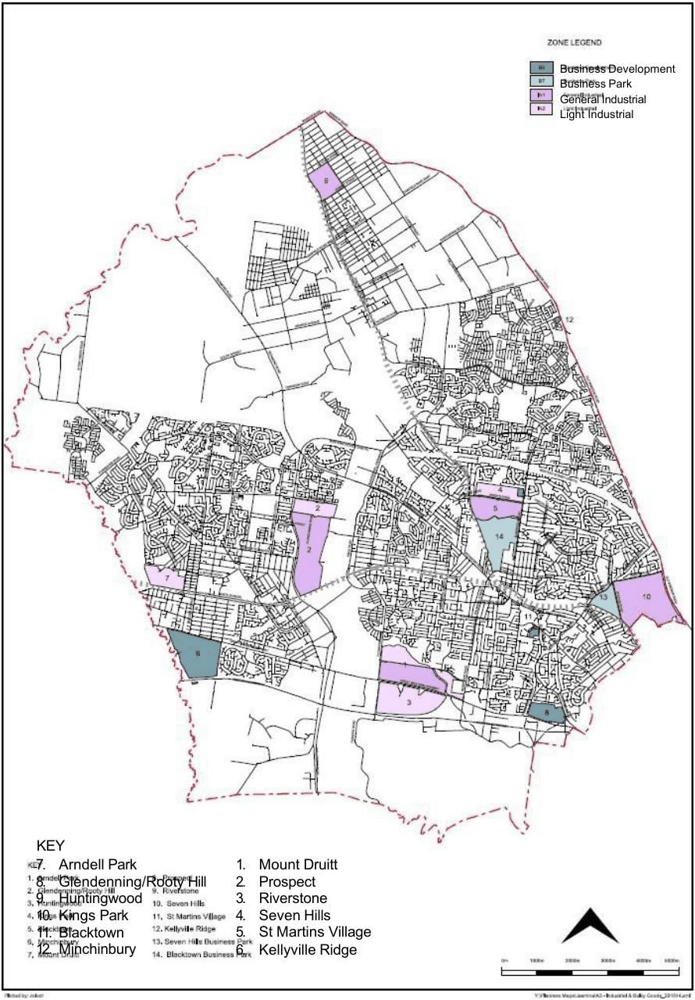

## 1 Introduction

### 1.1 Land to which this Part applies

This Part of Blacktown Development Control Plan (DCP) 2015 applies to all land within

the Blacktown local government area that is zoned to allow industrial development under

Blacktown Local Environmental Plan (LEP) 2015 (Refer to Figure 1.1).

### 1.2 Objectives

The objectives of this Part of the DCP are as follows: ■ Objectives

(a) To provide detailed design guidelines for development within the

industrial, B5 and B7 zones

(b) To provide guidance on preparing and lodging development

applications (DAs) for development within the industrial, B5 and B7

zones

(c) To ensure that all development within Blacktown’s industrial, B5 and

B7 zones is consistent with the relevant zone objectives outlined in

Blacktown LEP 2015.

> [Picture on page 5: a map, saved as a picture (images/part-e-development-in-the-industrial-areas-page-5-1.gif, 150 dpi); the street names and other small labels are on the picture.]
> Labels printed on the map (copied from the PDF, in no particular order):
> Business Development · Business Park · General Industrial · Light Industrial · KEY · 7. Arndell Park · 8. Glendenning/Rooty Hill · 9. Huntingwood · 10. Kings Park · 11. Blacktown · 12. Minchinbury · 1. Mount Druitt · 2. Prospect · 3. Riverstone · 4. Seven Hills · 5. St Martins Village · 6. Kellyville Ridge

#### Figure 1.1 Lands zoned B5, B7 or Industrial under BLEP 2015

### 1.3 The industrial, B5 and B7 zones

Blacktown LEP 2015 contains 2 Industrial zones, being:

(a) IN1 General Industrial

(b) IN2 Light Industrial.

Blacktown LEP 2015 also contains the B5 Business Development and the B7 Business

Park zones. The B5 zone is essentially a light industrial zone that also allows bulky goods

premises that require a large floor area. The B7 zone is also essentially a light industrial

zone that allows office premises with the aim of encouraging high density employment

opportunities in appropriate locations. The Blacktown LEP 2015 zoning maps show the location of the industrial, B5 and B7

zones. The Land Use Tables at Part 2 of the Blacktown LEP 2015 Written Instrument outline

the objectives of each zone and identify the types of land uses that are permitted (with

or without Council’s consent) and prohibited in each zone. The Blacktown LEP 2015 Written Instrument also contains clauses that affect how land

within the zones can be developed and used.

### 1.4 Definition of ‘light industry’

Blacktown LEP 2015 has adopted the following definition: Light industry means a building or place used to carry out an industrial activity that does

not interfere with the amenity of the neighbourhood by reason of noise, vibration, smell,

fumes, smoke, vapour, steam, soot, ash, dust, waste water, waste products, grit or oil,

or otherwise, and includes any of the following:

(a) High technology industry

(b) Home industry.

Any DA involving a type of light industry must provide sufficient information to

demonstrate that the proposed development is in fact a type of light industry. As a guide, Council considers the following land uses to be ‘light industry’.

(a) Appliance assembly and repair

(b) Beverage and food packaging

(c) Cabinet making and furniture assembly

(d) Electronic and computer components (and accessories) assembly and

repair

(e) Laboratories not involving the significant storage or use of toxic, volatile,

flammable or radioactive materials

(f) Light metal fabrication

(g) Motor vehicle accessory installation

(h) Motor vehicle repair

(i) Plastic extrusion and moulding

(j) Signwriting

(k) Small engine repair

(l) Trade yards (e.g. plumbers or builders storage yards).

Note: A separate light industry list has been developed for the Huntingwood Industrial

Estate (refer to Section 5).

Examples of development not considered by Council to be ‘light industry’ are listed

below.

(a) Asbestos cement products manufacture

(b) Bitumen manufacture or processing

(c) Boilermaking

(d) Brick, tile, pipe and fire clay products manufacture

(e) Cement, cement product manufacture and concrete batching works

(f) Chemical factory or works involving chemical processes or involving the

use of toxic, radioactive, flammable or otherwise volatile unstable

materials

(g) Chemical storage establishments (other than the storage of inert, non-

toxic, non-flammable and non-radioactive materials or products)

(h) Cutting, crushing and grinding of rocks, ore or minerals

(i) Drum reconditioning works

(j) Glass, fibreglass and associated products manufacture

(k) Hardboard manufacture

(l) Heavy engineering, boilermaking and heavy machine manufacture

(m) Liquid, chemical, oil or petroleum waste works

(n) Metallurgical works involving the processing of metals or their ores

(o) Motor body building and motor vehicle manufacture

(p) Paper or pulp works

(q) Petroleum products refineries

(r) Hazardous industries

(s) Offensive industries

(t) Rubber (including tyres) or plastics manufacture.

Other uses, such as extractive industries, liquid fuel depots, offensive and hazardous

industries and offensive and hazardous storage establishments have not been included

in the above list as these uses are prohibited in the IN1 and IN2 zones.

### 1.5 Change of use

If, in the IN1 General Industrial zone, you propose to change the use of an existing (and

legally constructed) building to another industry (but not a type of ‘heavy industry’, a

‘designated development’ or a ‘prohibited use’), then you do not need to submit a DA to

Council. This means that, for example, if Council has given development consent to the

use of a factory unit as a motor mower repair workshop, then development consent is

not required to change this use to a small electrical appliance repair workshop. This approach is also applicable within the IN2 Light Industrial, B5 and B7 zones.

However, as only light industries are permitted within these zones, the use or occupation

of buildings without development consent is limited to light industries (again, other than

a type of ‘heavy industry’, ‘designated development’ or a ‘prohibited use’), except as

permitted under the provisions of State Environmental Planning Policy (Exempt and

Complying Development Codes) 2008.

### 1.6 Factory units

In the case of multi-unit developments, a separate DA may be required for each unit

prior to initial occupancy or change of use. Intending occupiers of factory units are advised to review the provisions of State

Environmental Planning Policy (Exempt and Complying Development Codes) 2008 or

contact Council to find out if a DA is required. Such contact should be made well in

advance of the intended date of occupation.
