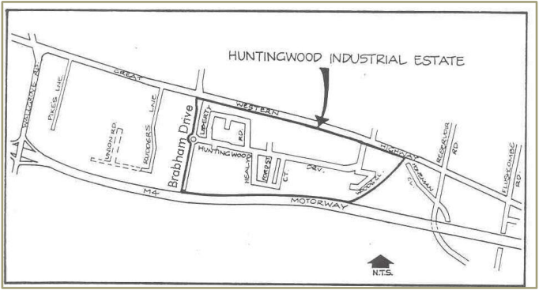

## 5 Specific controls for the Huntingwood Industrial

### Estate

The Huntingwood Industrial Estate is bounded by the Great Western Highway to the

north, the M4 Motorway to the south, Brabham Drive to the west and Woods Close to

the east, as shown in Figure 5.1 below.

> [Picture on page 20: a picture, saved as a picture (images/part-e-development-in-the-industrial-areas-page-20-6.gif, 150 dpi).]

#### Figure 5.1 Huntingwood Industrial Estate

### 5.1 Aims

The controls for the Huntingwood Industrial Estate contained in this Part have been

developed to:

(a) Encourage modern forms of light industrial, warehousing, manufacturing,

research and like development in the estate

(b) Ensure that development is of a high visual and environmental standard

and incorporates best practice environmental management techniques

(c) Encourage development that enhances the amenity of the estate by

encouraging high quality landscaping, adequate building setbacks and

high-quality external finishes

(d) Discourage development that is likely to detract from the amenity of the

estate by reason of its appearance, noise, emissions or the nature of

proposed the uses.

### 5.2 Appropriate types of light industry

As a guide, Council considers the following light industrial land uses to be suitable in

the Huntingwood Industrial Estate. This list is not intended to be exhaustive.

(a) Advanced technology research and manufacturing industries

(b) Appliance assembly and repair

(c) Beverage and food packaging

(d) Communications industries

(e) Computer programming and development industries

(f) Data storage, research and retrieval

(g) Education and training establishments related to or ancillary to business and industrial activities

(h) Electronic and computer components (and accessories) assembly and repair

(i) Laboratories not involving the significant storage or use of toxic, volatile, flammable or radioactive materials

(j) Plastic extrusion and moulding

(k) Research laboratories.

Examples of development considered by Council to not be suitable in the Huntingwood

Industrial Estate are listed below. This list is not intended to be exhaustive.

(a) Bitumen manufacture or processing

(b) Boilermaking

(c) Brick, tile, pipe and fire clay products manufacture

(d) Cabinet making and furniture assembly

(e) Cement, cement product manufacture and concrete batching works

(f) Chemical factories or works involving chemical processes or involving the use of toxic, radioactive or flammable or otherwise volatile unstable materials

(g) Chemical storage establishments (other than the storage of inert, non-toxic, non-flammable and non-radioactive materials or products)

(h) Cutting, crushing and grinding of rocks, ore or minerals

(i) Drum reconditioning works

(j) Extractive industries

(k) Glass, fibreglass and associated products manufacture

(l) Hardboard manufacture

(m) Heavy engineering, boilermaking and heavy machine manufacture

(n) Liquid, chemical, oil or petroleum waste works

(o) Liquid fuel depots

(p) Metallurgical works involving the processing of metals or their ores

(q) Motor body building and motor vehicle manufacture

(r) Motor vehicle accessory installation

(s) Motor vehicle repair involving panel beating or spray painting

(t) Paper or pulp works

(u) Petroleum products refineries

(v) Potentially hazardous industries and/or storage establishments

(w) Potentially offensive industries and/or storage establishments

(x) Rubber (including tyres) or plastics manufacture

(y) Small engine repair

(z) Trade yards (e.g. plumbers or builders storage yards).

### 5.3 Multi-tenanted industrial development

Council does not support the establishment of multi-tenanted industrial developments

within the Huntingwood Industrial Estate. Multi-tenanted industrial development means a building or buildings in which 2 or

more industrial uses are carried out and situated on the same land. This definition does

not preclude 2 or more differing industrial processes associated with the same

development occurring on a single site. However, Council will not support DAs for factory

units or warehouse units in Huntingwood unless the units are of a high visual appearance

compatible with existing development in the estate, and unless appropriate end uses for

the units are specified in the DA. In determining what constitutes an ‘appropriate’ end use for multi-tenanted industrial

developments, Council will consider the objectives of the Design Guidelines outlined in

Section 5.4 below and the IN2 Light Industrial zone objectives contained in Part 2 of

Blacktown LEP 2015.

### 5.4 Design guidelines

#### 5.4.1 Building design and construction

The objectives of this section are as follows:

(a) To encourage a high standard of building design to complement existing

buildings in the estate

(b) To encourage quality and consistency in the treatment of facades,

external finishes and the like

(c) To ensure that future development in the estate is compatible with the

height, scale, siting and character of existing development in the estate

(d) To ensure that sufficient visual relief is achieved on facades significantly

exposed to view from major thoroughfares, subdivisional roads and

adjoining sites

(e) To ensure that development addresses the road frontage that provides

vehicular access where dual road frontage exists.

In recognition of the nature and quality of existing development in the estate, Council

encourages high aesthetic standards for building designs. Attractive building design can,

in most cases, be achieved simply and at comparatively low cost and applicants are

encouraged to consider variations in fascia treatments, facade treatments, roof lines and

selection of building materials to achieve an attractive design. High quality landscaping

is also required and is discussed in more detail in Section 4.2. All applicants are strongly urged to discuss their development proposal and submit

preliminary drawings to Council prior to formally lodging a DA. Applicants must submit with their DA detailed descriptions, coloured elevations and,

where considered necessary, samples of fascia, façade and roof materials for approval.

A condition of development consent will refer to the approved schedule of finishes. Building facades to street frontages, with a minimum 3m return, must be constructed of

face brick, decorative masonry blocks (not standard concrete blocks), glass or other

building materials to the requirements of Council. Front elevations should be staggered

so that a single wall does not account for more than 50% of the overall width of that

elevation. Where long, continuous facades present themselves along a street frontage, care should

be taken to provide visual relief along the facade by varying the facade alignment, using

varying external finishes (texture and colour), providing glass curtain walls or locating

office facilities along the facade. On lengthy facades the ratio of ‘hard’ finishes (masonry

blocks, concrete blocks and bricks) to ‘soft’ finishes (glass walls, windows) should be

considered in order to mitigate the bulk of the building and provide visual relief. Care should be taken to site roller shutters, loading docks and other building openings

where they do not detract from the overall appearance of the building. Where possible,

roller shutters and the like should not be located on the principal street frontage. The Great Western Highway, Brabham Drive and the M4 Motorway are access denied

roads that currently define the limits of the Huntingwood Industrial Estate. Properties that

face these roads have a dual road frontage, with direct property access provided from

roads within the estate. Care should be taken to ensure that sufficiently interesting and

varied facades are provided to both road frontages where dual road frontage exists.

Blank walls will not be accepted on facades that address access denied roads. The design of buildings on lots that have dual road frontage should be such that the

building addresses the road frontage from which vehicular access is gained. Particular attention is drawn to the fire safety provisions for industrial buildings contained

in the Building Code of Australia.

#### 5.4.2 Advertising structures

The objectives here are:

(a) To encourage signage in the estate that is commensurate with the quality

of development in the estate

(b) To ensure that signage does not detract from the visual appeal of buildings

within the estate by discouraging superfluous and unsuitable signs

(c) To ensure appropriate signage is erected on developments with dual road

frontage.

Advertising signage within the estate should be kept to a minimum, should relate only to

the use occurring on the respective property and should identify the relevant business

name. Directional signs for car parking areas, loading docks, delivery areas and the like should

be designed in an attractive manner and should be located at a convenient point close to

the main access to a development site. The colouring, type and scale of signage erected

within individual properties should also be considered to ensure consistency within the

development. Many properties have dual road frontage, with high visual exposure to the Great Western

Highway, Brabham Drive and the M4 Motorway. Whilst it is understood that

developments on land adjacent to these regional roads would seek to take advantage of

advertising opportunities to these major roads, Council will not support freestanding signs

exposed to passing traffic along these road frontages. Council prefers that signage to the

Great Western Highway, Brabham Drive and the M4 Motorway be limited to fascia signs

only identifying the business located on the site.

#### 5.4.3 Drainage

The objectives for this section are as follows:

(a) To provide for the disposal of stormwater from the site in efficient,

equitable and environmentally sustainable ways

(b) To encourage the re-use of stormwater drainage for the irrigation of

landscaped areas, particularly during establishment periods.

Adequate provision must be made for the collection and disposal of surface and roofwater

runoff. All stormwater shall be either reticulated to the street gutter or piped to a suitable

location as approved by Council. Where a site falls away from the fronting street, the Development Application must

include documentation establishing a suitable drainage solution including inter- allotment

drainage (and proposed easement) through downstream properties, and written

permission from downstream property owners where applicable. Section 88K of the

Conveyancing Act 1919 provides suitable mechanisms to negotiate the creation of

easements where an amicable arrangement cannot be made. Council will not support the

placement of fill on land to channel stormwater drainage back to the street.

#### 5.4.4 Consideration of adjoining land

The objectives for this section are as follows:

(a) To ensure that development has due consideration of adjoining land by

encouraging architectural styles, building materials and landscape

treatments which do not detract from existing high-quality development

within the estate

(b) To ensure that reasonable building separation to adjoining development

is achieved so that solar access to adjoining development is not

compromised by inappropriately scaled and located development

(c) To ensure that appropriate controls exist so that the impact of polluting

discharges (e.g. noise, air and water) on adjoining land are minimised.

Council, in recognition of the investment in the estate by existing occupants, will require

that new development in the estate have due regard to the style and quality of existing

development. In this regard similar architectural styles, building materials, landscape

treatments and the like are encouraged. Solar access to adjoining development should not be unreasonably compromised by

new development. Care should be taken to ensure that overshadowing of landscaping

and staff recreation areas does not occur. Particular attention will need to be paid to

development on lots in the estate that are around 4,000 square metres in area, to ensure

a continuity of development styles and sympathetic relationship to adjoining

development. Council will require the submission of shadow diagrams indicating the

effect of shadows between 9am and 3pm on 21 June (the winter solstice) where

development exceeds 4 metres in height (measured from existing ground level to the

highest roof element). Light industry is the preferred land use in the estate and uses that require substantial

measures to reduce or ameliorate their potential environmental effects are discouraged.

These principles are objectives of the IN2 Light Industrial zone and should ensure that

proposed land uses do not adversely affect adjoining development by the emission of

air, noise or water pollution. In general, noise generated by a development should not

exceed the existing background sound pressure level by more than 5dB(A). A statement

of compliance with this standard from an experienced acoustic consultant may be

required to be submitted with the DA.

#### 5.4.5 Storage areas

The objectives for this section are as follows:

(a) To ensure that visual amenity within the estate is protected by

prohibiting open storage areas

(b) To ensure that storage areas are of a high quality and compatible with

proposed development on the site.

Open storage areas in the estate will not be permitted. Where any materials are to be

stored outside the primary industrial building on the site, the storage areas are to be fully

enclosed and are to be constructed of materials similar to the primary industrial building.

Where possible, Council encourages the provision of storage areas within the confines

of the primary industrial building.
