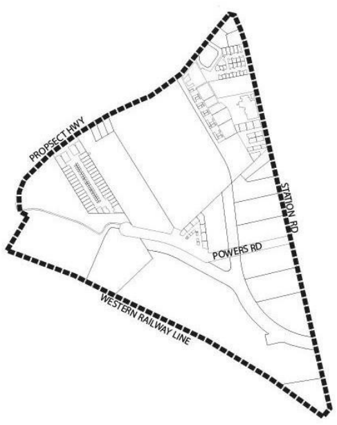
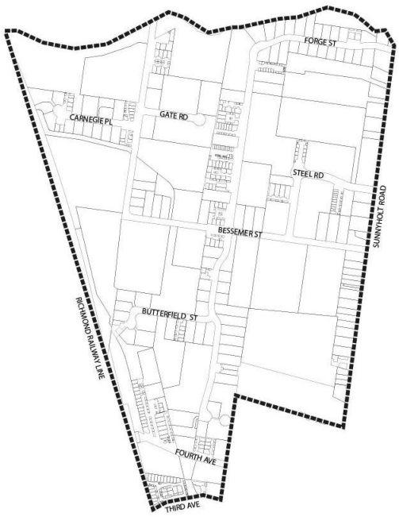
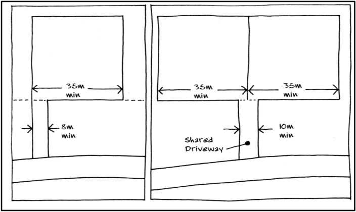
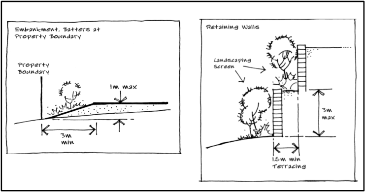
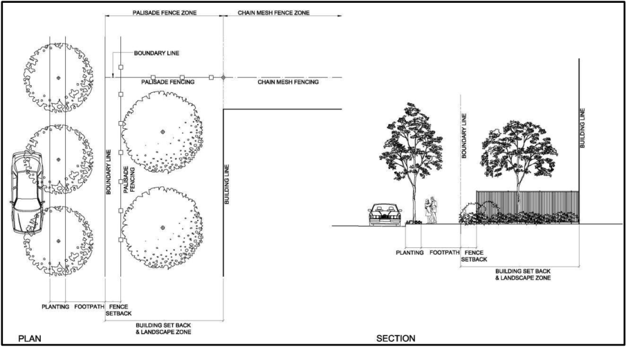
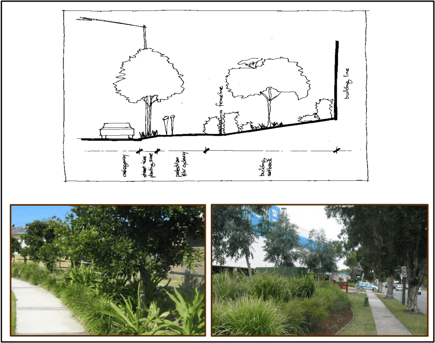
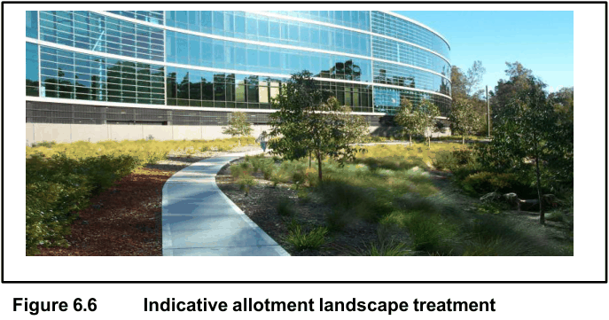
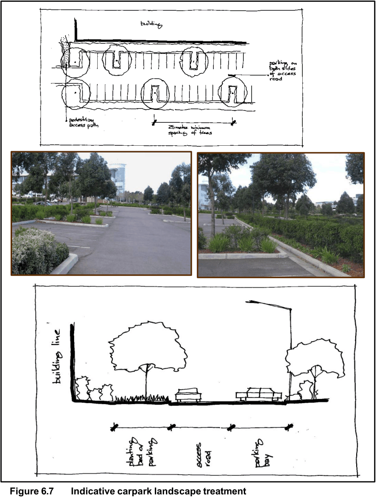

## 6 Specific controls for the B7 Business Park zone

### 6.1 Preliminary

#### 6.1.1 Purpose and aims of this section

The purpose of this section is to provide detailed controls to guide the

development of land in the Blacktown and Seven Hills Business Park precincts. The specific aims of this section are:

(a) To facilitate the redevelopment of existing industrial areas into vibrant,

mixed use business parks

(b) To provide planning and design guidelines that ensure high quality built

form outcomes and an improved public domain in a manner that is

sustainable and minimises impact on the local community

(c) To set out clear planning, design and environmental criteria against which

Council will assess future DAs for all new development.

#### 6.1.2 Land to which this section applies

This section applies to land in the Blacktown City Centre Business Park and

> [Picture on page 26: a picture, saved as a picture (images/part-e-development-in-the-industrial-areas-page-26-16.gif, 150 dpi).]

the Seven Hills Business Park as shown below.

> [Picture on page 26: a picture, saved as a picture (images/part-e-development-in-the-industrial-areas-page-26-18.gif, 150 dpi).]

#### Blacktown City Centre Business Park

#### Seven Hills Business Park

#### Figure 6.1 Land to which Section 6 applies

### 6.2 Detailed design guidelines

#### 6.2.1 Subdivision and consolidation

■ Objectives

(a) Ensure that substantial perimeter planting, landscaping and attractive

buildings are located around entrances and visible areas

(b) Allow for a range of allotment sizes

(c) Orientate allotments to ensure buildings appropriately address the

public domain.

■ Controls

(a) Minimum allotment size and dimension

| Minimum allotment size | Control |
|---|---|
| Torrens title subdivision | 1,500sq.m |
| Strata title subdivision or the gross floor area of any unit that forms part of a multi-tenanted building | 500sq.m |
| Minimum allotment width | Control |
| Torrens title subdivision, measured at the building line | 35m |
| Battle-axe allotment, measured at the building line | 35m |
| Battle-axe handle, single access | 8m |
| Battle-axe handle, shared access | 10m with additional turning area |

#### Table 6.1 Subdivision requirements

> [Picture on page 27: a picture, saved as a picture (images/part-e-development-in-the-industrial-areas-page-27-13.gif, 150 dpi).]

#### Figure 6.2 Battle-axe lot subdivision

(b) Allotment shape Lots are to be relatively regular in shape, although lot sizes should

also be diverse to meet a range of land uses. These may range from

those requiring wide street frontages and a minimum depth to those

that require fewer frontages but a greater depth. Irregular shaped

allotments with narrow street frontages should be avoided,

particularly where several of these are proposed in an adjoining

manner.

(c) Allotment orientation Lots should be orientated and aligned:

• So that future buildings can face the street to increase visual

surveillance and to avoid streetscapes with loading docks and

long blank walls

• To facilitate solar efficiency

• To encourage building design that has frontage to landscaped

areas.

(d) Allotment access

• Access to lots shall be sited to ensure that sight lines are

unimpeded when exiting and entering the lot

• Subdivisional roads should incorporate a road hierarchy that

will accommodate the anticipated traffic volumes and vehicle

types and be practical and legible for users.

(e) Allotment titles Where a Strata or Community title subdivision is proposed, any

space for parking or other purposes forming part of a sole

occupancy unit required by Council must be included in the same

strata lot as the unit. All landscaping, access areas and directory

board signs not forming part of an individual unit will be required by

Council to be included in any strata plan of subdivision as common

property. Applicants must demonstrate that, given the built form provisions of

this section, the exclusion of an adjacent / adjoining allotment from

their site will not adversely affect the development potential of that

allotment.

#### 6.2.2 Setbacks, site coverage and floor space ratio

A key element in maintaining visual character is the visibility and appearance

of development when viewed from the public domain. ■ Objectives

(a) Define building envelopes within each allotment by specifying

minimum setbacks

(b) Achieve attractive streetscapes

(c) Use setback areas exclusively for landscaping and other

enhancement works

(d) Ensure buildings present an acceptable scale and bulk when

viewed from the public domain

(e) Ensure target development is for large floor plate occupancies,

especially in the instance of strata titled development, to prevent

small floor plate occupancies that could otherwise be

accommodated more appropriately in the Blacktown CBD.

■ Controls

| Provision |  | Control |
|---|---|---|
| Setback of property boundary from: |  |  |
| Arterial and sub-arterial roads |  | 20m |
| Collector road |  | 10m |
| Local road |  | 7.5m |
| Secondary street setback |  | 5m |
| Side and rear boundary | to building to hardstand area | 3m 2m |
| Defined natural form creek or drainage channel |  | 5m |
| Top edge of retaining wall or top of bank of battered slope |  | 2m |
| Maximum site coverage (industrial/office uses on the same lot) |  | 65% |
| Minimum floor space for tenancies |  | 1,500sq.m |

#### Table 6.2 Setback, site coverage and floor space requirements

(a) No building, basin or hardstand area shall be erected within any setback

(b) All setback areas should be landscaped and maintained in

accordance with the landscape provisions of this section

(c) Pedestrian access should be provided to all landscaped setback

areas for maintenance and security purposes, but is not to be

included in the designated landscape setback area

(d) No storage of any kind is permitted within landscaped setback areas

(e) The landscape setback areas should be designed to create

attractive views from the public domain and reduce the bulk and

scale of development

(f) Council may increase the minimum setback where the proposed

development is of a bulk and scale out of character with existing

development within the zone, or where the proposed landscape

techniques are not sufficient to ameliorate the visual impact of the

proposed development.

#### 6.2.3 Building height and design

■ Objectives

(a) Encourage creative and innovative building design of a high

architectural standard that reflects natural, functional and aesthetic

opportunities

(b) Encourage quality and consistency in the treatment of facades,

external finishes and the like

(c) Ensure that proposed new development is compatible with the

height, scale, siting and character of existing development in the

zone

(d) Ensure sufficient visual relief is achieved on facades visible from

adjoining sites and the public domain, including major thoroughfares

(e) Ensure development addresses the primary street frontage.

■ Controls

(a) To achieve attractive design, applicants are to consider a variety of

building heights and footprints, a range of fascia treatments, facade

treatments, rooflines and building materials

(b) Applicants must consider the following:

• Integration of building design with landscape elements

• The impact of building bulk and scale on district views

• Optimising building orientation and siting to natural elements

such as topography, wind and sunlight, and to maximise

aspect and views

• Articulation of building facades by elements such as: o

External structures, finishes, etchings and recessed

patterns

o Decorative features, textures and colours

o

Locating offices and highlighting entries within front

facades

o Prevention of blank wall building facades.

• Buildings with dual street frontages should be designed to

ensure that: o The building addresses the primary street frontage

o

Distinctive identifying architectural elements are

incorporated to provide sufficiently interesting and

varied facades

o

The amenity of any adjoining landscaped areas is

preserved

o

The location of roller shutters, loading docks and other

building openings do not detract from the overall

appearance of the building. Roller shutters and the like

should not be located on the primary street frontage

o

Visual interest in roof design, natural lighting and

compatibility with the overall building design is achieved.

Where visible from a public area, all rooftop or exposed

structures (lift motor rooms, plant rooms etc), must be

suitably screened and integrated with the building

• The location of above ground water tanks to ensure they are

not located forward of the front façade of the primary building,

are not visible from the public domain and are suitably

screened. Details (including elevations) of all water tanks must

be submitted with the DA.

#### 6.2.4 External building materials and colours

■ Objectives

(a) Enhance the visual quality of the zone through the selection of

appropriate materials and colours

(b) Encourage the use of materials that minimises impacts on the

environment

(c) Ensure that any reflective materials are used with sensitivity to

neighbouring development, vehicular traffic and public domain

areas.

■ Controls

(a) Applicants are required to submit a materials sample board detailing

external colours and finishes with all DAs

(b) External finishes should be constructed of durable, high quality and

low maintenance materials

(c) All external walls of buildings used for office/showroom purposes

should be constructed of brick, glass, steel, concrete, textured block

work, pre-cast exposed aggregate panels or other materials

approved by Council

(d) External materials, including masonry, blockwork, galvanized iron,

zincalum, timber or fibre cement should be painted or rendered

(e) External finishes should contain a combination of materials

(f) Use of metal cladding:

• The use of metal cladding is discouraged on the walls of a

building, unless it can be satisfactorily demonstrated that it

forms part of an architectural design solution and is used in

association with masonry, glass and other high-quality

materials and used on the office component only

• Where a side or rear elevation is visible from the public domain,

the use of metal cladding must only comprise 50% of that

wall’s building material

(g) Any wall visible from the public domain must be finished with a

suitable material to enhance the appearance of that façade

(h) Roofs should be either pre-coloured coated masonry tiles or pre-

coloured metal

(i) Building materials should be selected such that reflection is

minimised and will not adversely affect adjacent development,

vehicular traffic and public domain areas

(j) The following should be considered in the choice of building

materials in all developments:

• Energy efficiency

• Use of renewable resources

• Low maintenance

• Recycled or recyclable

• Non-polluting

• Minimal PVC content.

#### 6.2.5 Ancillary buildings, storage and service areas

■ Objective Ensure that ancillary buildings, storage and service areas are considered

part of the overall design, and do not detract from the amenity and

appearance of the development.

■ Controls

(a) Storage areas should be located within the confines of the primary

building

(b) Open storage areas visible from the public domain are not

permissible

(c) Where any materials are to be stored outside the primary building,

the storage areas are to be fully enclosed with solid fencing,

surrounded by mature vegetation, and located as part of the primary

building

(d) Open storage areas should not compromise truck or vehicle

manoeuvring and car parking areas

(e) Ancillary buildings and storage sheds are to be located behind the

setback lines and be consistent with the design of the main building

(f) Details of any proposed ancillary buildings, open storage and

services areas must be submitted with any DA.

#### 6.2.6 Entrance treatment

■ Objectives

(a) Create distinctive high-quality gateways to the site

(b) Create identifiable, attractive and safe entrances to buildings.

■ Controls

(a) Entrances to the site should be clearly visible, well signposted, well-

lit and landscaped

(b) Entries to buildings should be clearly visible to pedestrians and

motorists and be integrated into the form of the building

(c) Architectural features are to be provided at ground level, giving an

entrance element to any building and addressing the primary street

frontage

(d) All entrance treatments, such as directory boards, must be located

on private property, with appropriate positive covenants and

restrictions on title to ensure the ongoing management of such

treatments

(e) No form of advertising will be permitted on any entrance treatment

facility.

#### 6.2.7 Cut and fill

The image of the precinct will be affected by the extent of cut and fill on large

scale development sites. ■ Objectives

(a) Ensure that development is capable of visual integration with the

surrounding environment

(b) Ensure that any imported fill material on site is clean and complies

with the contamination and salinity provisions of this section

(c) Ensure that any cut into the site is managed and mitigated from the

impacts of salinity

(d) Ensure that the extent of cut and fill does not encroach within, or

adversely affect the efficiency, integrity and stability of, any public

domain area.

■ Controls

| Provision | Control |
|---|---|
| Embankment batters from property boundary | 3m:1m (length to height ratio) |
| Maximum height of retaining wall elements | 3m |
| Terraced fill greater than 3m in height | 1.5m:3m (length to height ratio) |

#### Table 6.3 Cut and fill requirements

(a) Embankment batters and retaining walls are to be landscaped to

reduce erosion and provide a suitable screen

(b) Appropriate soil erosion and siltation measures are to be

implemented on site. Details of the proposed measures are to be

provided with the DA

(c) A DA that includes cut and fill on a site adjoining a defined naturally

formed creek or drainage channel shall address the potential

environmental impacts of the proposed works on those areas.

> [Picture on page 34: a picture, saved as a picture (images/part-e-development-in-the-industrial-areas-page-34-9.gif, 150 dpi).]

#### Figure 6.3 Embankment batter and retaining walls

#### 6.2.8 Fencing

Fencing plays a major role in shaping the quality of the public domain and

should be appropriately designed and located to promote public safety and

amenity by maximising sight lines and casual surveillance. ■ Objective Use fencing to define boundaries and provide security, as well as

contribute to streetscape and amenity.

■ Controls

| Provision | Control |
|---|---|
| Landscaped setback of front fence | 1m |
| Maximum fence height | 2.1m |

#### Table 6.4 Fencing requirements

(a) Low feature walls are encouraged at entry driveways. These walls

should be used for retaining purposes, as garden beds or as

landscaped features and should be integrated into the overall

design of the development

(b) Front and side boundary fences forward of the building line shall

consist of an open wrought iron palisade style fence, finished in

either dark green or black

(c) Side fencing behind the building line may comprise open-style

fencing, plastic coated in dark green or black

(d) Pre-painted solid metal fencing and other solid fencing is not

permissible.

> [Picture on page 35: a picture, saved as a picture (images/part-e-development-in-the-industrial-areas-page-35-8.gif, 150 dpi).]

#### Figure 6.4 Fencing details

#### 6.2.9 Signage and lighting

■ Objective Ensure that signage and lighting support the visual appearance of the

building and visual appeal.

■ Controls

(a) Signage is to relate to the use occurring on the property and should

identify the relevant business name

(b) Business identification signage should be attached to the wall of the

main building and be designed to complement the architectural style

of the building. Freestanding signs will only be permitted where

signs are integrated with the landscaping and visual character of the

site and surrounding area

(c) Directional signs for car parking areas, loading docks, delivery areas

and the like should be located close to the main access of a

development site. The design, colouring, type and scale of signage

within individual properties should be consistent with signage

across the whole precinct

(d) Signage is only to display corporate logos and company names and

is not to occupy more than 10% of any facade or wall of a building,

unless it can be demonstrated that the characteristics of the site or

the building require a larger area of signage

(e) Details of all signage, including freestanding, fascia and wall signs

must accompany DAs

(f) The design and lux of any internal or spot lighting shall be designed

to avoid off-site or traffic safety impacts

(g) No form of moving or flashing signage or lighting is permitted within

the precinct

(h) Signage is not to have a detrimental impact on the visual character

of the site or surrounding area.

#### 6.2.10 Safety and security

■ Objectives

(a) Ensure personal safety for workers and visitors to the development

(b) Ensure that design minimises the opportunity for crime and

maximises opportunities for passive surveillance.

■ Controls

(a) Development which has the potential to present a crime risk will

require a Crime Risk Assessment Report (Safer by Design

Evaluation) to be submitted with the DA. The report should address

the 4 crime prevention through environmental design principles of

surveillance, access control, territorial reinforcement and space

management

(b) Buildings should be designed to overlook public domain areas and

provide casual surveillance

(c) Building entrances should be orientated towards the street to

ensure visibility between entrances, foyers, car parking areas and

the street

(d) Appropriate lighting should be provided to all cycle and pedestrian

paths, bus stops, carparks and buildings

(e) Development should provide clear sight lines and well-lit routes

between buildings and the street, and along pedestrian and cycle

networks within the public domain

(f) Consideration should be given to the use of landscape elements so

as to not compromise the perceived level of safety.

### 6.3 Landscaping guidelines

Landscaping should reflect environmentally sustainable design principles that minimise

the use of non-renewable resources (in particular water) and maximise recycling.

Landscaping should integrate with building design to ameliorate the impact of climate

conditions on buildings, amenity and comfort.

■ Objectives

(a) Encourage a high standard of landscaping to enhance the

streetscape and amenity of the precinct

(b) Enhance the appearance, amenity, energy and water efficiency of

development through integrated landscape design

(c) Ensure that the public domain and outdoor staff areas are

landscaped

(d) Ensure an integrated design solution through allotment planning

taking into consideration the provision of deep soils, shade/solar

access and drainage.

■ Controls

#### Design and planning

(a) A landscape plan is to be prepared and submitted with all DAs.

Information to be included on the landscape plan should include:

• North point

• Scale

• Contours and spot levels

• Main structures on the site (buildings, car parking,

driveways and service areas, walls, fences, paved

areas, storage areas etc)

• Drainage structure and above ground water storage

tanks

• Existing trees to be removed or retained

• Proposed planting areas

• Proposed turfed areas

• Plant species schedule including botanical and

common names

• Details of seating and other outdoor furniture including

bins, bollards and signs

• Details of paving, fencing, wall and edge treatments

• Lighting

• Irrigation systems and water requirements

• Sections and/or elevations where necessary to

describe special features or alterations in levels

• Name and contact details of the landscape architect

(b) Site landscaping is to comprise trees, shrubs and groundcovers.

#### Streetscape and allotment frontages

(a) The streetscape design is to integrate vertical elements (trees, light

poles and allotment signage) to provide consistency of elements

and materials across the zone

(b) Service lids and above ground structures are to be minimised in

street frontages. Where possible, service lids are to be located

adjoining pavement or kerbs to avoid small areas of turf or planting

beds

(c) Street tree planting should be implemented at the subdivision stage

to ensure plantings are visually consistent in height, spread and

form across the zone

(d) A mass planted and mulched zone is to adjoin pedestrian and/or

cycleways. The zone is to extend from the road carriageway into

the building setbacks and is to be planted with a consistent theme

of low groundcovers and mature vegetation. The mass planted

zone is to be evenly graded towards the adjoining path at a

maximum grade of 10m in length to 1m in height

.

> [Picture on page 38: a picture, saved as a picture (images/part-e-development-in-the-industrial-areas-page-38-19.gif, 150 dpi).]

#### Figure 6.5 Indicative streetscape landscape treatment

#### Allotment landscaping

(a) Allotment landscaping is to be undertaken as part of an integrated

design with site planning and building design to:

• Reduce the scale of built form from the street

• Provide tree species with a canopy equivalent or larger

than the height of the building at building corners and

along facades, to reduce the visual impact and extent of

continuous building façades

• Highlight architectural features and complement façade

articulation

• Identify site and building entries, carpark entries and

parking areas, in coordination with signage

• Mitigate adverse site conditions through buffering of

western sun, provision of shade, wind protection and

screening of poor views

• Maximise northern sun exposure Integrate usable and attractive external seating and

amenity areas for staff, incorporating paved areas, soft

landscape and shade planting (and canopies where

necessary)

(b) The allotment landscape should incorporate hard and soft

landscape elements in pavements, retaining walls, low walls and

terracing, trees, garden bed planting, turfed areas and irrigation

(c) Tree plantings should be a minimum height of 1m at the time of

planting. Mass plantings may use a variety of sizes including viro

tubes

(d) The allotment landscape is to be provided with an automatic trickle

irrigation system installed below mulch level. The system is to be

supplied by the rainwater tanks on site

(e) Irrigation systems are to incorporate soil moisture monitoring where

possible to ensure that moisture levels are maintained at an

appropriate level

(f) Landscaped areas are to be separated from vehicular access areas

by an appropriate edge, preferably a raised kerb

(g) Landscaped areas are to be separated from storage areas by an

appropriate edge, preferably low walls. Signage and management

strategies are to be put in place to ensure that storage activities do

not impact on, and extend into, landscaped areas. No storage is

allowed in landscaped setback areas.

> [Picture on page 40: a picture, saved as a picture (images/part-e-development-in-the-industrial-areas-page-40-1.gif, 150 dpi).]

#### Figure 6.6 Indicative allotment landscape treatment

#### Car parking areas

| Provision | Control |
|---|---|
| Large canopy tree plantings | Maximum intervals of 25m (9 parking bays) |
| Tree plantings | Minimum 2m bay of deep soil condition (minimum 1m) |
| Car parking bays | Raised kerb barrier (rounded adjoining accessways) and native groundcover planting |

#### Table 6.5 Carpark landscaping requirements

(a) Allotment car parking areas are to be effectively landscaped to:

• Reduce their visual impact

• Reduce heat generation and glare from hard paved

surfaces

• Provide shade for parked vehicles

• Maximise potential for soft drainage (non-piped) to soft

landscaped areas or collection zones

(b) Carpark lighting design is to be coordinated with the

preferred tree layout

(c) Dividing zones between parking bays should be landscaped

as applicable to specific site conditions:

• Where pedestrian access will generate desire lines

across the dividing zone, pedestrian trafficable wearing

surface is required (e.g. stabilised gravel)

• Where pedestrian access is not required and some

infiltration drainage may be provided, mass planted

landscape areas (requiring flush kerb edge and wheel

stops to car parking bays) must be provided

• Where a major drainage role is envisaged and

pedestrian access is not required, a gravel surfaced

trench with collection pipework draining to on-site

storage or stormwater must be provided

(d) Clearly defined and appropriately surfaced pedestrian access links

from parking areas to building entry points must be provided,

incorporating kerb crossing ramps as required

(e) Carpark landscaping is to be provided with an automatic trickle

irrigation system installed below mulch level. Irrigation services

provision must be implemented before carpark surfacing. The

system is to be supplied by the rainwater tanks on site

(f) Irrigation systems are to incorporate soil moisture monitoring where

possible to ensure that moisture levels are maintained at an

appropriate level.

> [Picture on page 42: a picture, saved as a picture (images/part-e-development-in-the-industrial-areas-page-42-1.gif, 150 dpi).]

#### Figure 6.7 Indicative carpark landscape treatment
