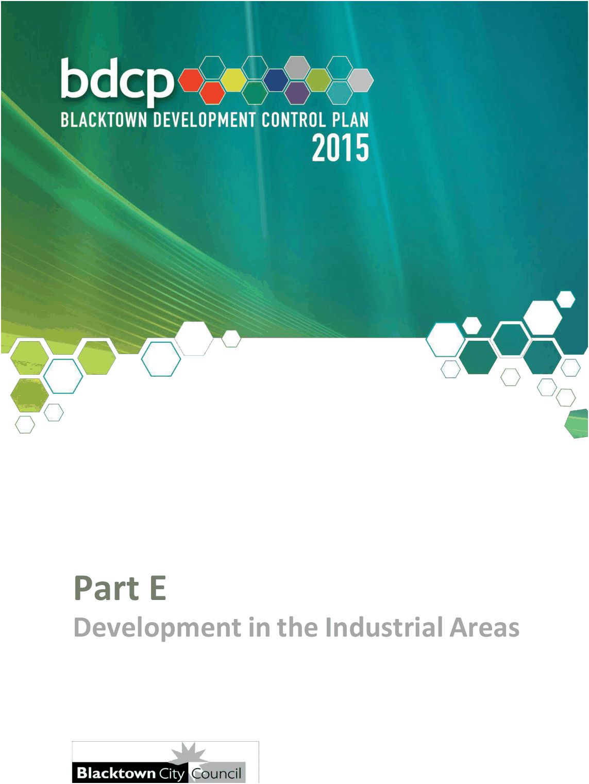

# Blacktown Development Control Plan 2015 - Part E Development in the Industrial Areas

> This chapter is split into 8 section file(s), one per numbered heading, in the order they appear in the PDF.

Source PDF: [Part-E-Development-in-the-Industrial-Zones_01-02-2026.pdf](Part-E-Development-in-the-Industrial-Zones_01-02-2026.pdf)

> [Picture on page 1: a picture, saved as a picture (images/part-e-development-in-the-industrial-areas-page-1-1.gif, 150 dpi).]

### Part E

### Development in the Industrial Areas

### Table of Contents

| 1 | Introduction ........................................................................................................ 4 |  |
|---|---|---|
|  | 1.1 | Land to which this Part applies ................................................................ 4 |
|  | 1.2 | Objectives .................................................................................................. 4 |
|  | 1.3 | The industrial, B5 and B7 zones ............................................................... 6 |
|  | 1.4 | Definition of ‘light industry’ ................................................................................6 |
|  | 1.5 | Change of use ............................................................................................ 8 |
|  | 1.6 | Factory units .............................................................................................. 8 |
| 2 | Ancillary commercial premises in the industrial, B5 and B7 zones ................ 9 |  |
|  | 2.1 | Ancillary retail premises ........................................................................... 9 |
| 3 | Subdivision of industrial land .......................................................................... 11 |  |
|  | 3.1 | Minimum subdivision lot size ................................................................. 11 |
|  | 3.2 | Minimum lot width ................................................................................... 11 |
|  | 3.3 | Battle-axe shaped allotments ................................................................. 11 |
|  | 3.4 | Strata subdivision ................................................................................... 11 |
| 4 | Design guidelines ............................................................................................. 12 |  |
|  | 4.1 | Setbacks .................................................................................................. 12 |
|  | 4.2 | Landscaping ............................................................................................ 13 |
|  | 4.3 | Consideration of adjoining land ............................................................. 15 |
|  | 4.4 | Development in the IN1 General Industrial zone adjoining residential land ....................................................................... 16 |
|  | 4.5 | Building design and construction .......................................................... 16 |
|  | 4.6 | Open storage areas ................................................................................. 16 |
|  | 4.7 | Vehicular access and circulation ............................................................ 17 |
|  | 4.8 | Car parking .............................................................................................. 18 |
| 5 | Specific controls for the Huntingwood Industrial Estate ............................... 20 |  |
|  | 5.1 | Aims ......................................................................................................... 20 |
|  | 5.2 | Appropriate types of light industry ........................................................ 20 |
|  | 5.3 | Multi-tenanted industrial development ................................................... 22 |
|  | 5.4 | Design guidelines .................................................................................... 22 |
| 6 | Specific controls for the B7 Business Park zone ........................................... 26 |  |
|  | 6.1 | Preliminary ............................................................................................... 26 |
|  | 6.2 | Detailed design guidelines ...................................................................... 27 |
|  | 6.3 | Landscaping guidelines .......................................................................... 36 |

| 7 | General .............................................................................................................. 43 7.1 Services ................................................................................................... 43 7.2 Pollution control ...................................................................................... 43 7.3 Areas requiring fill ................................................................................... 44 |
|---|---|
| 8 | Sex services premises in industrial zones ...................................................... 45 8.1 Background ............................................................................................. 45 8.2 Aims of this section ................................................................................ 45 8.3 Location of sex services premises ......................................................... 45 8.4 Lodging a Development Application ...................................................... 45 8.5 Specific requirements ............................................................................. 46 8.6 Consents and matters for consideration by Council ............................. 47 |

#### Figures

| Figure 1.1 | Lands zoned B5, B7 or Industrial under BLEP 2015 ...................... 5 |
|---|---|
| Figure 5.1 | Huntingwood Industrial Estate ..................................................... 20 |
| Figure 6.1 | Land to which Section 6 applies ................................................... 26 |
| Figure 6.2 | Battle-axe lot subdivision ............................................................. 27 |
| Figure 6.3 | Embankment batter and retaining walls ...................................... 34 |
| Figure 6.4 | Fencing details ............................................................................. 35 |
| Figure 6.5 | Indicative streetscape landscape treatment ............................... 38 |
| Figure 6.6 | Indicative allotment landscape treatment .................................... 40 |
| Figure 6.7 | Indicative carpark landscape treatment ....................................... 42 |

#### Tables

| Table 6.1 | Subdivision requirements ............................................................. 27 |
|---|---|
| Table 6.2 | Setback, site coverage and floor space requirements ................ 29 |
| Table 6.3 | Cut and fill requirements .............................................................. 33 |
| Table 6.4 | Fencing requirements ................................................................... 34 |
| Table 6.5 | Carpark landscaping requirements .............................................. 40 |

<!-- sections -->
## Sections

1. [1 Introduction](01-1-introduction.md)
2. [B5 and B7 zones](02-b5-and-b7-zones.md)
3. [3 Subdivision of industrial land](03-3-subdivision-of-industrial-land.md)
4. [4 Design guidelines](04-4-design-guidelines.md)
5. [5 Specific controls for the Huntingwood Industrial](05-5-specific-controls-for-the-huntingwood.md)
6. [6 Specific controls for the B7 Business Park zone](06-6-specific-controls-for-the-b7-business.md)
7. [7 General](07-7-general.md)
8. [8 Sex services premises in industrial zones](08-8-sex-services-premises-in-industrial.md)
