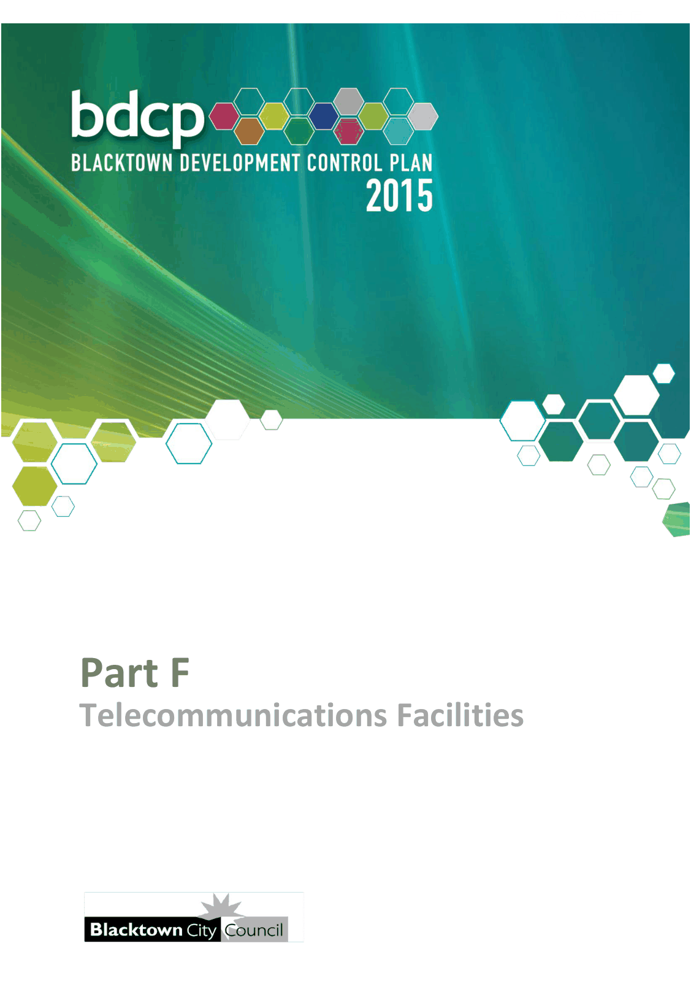

# Blacktown Development Control Plan 2015 - Part F Telecommunications Facilities

> This chapter is split into 4 section file(s), one per numbered heading, in the order they appear in the PDF.

Source PDF: [Part-F-Telecommunications-Facilities.pdf](Part-F-Telecommunications-Facilities.pdf)

> [Picture on page 1: a picture, saved as a picture (images/part-f-telecommunications-facilities-page-1-1.gif, 150 dpi).]

### Part F

### Telecommunications Facilities

### Table of Contents

| 1 | Objectives ............................................................................................................. 3 |
|---|---|
| 2 | Application of this Part ........................................................................................ 4 |
| 3 | What to submit with the Development Application ............................................ 5 3.1 Electromagnetic energy (EME) assessment .............................................. 5 3.2 Network masterplans .................................................................................. 5 3.3 Site identification and visual / aesthetic considerations .......................... 5 3.4 Landscaping plan ........................................................................................ 6 |
| 4 | Justification .......................................................................................................... 7 |

<!-- sections -->
## Sections

1. [1 Objectives](01-1-objectives.md)
2. [2 Application of this Part](02-2-application-of-this-part.md)
3. [3 What to submit with the Development Application](03-3-what-to-submit-with-the-development.md)
4. [4 Justification](04-4-justification.md)
