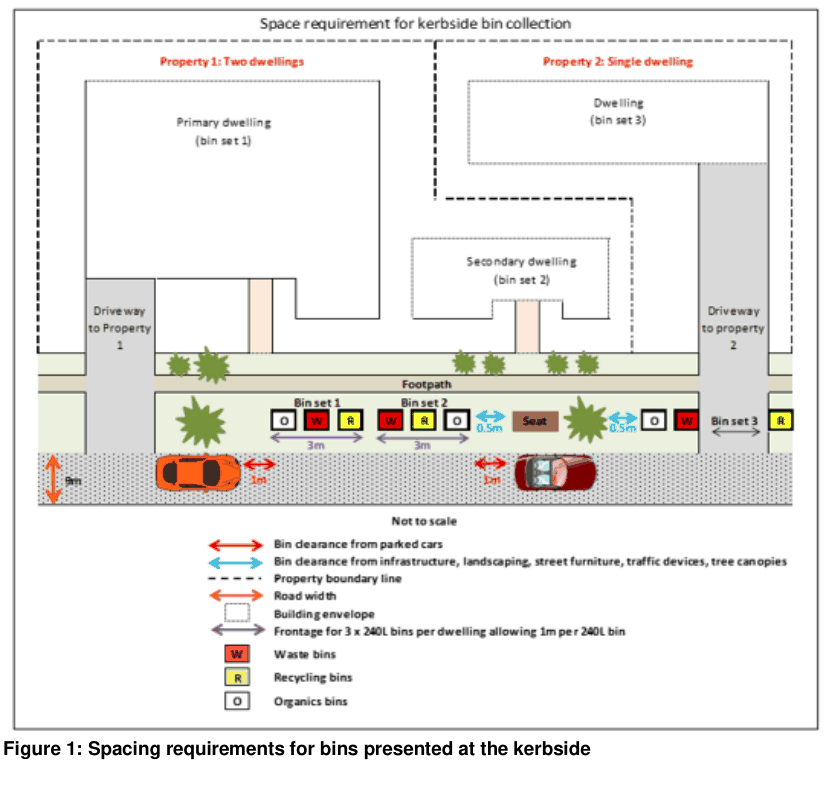
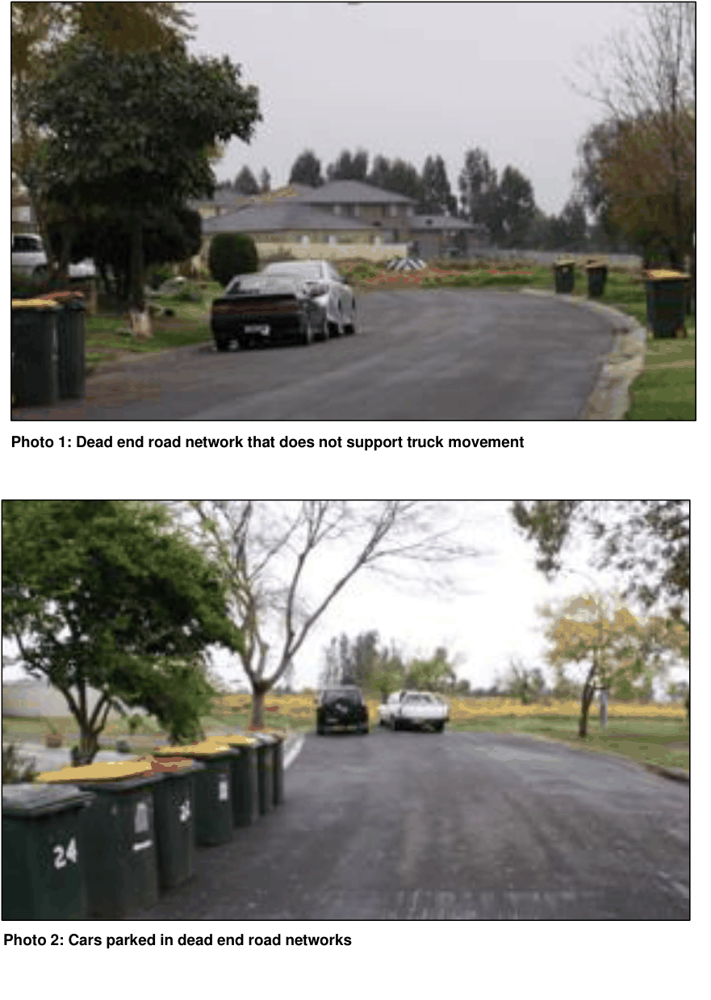
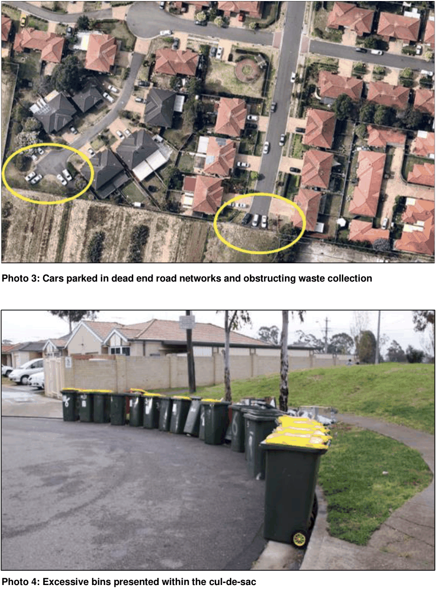
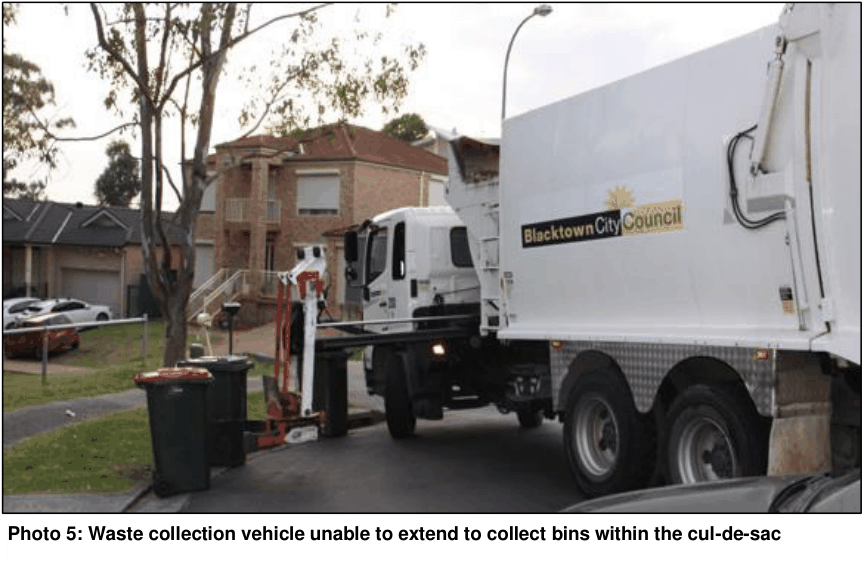

## 3. Subdivision and engineering works

This section applies to waste collection requirements for the design of new subdivisions and roads and constrained sites.

### 3.1 Objectives

a. Ensure that waste collection solutions are considered early in the design phase for subdivision and road design so they do not adversely impact on the neighbourhood amenity for future residents.

b. Ensure that the subdivision configuration, road and laneway design and block layout allow for the convenient and efficient collection of waste and recyclables from individual sites.

c. Consider any unique characteristics of the site and ensure that waste collection does not adversely impact on these characteristics.

### 3.2 Development controls

#### 3.2.1 Preparing a waste management plan

A waste management plan is required to be submitted with every development application for subdivision and engineering works and must:

• demonstrate how the development will reduce waste by reuse and recycling of materials during subdivision and engineering works

• identify waste streams likely to be generated onsite and the approximate amounts by: o providing details and volumes of materials that can be reused and recycled from the construction site

o identifying the condition of materials and any possible contamination by hazardous items such as asbestos containing material

o nominating whether materials will be reused, recycled or removed from site

• outline options to increase waste avoidance and support the circular economy by: o utilising a purchasing policy that includes using pre-fabricated and recycled materials, specifying exact requirements of goods and materials, arrangement for delivery of materials on an ‘as needs’ basis, and the option to return excess stock to the supplier

o determining storage requirements for goods and materials onsite, including the provision of a temporary storage area for materials generated by the construction activity that can be reused at a later stage

o ensuring appropriate storage and management of goods and materials onsite for reuse whilst considering slope, drainage and location of waterways and vegetation

• outline how contractors and other relevant parties involved in the subdivision work, will be aware of their legal requirements for waste disposal and their responsibilities under the waste management plan by: o nominating how data on the generation of waste and recyclable materials will be collected

o nominating how records (including dockets) on the lawful disposal and recycling of waste will be retained to ensure they are accessible for inspection by regulatory authorities

o identifying onsite communication strategies, such as signage, toolbox talks and inductions

• indicate that internal loop roads, private driveways, community title roads and any other private road used for bin collections are designed to accommodate the weight of 24 tonne waste vehicles.

#### 3.2.2 Preparing scaled site and floor plans

The waste management plan accompanying the development application must be supported by scaled site and floor plans that clearly identify the:

• nominated kerbside collection points for all future dwellings o Figure 1 shows suitable bin collection points and required clearances from parked cars, driveways, infrastructure and landscaping. It also indicates frontage requirements for bin collection of 3 metres x 1 metre for each dwelling including rear access subdivisions and battle axe blocks.

o bin collections for laneway developments must be from perimeter roads in the first instance. Collections from within laneways may only be considered where site characteristics (such as topography and retaining walls), prevent safe and efficient waste collection from the perimeter roads.

• temporary turning heads (other than hammerheads) for staged subdivisions where the entire road network will not be completed as part of stage 1, or for any development where only half the road network is required to be constructed under the subject development application. This will ensure waste collection vehicles are able to enter and exit the development without the need to reverse. Photos 1 and 2 show road networks that have not allowed for truck movement. Photo 3 shows truck turning areas that have been obstructed by parked cars

• road design and engineering specifications for cul-de-sac and turning paths can accommodate waste collection vehicles in line with the Blacktown City engineering standards. Bin collection within cul-de-sac heads is not permitted. Manoeuvring waste collection vehicles into position to collect from these locations is problematic (refer to photos 4 and 5)

• loop roads, private driveways and/or community title roads

• subdivision design ensures waste collection vehicles can enter and exit the development in a forward direction, without the need to reverse.

> [Picture on page 13: a picture, saved as a picture (images/part-g-waste-management-and-minimisation-page-13-1.gif, 150 dpi).]

Figure 1: Spacing requirements for bins presented at the kerbside

> [Picture on page 14: a picture, saved as a picture (images/part-g-waste-management-and-minimisation-page-14-1.gif, 150 dpi).]

#### Photo 1: Dead end road network that does not support truck movement

#### Photo 2: Cars parked in dead end road networks

> [Picture on page 15: a picture, saved as a picture (images/part-g-waste-management-and-minimisation-page-15-1.gif, 150 dpi).]

#### Photo 3: Cars parked in dead end road networks and obstructing waste collection

> Words printed on the picture (copied from the PDF):
> Photo 4: Excessive bins presented within the cul-de-sac

> [Picture on page 16: a picture, saved as a picture (images/part-g-waste-management-and-minimisation-page-16-1.gif, 150 dpi).]
> Words printed on the picture (copied from the PDF):
> Photo 5: Waste collection vehicle unable to extend to collect bins within the cul-de-sac

### 3.3 Additional considerations

#### 3.3.1 Laneway developments

Where the development proposes waste collection from a laneway, the development must demonstrate:

• adequate sight lines along the entire length of the laneway. There must be no bends or obstacles that prevent safe manoeuvring of waste collection vehicles

• there are no obstructions that restrict Council’s vehicle from servicing the development

• the bin collection point on one side of the laneway only and from the identified and designated bin collection point(s)

• ‘no stopping’ signage along the entire length of the laneway

• a safe exit strategy from the laneway in a forward direction for waste collection vehicles in case of an obstruction

• the laneway design includes a minimum 6 metre carriageway, a 1 metre verge on either side and garages setback a minimum 0.5 metres on each side

• the maximum bin travel distances for 240 litres bins do not exceed 30 metres

• the maximum bin transfer grades for 240 litres bins do not exceed 1:14.

#### 3.3.2 Developments with internal loop roads and private roads

Where the development includes an internal loop road and/or a private road, and waste collection is proposed, the development must demonstrate:

• there are no obstructions that restrict Council’s vehicle from servicing the development

• the bin collection point on one side of the internal loop road and/or private road where it is a through road. Suitable space for all required bins must be demonstrated

• ‘no stopping’ signage is installed along the entire length of the internal loop road and/or a private road where the designated bin collection points are located

• a safe exit strategy from the internal loop road and/or a private road in a forward direction for waste collection vehicles in case of an obstruction

• the internal loop road and/or a private road designed to include a minimum 6 metre carriageway, a 1 metre verge on either side and garages setback minimum 0.5 metres on each side

• the maximum bin travel distances for 240 litre bins do not exceed 30 metres

• the maximum bin transfer grades for 240 litre bins do not exceed 1:14. In line with section 3.2, scaled site and floor plans are to be submitted with the waste management plan indicating that the development complies with these requirements.

#### 3.3.3 Battle axe blocks

Where the proposal is for a battle axe block, the development must demonstrate:

• bin collection point(s) are situated on the frontage belonging to the subject development. Bins must not flow over to adjoining or neighbouring lots

• the maximum bin travel distances for 240 litre bins do not exceed 30 metres

• the maximum bin transfer grades for 240 litre bins do not exceed 1:14.
