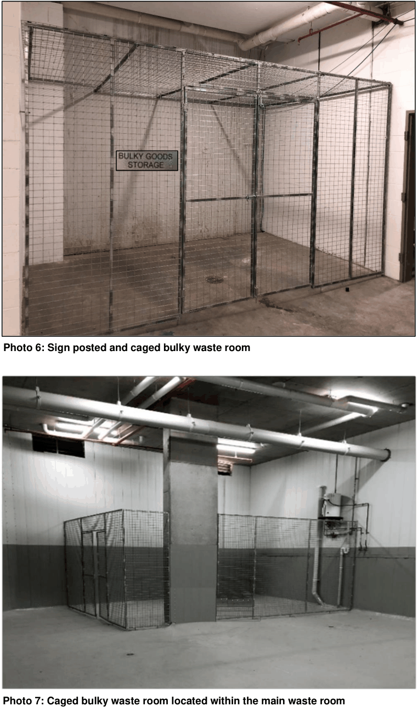
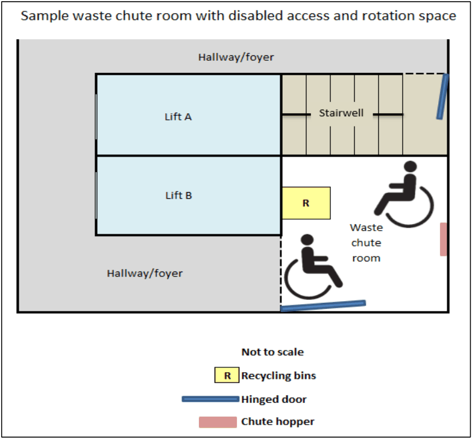
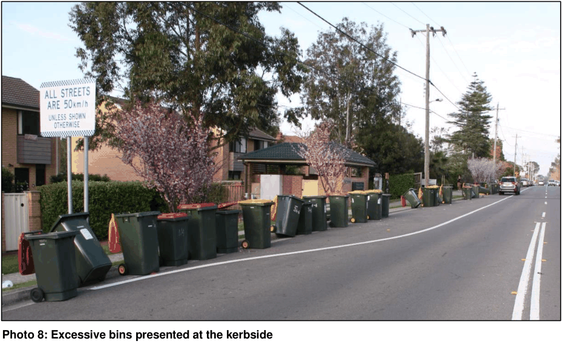
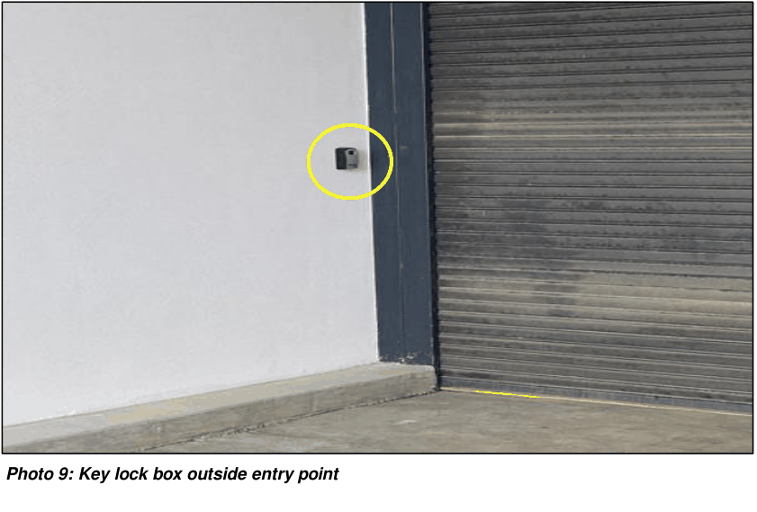
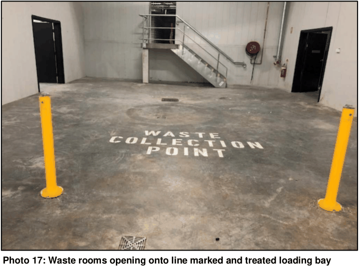

## 5. Other development types

The following development controls apply to all other development types, including dwelling houses, residential development, multi dwelling housing development, affordable rental housing typologies, residential flat buildings, mixed use developments, commercial development and industrial development. Refer to the matrix at Appendix 1 for the relevant development controls that apply to your development. The waste management plan accompanying your development application must address all the relevant development controls, as listed in the matrix for your development type.

### 5.1 Objective

a) Ensure the provision of appropriate and efficient waste storage and collection facilities that are easy to use, safe and well designed for residents, tenants and service providers.

b) Ensure that waste collection solutions are considered early in the design phase so they do not adversely impact on neighbourhood amenity, streetscape or safety for future residents, tenants and service providers.

c) Consider any unique characteristics of the site and ensure that waste collection does not adversely impact on these characteristics.

### 5.2 Development controls

#### 5.2.1  Preparing a waste management plan

All development applications must be accompanied by a waste management plan that includes scaled site and floor plans that clearly identify compliance with the following specific requirements, (where applicable), as identified in the matrix at Appendix 1. The scaled site and floor plans must clearly identify the proposed collection arrangement for the site including all the required waste features.

#### 5.2.2  Internal waste and recycling storage

The information submitted with the development application must be supported by scaled site and floor plans that clearly identify the internal storage area for waste and recyclables that must hold a minimum of 1 days separated waste and recyclables. The storage area must be located within the kitchen, a non-habitable room or other convenient location. This information needs to be shown on the plans for each dwelling, unit and/or tenancy.

### 5.3 Development controls – specific requirements

#### 5.3.1  Daily bin storage

(a) Individual residential bins

The information submitted with the development application must be supported by scaled site and floor plans that clearly identify the:

• daily bin storage area for 3 x 240 litre bins per dwelling allowing 1 metre per bin that is within the site boundary

• screening to the daily bin storage area so it cannot be viewed from public areas

• location of the daily bin storage area is away from windows on the subject lot or any known windows on the adjoining lot to reduce noise and odour nuisances

• daily bin storage area is designed as a hard stand surface, clear of pillars, support beams, services, air conditioning units and any other obstruction

• maximum walk distance for residents with bagged rubbish from their dwelling/unit to the daily bin storage area does not exceed 30 metres

• paved bin travel path from the daily bin storage area to the collection point

• daily bin storage area which is to exclude the garage or other area internal to a dwelling.

Note:  Massing of bins and bulky waste This note applies particularly to (a) individual residential bins, above, and (b) communal residential bins, below, but may apply to any development with bin massing. Appropriate notice must be given to purchasers of lots which are likely to be affected by the location of waste facilities and/or bin collection points in a development. A public positive covenant pursuant to Section 88E of the Conveyancing Act 1919, will be imposed on all developments where waste facilities, bin and bulky waste storage areas and/or bin and bulky waste collection points impact streetscape, resident amenity, operational requirements and safety concerns for pedestrians and other road users. This includes, but is not limited to, developments with strata schemes, community tiles, and/or torrens title lots where bins and/or bulky waste have come from other locations (not accessible by waste vehicles), for collection.

(b) Communal residential bins

The information submitted with the development application must be supported by scaled site and floor plans that clearly identify that:

• an appropriate and efficient waste storage system is selected for the site, ensuring all required bins can be appropriately accommodated in the communal waste room(s)

• interim waste room(s) and waste room(s) are located on the same level to avoid reliance on mechanical aids to move bins between the levels

• ground level waste room(s) are located behind the front building setback and integrated into the building footprint. It must be adequately designed and screened to ensure it is not visible from the street

• waste room(s) open straight onto the loading bay(s), allowing bins to be moved straight to the collection vehicle with minimal manual handling

• onsite collection point(s), must be located on the same floor as both the interim waste room(s) and waste room(s)

• access to the waste room(s) for residents is not via the loading bay(s)

• waste room(s) have separate access points for waste collection contractors and residents

• the location of any ground level waste room(s) is away from windows on the subject lot or any known windows on the adjoining lot to reduce noise and odour nuisances

• interim waste room(s) and waste room(s) are designed clear of pillars, support beams, services, air conditioning units, sprinklers and any other obstruction

• interim waste room(s) and waste room(s) are designed of regular shape (i.e. square or rectangular) that allow for the safe and practical use of these spaces and to assist in the cleaning of these facilities. These spaces must be a minimum 3 metres deep to allow for suitable bin rotation space

• interim waste room(s), if required, are designed and located so that the bins can be safely and efficiently transferred to the waste room(s) and collection point(s)

• interim waste room(s) and waste room(s) are not located within any communal open space, recreational areas or other resident amenity facilities onsite

• maximum walking distance for residents with bagged rubbish from their dwelling/unit to the applicable waste area does not exceed 30 metres

• bin travel path from the interim waste room(s) to the waste room(s)

• bin travel path from the waste room(s) to the collection point(s)

• width of all doorways in bin storage areas are a minimum 1.5 metres wide, excluding waste chute room(s) on residential floors.

(c) Non-residential development

The information submitted with the development application must be supported by scaled site and floor plans that clearly identify the:

• selection of an appropriate and efficient waste storage system for the site ensuring all required bins can be appropriately accommodated in the waste room(s)

• waste room(s), where they are located at ground level, are to be situated behind the building line and integrated into the overall design of the building footprint. The waste room(s) must be adequately screened to ensure it is not visible from the street or public areas. Ground level waste room(s) must be designed to not detract from the overall character of the development

• interim waste room(s) and waste room(s) are designed clear of pillars, support beams, services, air conditioning units, sprinklers and any other obstruction.

• interim waste room(s) and waste room(s) a designed of regular shape (i.e. square or rectangular) that allow for the safe and practical use of these spaces and to assist in the cleaning of these facilities. These spaces must be a minimum 3 metres deep to allow for suitable bin rotation space

• interim waste room(s), if required, are designed and located so that the bins can be safely and efficiently transferred to the waste room(s) and collection point(s)

• interim waste room(s) and waste room(s) are not co-located with any communal open space, recreational areas or other resident amenity facilities onsite

• waste room(s) open straight onto the loading bay(s), allowing bins to be moved straight to the collection vehicle with minimal manual handling

• onsite collection point is located on the same level as the interim waste room(s) and waste room(s)

• maximum walk distance for staff with bagged rubbish from their commercial, retail or industrial premise to the relevant waste area does not exceed 30 metres

• bin travel path from the interim waste room(s) to the waste room(s)

• bin travel path from the waste room(s) to the collection point(s)

• access to the waste room(s) for anyone other than the building manager and waste contractors is not to be via the loading bay

• suitable storage provision (waste and recycling) for non-residential tenancies or businesses

• suitable provision of bins and signage for drive thru and take away outlets

• doorways in bin storage areas are a minimum 1.5 metres wide, excluding waste chute room(s) on residential floors

• location of refrigerated waste room(s) for any commercial tenancy producing more than 50 kilograms of meat, seafood or poultry waste daily in between collection cycles

• interim waste room(s) and waste room(s) are within the site boundaries and are adequate to accommodate all required bins for all operations across the site.

(d) Additional considerations for mixed use developments

The information submitted with the development application must be supported by scaled site and floor plans that clearly identify, for the relevant components, the:

Residential component

• site has a different waste management system for the residential and commercial components in a mixed use development by: o providing separate chutes (if required) and chute discharge points

o providing separate interim waste room(s) (if required) and waste room(s)

o restricting commercial and retail staff access to the residential interim waste room(s) and waste room(s).

Commercial and retail component

• site has a different waste management system for the residential and commercial components in a mixed use development by: o providing separate chutes (if required) and chute discharge points

o providing separate interim waste room(s) (if required) and waste room(s)

|  | o restricting commercial and retail staff access to the residential interim waste room(s) and waste room(s) |
|---|---|
| Industrial | • provision of different containers for tenancies to separate waste from their processes. |
| component |  |

#### 5.3.2  Bulky waste

(a) Individual residential bins

The information submitted with the development application must be supported by scaled site and floor plans that clearly identify:

• sufficient space on the kerbside of a public road for the placement of unwanted bulky waste clear of driveways, light and power poles, traffic management devices, street furniture, landscaping and trees. This requirement is in addition to the unobstructed frontage required for bin placement.

(b) Individual residential bins – developments serviced by private roads

Developments serviced by private roads may include laneways, loop roads, private driveways and/or community title roads. The information submitted with the development application must be supported by scaled site and floor plans that clearly identify:

• an area for bulky waste collection that is adjoining the designated bin collection area

• line marking and sign posting for the onsite communal bulky waste collection point(s).

(c) Communal residential bins

The information submitted with the development application must be supported by scaled site and floor plans that clearly identify:

• bulky waste storage areas are designed clear of pillars, support beams, services, air conditioning units, sprinklers and any other obstruction

• bulky waste storage areas that are of a regular shape (i.e. square or rectangular) and have a minimum doorway width of 1.5 metres that allow for the safe and practical use of these spaces and to assist in the cleaning of these facilities. Rectangular shaped bulky waste storage areas must be a minimum 3 metres deep to allow for suitable use of these spaces

• bulky waste storage area(s) are caged across the front and signposted to identify potential hazards (see photos 6 and 7)

• bulky waste storage area(s) are of suitable size to accommodate the required bulky waste generation rate as outlined in the Blacktown City guideline for waste management in new developments

• the bulky waste storage area(s) as being located immediately adjacent to the waste room(s) and opening straight onto the loading bay(s) for collection.

> [Picture on page 25: a picture, saved as a picture (images/part-g-waste-management-and-minimisation-page-25-1.gif, 150 dpi).]
> Words printed on the picture (copied from the PDF):
> Photo 6: Sign posted and caged bulky waste room

> Words printed on the picture (copied from the PDF):
> Photo 7: Caged bulky waste room located within the main waste room

(d) Communal residential bins – multi dwelling housing

In addition to c) above, the information submitted with the development application must be supported by scaled site and floor plans that clearly identify:

• line marking and sign posting for the onsite communal bulky waste storage and collection point(s).

(e) Non-residential development

The information submitted with the development application must be supported by scaled site and floor plans that clearly identify:

• bulky waste storage areas are designed clear of pillars, support beams, services, air conditioning units, sprinklers and any other obstruction

• bulky waste storage areas that are of regular shape (i.e. square or rectangular) that allow for the safe and practical use of these spaces and to assist in the cleaning of these facilities. Rectangular shaped bulky waste storage areas must be a minimum 3 metres deep to allow for suitable use of these spaces.

• the bulky waste storage area(s) being located immediately adjacent to the waste room(s) and opening straight onto the loading bay(s) for collection

• bulky waste storage area(s) are caged across the front and signposted to identify potential hazards.

• bulky waste storage provision for the retail, commercial component(s) and industrial development in accordance with the Blacktown City guideline for waste management in new developments

#### 5.3.3  Chutes

Waste chutes are required in all developments of 3 storeys or more with a lift and containing residential dwellings/units. This includes mixed use developments with a residential component. The information submitted with the development application must be supported by scaled site and floor plans that clearly identify the:

• chutes proposed for the development are for waste only

• storage of a 240 litre recycling bin in each waste chute room on each residential floor

• chute room on each residential floor is sufficient in size to hold bulk cardboard

• chute room on each residential floor is suitably designed to cater for wheelchair access in line with the relevant Australian Standard (see Figure 2)

• chute discharge point. This must be suitably caged (or enclosed) to prevent injury with sufficient circulation space around the equipment for bin rotation as per the manufacturer’s specifications.

> [Picture on page 27: a picture, saved as a picture (images/part-g-waste-management-and-minimisation-page-27-1.gif, 150 dpi).]

#### Figure 2: Waste chute room with wheelchair access and rotation space

#### 5.3.4  Bin travel distances

The information submitted with the development application must be supported by scaled site and floor plans that clearly identify a maximum:

• 30 metre bin travel distance for bins up to 360 litres

• 10 metre bin travel distance for bins over 360 litres and up to 1,100 litres

• 3 metre bin travel distance for bins more than 1,100 litres. If any of the above distances are exceeded, a bin movement aid will be required for the site.

(a) Bin movement aids (other than industrial developments)

The documentation submitted with the development application must:

• provide details of the bin movement aid for the site if bin travel distances are exceeded (e.g. seated bin tug and trolley attachment)

• provide details of a suitable and secure storage area that caters for the proposed equipment, which is also located adjacent to the loading bay(s) and collection point(s). This area must be identified on the plans submitted with the development application. The Blacktown City guideline for waste management in new developments provides further information

• provide a power point to charge the bin movement aid

• carefully select bin movement aids considering the distance bins need to be moved across a site to get them from an interim waste room(s) to the waste room(s) and collection point(s). Motorised seated bin movement aids with trolley attachments are preferred for sites 1,500 square metres or more.

#### 5.3.5  Bin travel paths

(a) Individual residential bins

The information submitted with the development application must be supported by scaled site and floor plans that clearly identify a:

• bin travel path from the daily bin storage area to the kerbside collection point that does not contain any steps, lips or obstructions

• paved bin travel path that is a minimum 1 metre wide.

(b) Communal residential bins

The information submitted with the development application must be supported by scaled site and floor plans that clearly identify a:

• bin travel path from the interim waste room(s) to the waste room(s) (if required) that is clear of steps, lips or obstructions

• bin travel path from the waste room(s) to the collection point(s) that is clear of steps, lips or obstructions

• paved bin travel path that is a minimum 1 metre wide. Refer to the Blacktown City guideline for waste management in new developments for further information.

(c) Non-residential development

The information submitted with the development application must be supported by scaled site and floor plans that clearly identify a:

• bin travel path from the interim waste room(s) (if required) to the waste room(s) that is clear of steps, lips or obstructions

• bin travel path from the waste room(s) to the collection point(s) that is clear of steps, lips or obstructions

• paved bin travel path is a minimum 1 metre wide. Refer to the Blacktown City guideline for waste management in new developments for further information.

#### 5.3.6  Bin transfer grades

The information submitted with the development application must be supported by scaled site and floor plans that clearly identify bin transfer grades do not exceed:

• 1:14 for bins up to 360 litres

• 1:24 for 660 litre and 1,100 litre bulk bins.

#### 5.3.7  Collection points

We do not support the following collection methods for developments which require onsite collection as identified by the matrix at Appendix 1:

• onsite collection at ground level within the front building setback

• onsite collection where it is proposed that waste vehicles must reverse into or out of the site via footpaths and public areas as this increases unnecessary risk

• drive through collection via an indented bay within the front setback

• kerbside collection We may consider the use of truck turntables to facilitate onsite collection when demonstrated suitable to the satisfaction of Council.

(a) Individual residential bins

The information submitted with the development application must be supported by scaled site and floor plans that clearly identify the:

• nominated collection point

• available unobstructed frontage for bin collection measuring 3 metres x 1 metre for each dwelling clear of garages, driveways, light and power poles, traffic management devices, street furniture, landscaping and trees. See Figure 1 on page 13.

• bins are placed for collection within the boundary of the subject site. Bins must not flow over onto adjoining lots

The documentation submitted with the development application in relation to waste must:

• nominate whether bin collection will be provided by Council or a private waste contractor

• confirm that an agreement will be signed with Council (where onsite collection of residential bins is required), to indemnify Council against claims for loss or damage (see the Blacktown City guideline for waste management in new developments). This agreement must be signed by the elected strata management company on behalf of all landowners prior to issue of any Occupation Certificate for the development. Bin collection by Council will not occur until a signed agreement is in place.

(b) Multi-dwelling housing developments

Kerbside collection from a public road may be supported for multi-dwelling housing developments with 7 dwellings or less. The information submitted with the development application must be supported by scaled site and floor plans that clearly identify the:

• available space for bin collection measuring 3 metres x 1 metre along the internal loop road and private road for each dwelling clear of garages, driveways, light and power poles, traffic management devices, street furniture, landscaping and trees. See Figure 1 in section 3.2 for further information.

Onsite collection is required for multi-dwelling housing developments with 8 or more dwellings due to the significant number of bins placed at the kerb, the time needed for

collection and the resulting amenity, neighbourhood character and safety issues (see photo 8). Where it can be demonstrated that onsite collection is not possible for the site, kerbside collection from a public road may be permitted if it will not adversely impact on the visual appearance of the streetscape or result in amenity and safety issues. In reviewing whether kerbside collection is appropriate or not, consideration will be given to:

• the location of the proposed development. We will generally not support kerbside collection if the development is located on a busy road

• the total number of bins needed for the site

• the available street frontage(s)

• any other relevant factors. Kerbside collection will not be supported for multi-dwelling housing developments with individual bins for each lot and access to the site is through a cul-de-sac head where bin collection is proposed. Onsite collection is required for these developments

> [Picture on page 30: a picture, saved as a picture (images/part-g-waste-management-and-minimisation-page-30-15.gif, 150 dpi).]
> Words printed on the picture (copied from the PDF):
> Photo 8: Excessive bins presented at the kerbside

(c) Residential communal bins

The information submitted with the development application must be supported by scaled site and floor plans that clearly identify the:

• location of the basement collection point for residential flat buildings or developments with a residential component on sites 1,500 square metres or more

• location of the basement collection point (as the preferred arrangement) for residential flat buildings or developments with a residential component on sites less than 1,500 square metres

• ground level collection point (including truck turning and bin storage) when basement collection is not achievable due to site characteristics. In this case, the waste collection point(s) must be incorporated into the building footprint at ground level and located towards the rear of the site behind the building setback.

• undercroft collection area(s) at ground level, if permitted for the site, are located towards the rear of the site and behind the building line

• loading bay(s) and truck travel paths are designed clear of pillars, support beams, services, air conditioning units, sprinklers and any other obstruction that would hinder safe passage for waste collection vehicles

• onsite collection point(s), which must be located on the same level as the interim waste room(s) and waste room(s). Designs proposing that bins be stored in the basement but collected at ground level will not be supported.

The documentation submitted with the development application in relation to waste must:

• nominate whether bin collection will be provided by Council or a private waste contractor

• indicate provision of a building manager in perpetuity to manage the waste collection arrangement for the site. This includes, but is not limited to, placement and withdrawal of bins for collection, cleaning bins, managing illegal dumping and providing access to the loading bay (e.g. collapsing bollards or opening roller doors). The requirement for the provision of a building manager will be a condition of any development consent

• confirm that an agreement will be signed with Council (where onsite collection of residential bins is required), to indemnify Council against claims for loss or damage (see the Blacktown City guideline for waste management in new developments). This agreement must be signed by the elected strata management company on behalf of all landowners prior to issue of any Occupation Certificate for the development. Bin collection by Council will not occur until a signed agreement is in place.

(d) Boarding houses

Kerbside collection may be permitted from a public road for developments with 10 rooms or less if suitable frontage for the required number of bins can be demonstrated. The information submitted with the development application must be supported by scaled site and floor plans that clearly identify the:

• available space for all the required bins for the site. Frontage must be clear of garages, driveways, light and power poles, traffic management devices, street furniture, landscaping and trees. See Figure 1 in section 3.2 for further information.

Onsite collection is required developments with 11 rooms or more. The information submitted with the development application must be supported by scaled site and floor plans that clearly identify:

• the onsite collection point for waste, recyclables and bulky waste

• if an onsite caretaker is proposed.

(e) Isolated sites

Consideration may be given to a collection point(s) at-grade to the rear of the site and behind the building line where it can be demonstrated to be of benefit to the development. The documentation submitted with the development application in relation to waste must demonstrate improved outcomes for building design, resident and occupant amenity, and functionality of the waste management system when locating the collection point at-grade.

(f) Mixed use

The information submitted with the development application must be supported by scaled site and floor plans that clearly identify the:

• alternative onsite collection point for mixed use developments where it can be demonstrated that the site is unsuitable for basement collection. In these circumstances, the application will need to demonstrate that the development can provide an effective and efficient residential waste collection system that is compatible with Council’s standard waste service

• waste and recyclables will be collected onsite

• loading bay(s) and truck travel paths are designed clear of pillars, support beams, services, air conditioning units, sprinklers and any other obstruction that would hinder safe passage for waste collection vehicles

• onsite collection point(s), which must be located on the same level as the interim waste room(s) and waste room(s)

The documentation submitted with the development application in relation to waste must:

• nominate whether bin collection for the residential component of a mixed use development will be provided by Council or a private waste contractor. Bin collection for the retail and commercial component(s) must be serviced by private contractors

• indicate provision of a building manager in perpetuity to manage the waste collection arrangement for the site. This includes, but is not limited to, placement and withdrawal of bins for collection, cleaning bins, managing illegal dumping and providing access to the loading bay (e.g. collapsing bollards or opening roller doors). The requirement for the provision of a building manager will be a condition of any development consent

• confirm that an agreement will be signed with Council (where onsite collection of residential bins is required), to indemnify Council against claims for loss or damage (see the Blacktown City guideline for waste management in new developments). This agreement must be signed by the elected strata management company on behalf of all landowners prior to issue of any Occupation Certificate for the development. Bin collection by Council will not occur until a signed agreement is in place

• include a loading dock management plan to detail all proposed uses of the space and the management of competing services. Council will not provide service windows for waste collection.

(g) Commercial

The information submitted with the development application must be supported by scaled site and floor plans that clearly identify the:

• alternative onsite collection point for commercial developments where it can be demonstrated that the site is unsuitable for basement collection. In these circumstances, the application will need to demonstrate that the development can still provide an effective and efficient waste collection system

• loading bay(s) and truck travel paths are designed clear of pillars, support beams, services, air conditioning units, sprinklers and any other obstruction that would hinder safe passage for waste collection vehicles

• onsite collection point(s), which must be located on the same level as the interim waste room(s) and waste room(s). Designs proposing that bins be stored in the basement but collected at ground level will not be supported.

The documentation submitted with the development application in relation to waste must:

• state that all waste, recyclables and bulky waste collections will be by a private contractor

• include a loading dock management plan to detail all proposed uses of the space and the management of competing services. Council will not provide service windows for waste collection.

(h) Centre-based child care facility

The information submitted with the development application must be supported by scaled site and floor plans that clearly identify the:

• kerbside collection point if the number of proposed enrolments at the centre will result in a maximum 7 x 240 litre bins. The bin requirement will be based on compliance with the waste and recycling generation rates as outlined in the EPA Better Practice Guide for Resource Recovery in Residential Developments 2019

• onsite collection point if the number of proposed enrolments at the centre will result in 8 x 240 litre bins or more. The bin requirement will be based on compliance with the waste and recycling generation rates as outlined in the EPA Better Practice Guide for Resource Recovery in Residential Developments 2019 for childcare centres

• loading bays and truck travel paths for onsite collection are designed clear of pillars, support beams, services, air conditioning units, sprinklers and any other obstruction that would hinder safe passage for waste collection vehicles

• onsite collection point(s) are located on the same level as the interim waste room(s) and waste room(s)

The documentation submitted with the development application in relation to waste must:

• state how all waste, recyclables and bulky waste collections will be undertaken

• include a loading dock management plan to detail all proposed uses of the space and the management of competing services where applicable to the proposal. Council will not provide service windows for waste collection.

(i) Industrial

The information submitted with the development application must be supported by scaled site and floor plans that clearly identify the:

• loading bays and truck travel paths for onsite collection are designed clear of pillars, support beams, services, air conditioning units, sprinklers and any other obstruction that would hinder safe passage for waste collection vehicles

• onsite collection point(s) are located on the same level as the interim waste room(s) and waste room(s)

• onsite loading bay(s) are located immediately adjacent to the waste room(s). The documentation submitted with the development application in relation to waste must:

• state that all waste, recyclables and bulky waste collections will be by a private contractor

• include a loading dock management plan to detail all proposed uses of the space and the management of competing services. Council will not provide service windows for waste collection.

#### 5.3.8  Onsite truck access

The matrix (see Appendix 1) identifies the suitable truck for each development type. See Blacktown City guideline for waste management in new developments for further information on truck specifications. The information submitted with the development application must be supported by scaled site and floor plans that clearly identify:

• swept paths for the trucks entire travel path including forward entry and exit and around the collection point. This must be demonstrated without the use of a turntable

• the truck can access the collection point without the need to reverse outside of the site boundaries or intrude on landscaped areas. Onsite 3-point turns are acceptable

• the minimum vertical clearance along the vehicles entire travel path and any turning area in line with Blacktown City guideline for waste management in new developments

• for any collection occurring in a basement, the ramp grades and changes of rate of grade on the ramp do not exceed 15.4%, in line with Australian Standard AS2890.2 Parking Facilities: Off-Street Commercial Vehicle Facilities (Tables 3.2 and 3.3)

• that the truck travel path is rated suitable for a 24 tonne truck.

The applicant must provide a lock box immediately outside the entry point to each building of a residential development to store the waste room keys in case of an emergency (see photo 9). The lock box must be keypad operated with the code provided at Occupation Stage. Collection contractors must also have a key at Occupation Stage.

> [Picture on page 35: a picture, saved as a picture (images/part-g-waste-management-and-minimisation-page-35-5.gif, 150 dpi).]
> Words printed on the picture (copied from the PDF):
> Photo 9: Key lock box outside entry point

#### 5.3.9 Loading bays

The information submitted with the development application must be supported by scaled site and floor plans that clearly identify:

• the proposed physical treatment of the loading bay to prevent unauthorised parking in this

area. Measures to achieve this could include a security gate, lockable removable bollards (see photo 10), roller doors and/or other devices in the proposed at-grade, undercroft or basement collection area(s) to maintain truck turning areas. This requirement will be in addition to any line marking and/or no stopping signage proposed for the site. A requirement that a building manager provide access to this area for collection vehicles will be a condition of any development consent

• that the loading bay can accommodate the entire length of the required collection vehicle, plus an additional 3 metre front or rear clearance (whichever applies), for bin servicing and rotation. The design must ensure that the truck does not overhang the length of the loading bay or adversely impact traffic flow onsite

• that the loading bay is a minimum 3.5 metres wide in line with Australian Standard AS 2890.2 Parking Facilities: Off-Street Commercial Vehicle Facilities (Table 4.1) to accommodate the collection vehicle plus an additional minimum 300 millimetre clearance on either side of the vehicle for movement. The design must ensure that the truck does not overhang the width of the loading bay or adversely impact traffic flow onsite.

> [Picture on page 36: a picture, saved as a picture (images/part-g-waste-management-and-minimisation-page-36-6.gif, 150 dpi).]
> Words printed on the picture (copied from the PDF):
> Photo 17: Waste rooms opening onto line marked and treated loading bay

#### 5.3.10  Loading dock management plan

A loading dock management plan is required for any site where competing uses of the loading bay for waste collection, general servicing and/or deliveries exists. In compiling a loading dock management plan, the applicant must take into consideration that Council will not provide service windows for residential waste collection in mixed use developments. Considerations for accommodating competing uses, include:

• coordinating uses of the loading bay (other than for residential waste collection) to occur outside Council collection hours

• developing a suitable exit strategy from the collection area if the loading dock is occupied. Design must ensure forward entry to and exit from the site.

If Council determines that suitable access cannot be achieved, a dedicated loading bay for residential waste collection will be required. At a minimum, the loading dock management plan must address:

• site and dock access

• operation and scheduling

• dock configuration

• physical treatment of the area to prevent unauthorised parking

• all dock users and services

• line marking and signposting.

• responsibilities of the loading dock manager

A copy of the approved waste management plan must be included as an appendix.

#### 5.3.11  Plan of management

(a) Boarding house developments

The documentation submitted with the development application in relation to waste must include a plan of management for the site that contains the proposed waste arrangements. This is in addition to the waste management plan. The plan of management must state:

• that no bins will be placed in the collection point(s) outside the scheduled collection time for the area

• that it is the caretaker’s/building manager’s responsibility to transfer all bins to their nominated collection point(s) and withdraw them by 7 pm on the day of service in line with collection schedules for the area

• that it is the caretaker’s/building manager’s responsibility to clean the bins and the waste room(s)

• the proposed method of communication to new tenants and residents on the waste management services and collection system for the site

• the nominated collection point(s) for waste and recycling bins, and bulky waste from the site

• number and capacity of the bins needed for the site

• how waste will be managed during occupation including bulky waste and illegal dumping

A copy of the approved waste management plan must be included as an appendix.
