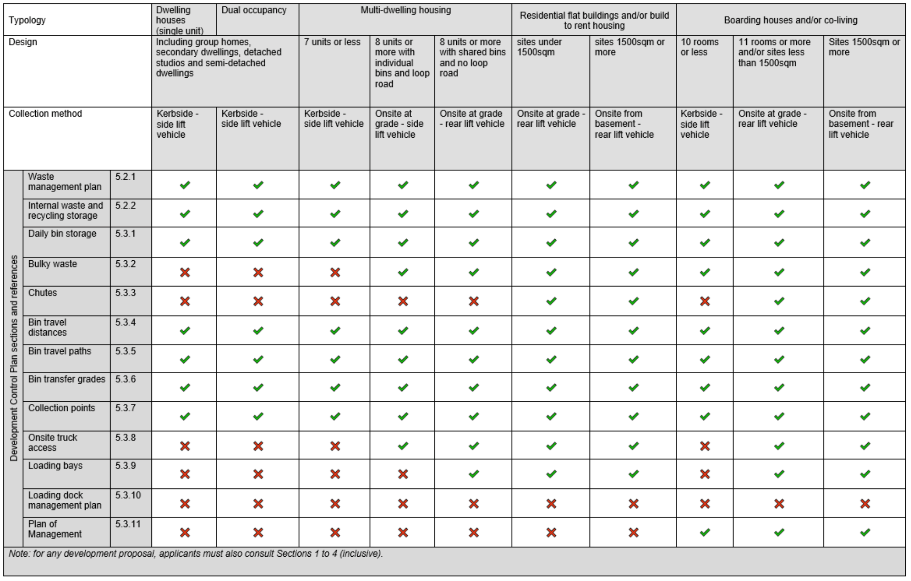
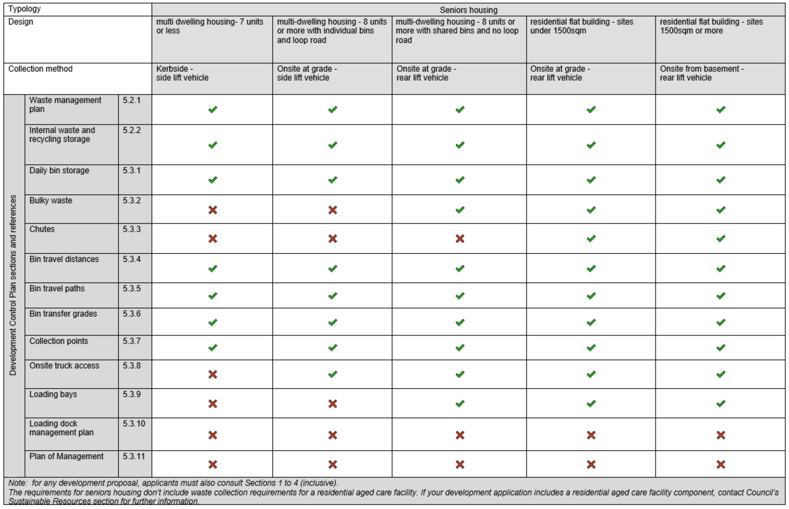
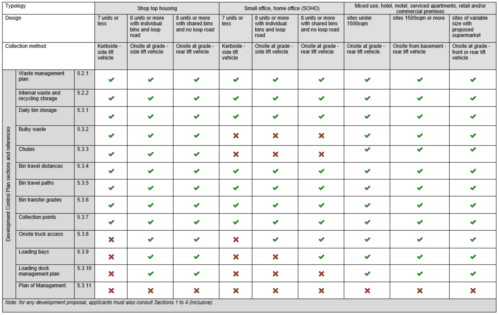
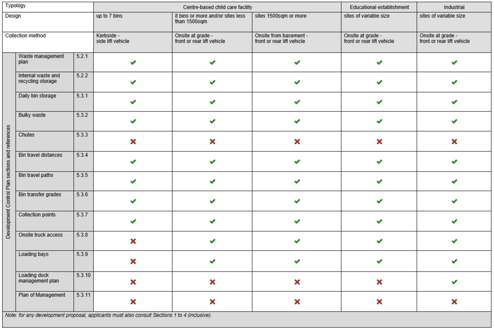

## 6. Appendix 1 – Matrix

> [Picture on page 39: a picture, saved as a picture (images/part-g-waste-management-and-minimisation-page-39-1.gif, 150 dpi).]

> [Picture on page 40: a picture, saved as a picture (images/part-g-waste-management-and-minimisation-page-40-1.gif, 150 dpi).]

> [Picture on page 41: a picture, saved as a picture (images/part-g-waste-management-and-minimisation-page-41-1.gif, 150 dpi).]

> [Picture on page 42: a picture, saved as a picture (images/part-g-waste-management-and-minimisation-page-42-1.gif, 150 dpi).]
