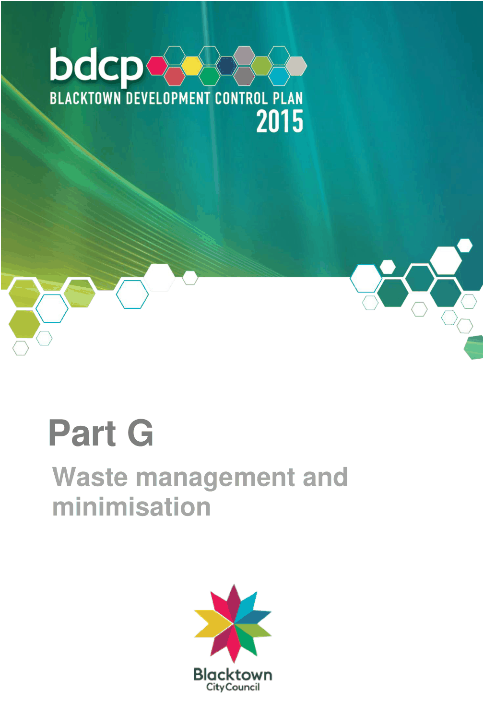

# Blacktown Development Control Plan 2015 - Part G Waste management and minimisation

> This chapter is split into 6 section file(s), one per numbered heading, in the order they appear in the PDF.

Source PDF: [Part-G-Site-Waste-Management-and-Minimisation.pdf](Part-G-Site-Waste-Management-and-Minimisation.pdf)

> [Picture on page 1: a picture, saved as a picture (images/part-g-waste-management-and-minimisation-page-1-1.gif, 150 dpi).]

### Part G

Waste management and

### minimisation

### Table of contents

| Table of contents .......................................................................................................................... 2 |  |
|---|---|
| 1. | Introduction .......................................................................................................................... 5 1.1 Aims of this Part............................................................................................................ 5 1.2 Objectives of this Part ................................................................................................... 5 1.3 Relationship to other documents ................................................................................... 5 1.4 When does this Part apply? .......................................................................................... 5 1.5 How to read this Part .................................................................................................... 6 1.6 Definitions ..................................................................................................................... 6 |
| 2. | Waste management plan ..................................................................................................... 9 2.1 Generation rates ........................................................................................................... 9 2.1.1 Residential ........................................................................................................... 9 2.1.2 Commercial and retail .......................................................................................... 9 2.1.3 Industrial ............................................................................................................ 10 2.2 Waste systems and technologies ................................................................................ 10 2.3 Constrained sites ........................................................................................................ 10 |
| 3. | Subdivision and engineering works ................................................................................. 11 3.1 Objectives ................................................................................................................... 11 3.2 Development controls ................................................................................................. 11 3.2.1 Preparing a waste management plan................................................................. 11 3.2.2 Preparing scaled site and floor plans ................................................................. 12 3.3 Additional considerations ............................................................................................ 16 3.3.1 Laneway developments ..................................................................................... 16 3.3.2 Developments with internal loop roads and private roads .................................. 16 3.3.3 Battle axe blocks................................................................................................ 17 |
| 4. | Demolition and construction............................................................................................. 18 4.1 Objective..................................................................................................................... 18 4.2 Development controls ................................................................................................. 18 4.2.1 Preparing a waste management plan................................................................. 18 4.2.2 Preparing scaled site and floor plans ................................................................. 19 |
| 5. | Other development types .................................................................................................. 20 5.1 Objective..................................................................................................................... 20 5.2 Development controls ................................................................................................. 20 5.2.1 Preparing a waste management plan................................................................. 20 5.2.2 Internal waste and recycling storage .................................................................. 20 5.3 Development controls – specific requirements ............................................................ 20 5.3.1 Daily bin storage ................................................................................................ 20 (a) Individual residential bins ................................................................................... 20 |

|  | (b) Communal residential bins ................................................................................. 21 |
|---|---|
|  | (c) Non-residential development ............................................................................. 22 |
|  | (d) Additional considerations for mixed use developments ...................................... 23 |
|  | 5.3.2 Bulky waste ....................................................................................................... 24 |
|  | (a) Individual residential bins ................................................................................... 24 |
|  | (b) Individual residential bins – developments serviced by private roads ................. 24 |
|  | (c) Communal residential bins ................................................................................. 24 |
|  | (d) Communal residential bins – multi dwelling housing .......................................... 26 |
|  | (e) Non-residential development ............................................................................. 26 |
|  | 5.3.3 Chutes ............................................................................................................... 26 |
|  | 5.3.4 Bin travel distances ............................................................................................ 27 |
|  | (a) Bin movement aids (other than industrial developments) ................................... 27 |
|  | 5.3.5 Bin travel paths .................................................................................................. 28 |
|  | (a) Individual residential bins ................................................................................... 28 |
|  | (b) Communal residential bins ................................................................................. 28 |
|  | (c) Non-residential development ............................................................................. 28 |
|  | 5.3.6 Bin transfer grades ............................................................................................ 28 |
|  | 5.3.7 Collection points ................................................................................................ 29 |
|  | (a) Individual residential bins ................................................................................... 29 |
|  | (b) Multi-dwelling housing developments................................................................. 29 |
|  | (c) Residential communal bins ................................................................................ 30 |
|  | (d) Boarding houses ................................................................................................ 31 |
|  | (e) Isolated sites ...................................................................................................... 32 |
|  | (f) Mixed use .......................................................................................................... 32 |
|  | (g) Commercial ....................................................................................................... 33 |
|  | (h) Centre-based child care facility .......................................................................... 33 |
|  | (i) Industrial ............................................................................................................ 34 |
|  | 5.3.8 Onsite truck access ........................................................................................... 34 |
|  | 5.3.9 Loading bays ..................................................................................................... 35 |
|  | 5.3.10 Loading dock management plan ..................................................................... 36 |
|  | 5.3.11 Plan of management ...................................................................................... 37 |
|  | (a) Boarding house developments........................................................................... 37 |
| 6. | Appendix 1 – Matrix ........................................................................................................... 38 |

#### Table of photos

Photo 1: Dead end road network that does not support truck movement ...................................... 14 Photo 2: Cars parked in dead end road networks.......................................................................... 14 Photo 3: Cars parked in dead end road networks and obstructing waste collection....................... 15 Photo 4: Excessive bins presented within the cul-de-sac .............................................................. 15 Photo 5: Waste collection vehicle unable to extend to collect bins within the cul-de-sac ............... 16 Photo 6: Sign posted and caged bulky waste room ....................................................................... 25 Photo 7: Caged bulky waste room located within the main waste room ........................................ 25 Photo 8: Excessive bins presented at the kerbside ....................................................................... 30 Photo 9: Key lock box outside entry point...................................................................................... 35 Photo 10: Waste rooms opening onto line marked and treated loading bay .................................. 36

#### Table of figures

Figure 1: Spacing requirements for bins presented at the kerbside ............................................... 13 Figure 2: Waste chute room with wheelchair access and rotation space ....................................... 27

<!-- sections -->
## Sections

1. [1 Introduction](01-1-introduction.md)
2. [2 Waste management plan](02-2-waste-management-plan.md)
3. [3 Subdivision and engineering works](03-3-subdivision-and-engineering-works.md)
4. [4 Demolition and construction](04-4-demolition-and-construction.md)
5. [5 Other development types](05-5-other-development-types.md)
6. [6 Appendix 1 – Matrix](06-6-appendix-1-matrix.md)
