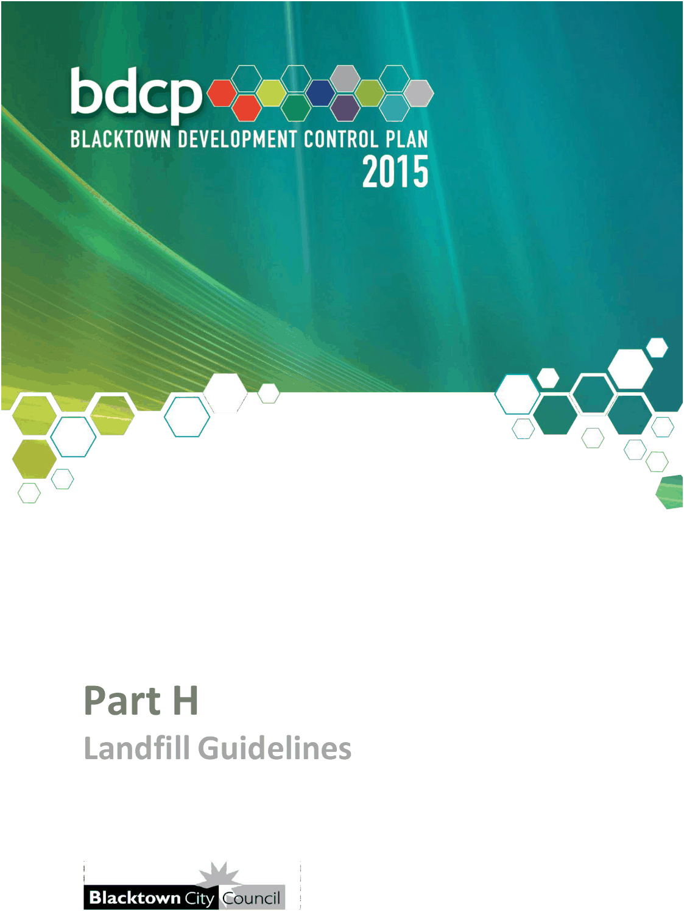
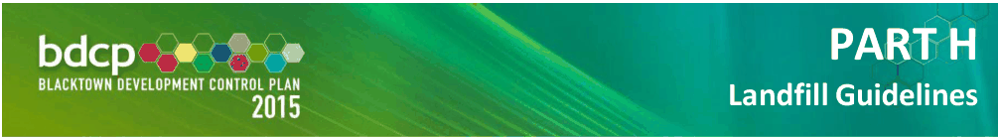

# Blacktown Development Control Plan 2015 - Part H Landfill Guidelines

> This chapter is split into 3 section file(s), one per numbered heading, in the order they appear in the PDF.

Source PDF: [Part-H-Landfill-Guidelines_01-02-2026.pdf](Part-H-Landfill-Guidelines_01-02-2026.pdf)

### P

> [Picture on page 1: a picture, saved as a picture (images/part-h-landfill-guidelines-page-1-2.gif, 150 dpi).]

### Part H

### Landfill Guidelines

> [Picture on page 2: a picture, saved as a picture (images/part-h-landfill-guidelines-page-2-1.gif, 150 dpi).]

### PART H

### Landfill Guidelines

| Table of Contents |  |  |
|---|---|---|
| 1 | Introduction ............................................................................................... 3 |  |
|  | 1.1 | Scope ............................................................................................... 3 |
|  | 1.2 | Aims ................................................................................................. 3 |
|  | 1.3 | Objectives ........................................................................................ 3 |
|  | 1.4 | Definitions ........................................................................................ 4 |
| 2 | What is landfill? ........................................................................................ 7 |  |
| 3 | General requirements ............................................................................... 8 |  |
|  | 3.1 | Relevant policies, legislation and guidelines ................................. 8 |
|  | 3.2 | Requirements for lodging a Development Application ................. 9 |
|  | 3.3 | Requirements for supporting documentation .............................. 13 |
|  | 3.4 | Operational compliance .............................................................. 144 |
| Table |  |  |
| Table 3.1 |  | Type of development ................................................................ 13 |

<!-- sections -->
## Sections

1. [1 Introduction](01-1-introduction.md)
2. [2 What is landfill?](02-2-what-is-landfill.md)
3. [3 General requirements](03-3-general-requirements.md)
