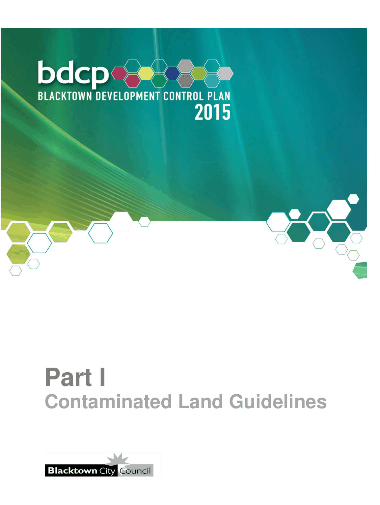

# Blacktown Development Control Plan 2015 - Part I Contaminated Land Guidelines

> This chapter is split into 5 section file(s), one per numbered heading, in the order they appear in the PDF.

Source PDF: [Part-I-Contaminated-Land-Guidelines.pdf](Part-I-Contaminated-Land-Guidelines.pdf)

> [Picture on page 1: a picture, saved as a picture (images/part-i-contaminated-land-guidelines-page-1-1.gif, 150 dpi).]

### Part I

### Contaminated Land Guidelines

### Table of Contents

| 1 | Introduction ................................................................................................................. 3 |
|---|---|
| 2 | Necessary information in the decision-making process .......................................... 5 2.1 Stages of investigation ...................................................................................... 5 2.2 Preliminary Investigation Report ...................................................................... 6 2.3 Subsequent stages ............................................................................................ 7 2.4 Site audit ............................................................................................................ 7 2.5 Site Auditor Scheme .......................................................................................... 7 2.6 Independent review ........................................................................................... 7 |
| 3 | Procedures for Planning Proposals .......................................................................... 9 |
| 4 | Procedures for Development Applications and Complying Development Certificates ................................................................................................................ 10 4.1 Procedures for development applications ..................................................... 10 4.2 Procedures for Complying Development Certificates ................................... 11 |
| 5 | Clean-up Notice remediation .................................................................................... 13 |
| APPENDIX 1 Some activities that may cause contamination ....................................... 14 |  |

<!-- sections -->
## Sections

1. [1 Introduction](01-1-introduction.md)
2. [2 Necessary information in the decision-making](02-2-necessary-information-in-the-decision.md)
3. [3 Procedures for Planning Proposals](03-3-procedures-for-planning-proposals.md)
4. [4 Procedures for Development Applications and](04-4-procedures-for-development-applications.md)
5. [5 Clean-up Notice remediation](05-5-clean-up-notice-remediation.md)
