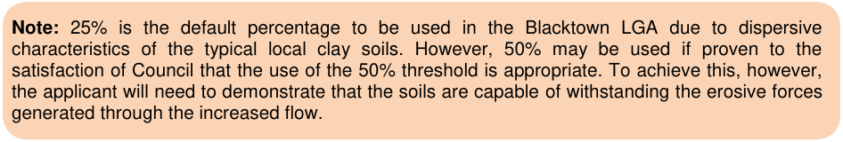

## 1 Introduction

Water is a limited resource that must be managed both for immediate needs and long-term economic and environmental sustainability. With urban development increasing our water usage, altering flow regimes in our local waterways and increasing pollutant loads in stormwater runoff, sound policies are required to ensure a sustainable environment for present and future generations. Council has adopted a water sensitive urban design approach to the management of water within the Blacktown Local Government Area to reflect a similar approach to water management being implemented throughout the North West Growth Centre. Water sensitive urban design is an approach that helps integrate water cycle management into urban planning and design. It is used to help mitigate and reduce the impacts of development on our local waterways and natural environment. There are a range of measures that can be used to meet the development requirements of Council such as:

• Water conservation measures including reduction of potable use through installation of water efficient appliances

• Use of rainwater or reuse of stormwater or treated effluent for toilet flushing, washing machines, garden watering, car washing or for industrial purposes

• Structural stormwater treatment measures such as gross pollutant traps, secondary filtration systems or porous paving

• Vegetated stormwater treatment measures such as street tree bioretention systems, bioretention systems and wetlands

• Schemes which incorporate structural and vegetated stormwater treatment measures such as stormwater harvesting and reuse schemes

• On-site stormwater detention measures such as surface storages or tanks. Integrated water cycle management is an approach to the management of water that considers all aspects of water including rainwater, stormwater, groundwater, water supply and use, reuse and treatment.

### 1.1 Objectives of this Part

The objectives of this Part of Blacktown Development Control Plan (DCP) 2015 are to:

(a) Provide direction and advice to applicants in order to facilitate water sensitive urban design and integrated water cycle management within the Development Application (DA) process

(b) Provide design principles that will assist development to meet the aims of this Part of the DCP

(c) Provide objectives, targets and controls for water conservation, water quality, waterway stability, on-site stormwater detention, erosion, sediment and pollution control and groundwater.

### 1.2 Aims of this Part

The aims of this Part are to:

(a) Protect and enhance natural watercourses and their associated ecosystems and ecological processes

(b) Minimise potable water demand and wastewater generation

(c) Minimise stream erosion by matching the post development runoff regime to the pre development or natural water runoff regime

(d) Mitigate the impacts of development on water quality and quantity

(e) Mitigate the impacts of development on groundwater, particularly in saline groundwater environments

(f) Ensure any changes to the existing groundwater regime do not adversely impact upon any other properties and the environment

(g) Integrate water cycle management measures into the landscape and urban design to maximise amenity

(h) Minimise the potential impacts of development and other associated activities on the aesthetic, recreational and ecological values of receiving waters

(i) Minimise soil erosion and sedimentation resulting from site disturbing activities

(j) Ensure the principles of ecologically sustainable development are applied in consideration of economic, social and environmental values in water cycle management.

### 1.3 Relationship to other documents

This DCP Part is to be read in conjunction with the NSW State Environmental Planning Policy (Sydney Region Growth Centres), State Environmental Planning Policy (Western Sydney Employment Area), Blacktown Local Environment Plan, Blacktown City Council’s Engineering Guide for Development, Blacktown City Council’s Civil Works Specification, Blacktown City Council’s Water Sensitive Urban Design Handbook, the Upper Parramatta River Catchment Trust On-site Stormwater Detention Handbook (version 4), The Blue Book

– Managing Urban Stormwater: Soils and Construction and any other relevant policies, handbooks, guides, fact sheets, templates, checklists or other documents released from time to time by Blacktown City Council that relate to water sensitive urban design and integrated water cycle management.

### 1.4 Definitions

Activity means any development on land and may include, but is not limited to, any one of the following:

(a) The erection of a building

(b) The carrying out of work in, on, over or under land

(c) The use of land or of a building or work

(d) The subdivision of land whether involving earthworks or not

(e) Any soil disturbing activity in or on a public place or on lands owned by Blacktown City Council which may or may not be the subject of an approval

(f) Any act, matter or thing for which provision may be made under Section 26 of the Environmental Planning and Assessment Act 1979 and which is prescribed for the purposes of this definition but does not include any act, matter or thing referred to in Section 26 for which development consent is required or which is prohibited under an environmental planning instrument.

Aquifer means a body of saturated rock or soil containing a system of interconnected voids from which significant (economic) quantities of groundwater may be extracted. Building means any part of a building, and also includes any structure or part of a structure (including any temporary structure or part of a temporary structure), but does not include a moveable dwelling or associated structure or part of a manufactured home, moveable dwelling or associated structure. Business Development as generally defined in the Blacktown LEP 2015 and includes not-for-profit and government organisations undertaking developments such as schools, aged or disabled care facilities, nursing homes, hospitals, affordable housing, meeting halls, places of public worship, entertainment and sporting facilities or similar. Civil Works Specification refers to the document dated February 2005 and developed by Blacktown City Council and entitled Civil Works Specification as amended or superseded. Contributions Plan means a plan prepared, exhibited and adopted by Blacktown City Council in accordance with Section 94 of the NSW Environment Planning and Assessment Act 1979, authorising the conditioning of contributions. Cooling towers means heat removal devices used to transfer and process waste heat to the atmosphere by evaporating water to remove process heat and cool the working fluid to near the wet-bulb air temperature or by relying solely on air to cool the working fluid to near the dry-bulb air temperature. Common applications include cooling the circulating water used in oil refineries, chemical plants, power plants and building cooling. Deemed to Comply Certificate means a certificate of compliance produced by Blacktown City Council’s Deemed to Comply Tool. Deemed to Comply Tool means the online tool developed by Blacktown City Council that can demonstrate compliance with the water conservation, water quality and/or on-site stormwater detention controls. Detention means the temporary storage of stormwater generated within an allotment to restrict the discharge leaving the site to a predetermined rate to prevent an increase in flooding downstream both in the local drainage system immediately downstream of the site and along the creeks and watercourses further downstream. Dewatering means the removal of water from solid material or soil by a solid-liquid separation process. This is often done during the site development phase of a major construction project due to a high water table and may involve the use of pumps. Development footprint means the area of new work which is the subject of the development application. It refers only to new external work. It includes new paved areas and new buildings and new for old building replacements.

Drainage means the natural or artificial movement of surface and sub-surface water from a given area. Dual reticulation means the delivery of the supply of water from two different sources using separate pipes, for example when an alternative water source such as sewage or stormwater is used for non-potable purposes such as irrigation and toilet flushing and Sydney Water’s supply is used for potable purposes such as drinking and cooking. Dwelling means a room or suite of rooms occupied or used or so constructed or adapted as to be capable of being occupied or used as a separate domicile. Ecologically sustainable development has the same meaning as the definition in the Local Government Act 1993. Engineering Guide for Development refers to the document dated February 2005 and developed by Blacktown City Council and entitled Engineering Guide for Development as amended or superseded. Erosion means the process by which the detachment, entrainment, suspension and transport of soil occurs by wind, water or gravitational effects. Erosion leads to sedimentation. Erosion and sediment control plan means a plan as described in Appendix 1 of this Part. Flow path means the route which water draining from an area will take. Flow rate means the volume of fluid, in this instance water, that passes through a given point per unit of time. Flow duration means the time period over which flows occur. Groundwater means water contained within the voids and spaces in rocks or soils. Groundwater management system means the processes or practices used to control groundwater. Gross pollutant means contaminants equal to or greater than 5 millimetres in diameter that, when introduced into an environment, cause instability, disorder, harm or discomfort to the physical systems or living organisms. This may include for example trash, litter and vegetation. Gross pollutant and hydrocarbon trap means a trap that captures 90% of gross pollutants and 90% of hydrocarbons. Hydrocarbon means a compound of hydrogen and carbon, such as any of those which are the chief components of petroleum and natural gas. Impervious areas means areas which have no or very limited ability to transmit fluids from the surface through to the subsurface. Impervious areas occur where the soil surface is sealed eliminating rainwater infiltration and natural groundwater recharge. They consist mainly of artificial structures such as pavements, rooftops, sidewalks, roads and parking lots covered by materials such as asphalt, concrete, brick and stone. Soils compacted by urban development are also highly impervious.

Integrated water cycle management is an approach to the management of water that considers aspects of water including rainwater, stormwater, groundwater, water supply and use, reuse and treatment. Managing Urban Stormwater: Soils and Construction (The Blue Book) refers to the document dated 2004 and developed by Landcom entitled Managing Urban Stormwater: Soils and Construction, also commonly referred to as The Blue Book as amended or superseded. Non-potable water means water that is not fit or suitable for drinking and consumption purposes that may be used for other alternative non-potable uses such as laundry, toilet flushing and air conditioning cooling towers etc. Non-potable water includes rainwater and stormwater and recycled sewerage. The source determines appropriate uses with rainwater having more fit for purpose uses than the other two sources, subject to treatment methods. On-site stormwater detention measures means practices that control the peak post development flows of stormwater being discharged from a site to below pre-developed flows of stormwater being discharged from a site. Perched aquifer means an aquifer in which infiltrating water remains separated from an underlying main body of groundwater, with an unsaturated zone existing between the two. Potable water means water reserved for or suitable for drinking purposes/consumption. Public open space means land zoned as RE1 Public Recreation in the Blacktown LEP 2015. Rainwater tank means a reservoir or container that is used to collect and store (harvest) rain that runs off impervious surfaces such as roofs via gutters and downpipes. Receiving watercourses means any watercourse to which water is delivered from an area. The method of delivery may include, for example, subsoil drainage, local overland flow paths, pipes or other watercourses. Sediment means material of varying size, both mineral and organic, that is being or has been moved from its site of origin by the action or wind, water or gravity and comes to rest. Sedimentation means the deposition of sediment, usually in locations such as a channel, along a fence line, in an area of low slope, depression, watercourse or sediment trap. Soil means a natural material consisting of layers, amalgamates or individual particles or mineral and/or organic constituents, or variable thickness, that differs from its parent material in morphological, physical, chemical and mineralogical properties and biological characteristics. Stormwater means rainwater plus anything the rain carries along with it. In urban areas this includes the rain that falls on the roof of houses, or collects on paved areas such as driveways, roads and footpaths, and is carried away through a system of pipes that is separate to the sewerage system. Stormwater harvesting and reuse scheme means a process of collection, treatment, storage and use of stormwater. Stormwater management means the processes or practices used to control stormwater.

Stormwater treatment measure means both hard and soft engineering practices that treat and improve the quality and quantity of stormwater. Stream forming flow is defined as the following percentage of the 2 year ARI flow rate estimated for the catchment under natural conditions to help maintain waterway stability:

(a) 10 per cent for cohesionless (for example sandy) bed and banks

(b) 25 per cent for moderately cohesive bed and banks

(c) 50 per cent for cohesive (for example stiff clay) bed and banks.

> [Picture on page 8: a picture, saved as a picture (images/part-j-water-sensitive-urban-design-and-integrated-water-page-8-8.gif, 150 dpi).]
> Words printed on the picture (copied from the PDF):
> Note: 25% is the default percentage to be used in the Blacktown LGA due to dispersive
> characteristics of the typical local clay soils. However, 50% may be used if proven to the
> satisfaction of Council that the use of the 50% threshold is appropriate. To achieve this, however,
> the applicant will need to demonstrate that the soils are capable of withstanding the erosive forces
> generated through the increased flow.

Subsoil drainage means drainage of the layer of soil under the surface of the ground. Total nitrogen is the sum of the nitrogen present in all nitrogen-containing components in the water column including large and small phytoplankton and zooplankton, suspended microphytobenthos, dissolved inorganic nitrogen (nitrate and ammonia), dissolved organic nitrogen, labile detritus (both at the Redfield ratio and the Atkinson ratio) and refractory detritus. Total nitrogen concentration is determined by a balance between inputs (diffuse catchment loads, point source loads) and loss terms (export from the site to a watercourse and within the sediments). Total phosphorous is the sum of the phosphorus present in all phosphorus-containing components in the water column including large and small phytoplankton and zooplankton, suspended microphytobenthos, dissolved inorganic phosphorus (both absorbed and desorbed), dissolved organic phosphorus, labile detritus (both at the Redfield ratio and the Atkinson ratio) and refractory detritus. Total phosphorus concentration is determined by a balance between inputs (diffuse catchment loads and point source loads) and loss terms (export from the site to a watercourse and within the sediments). Total suspended solids is a measure of the mass of solid material (organic and inorganic) suspended in the water column. Suspended solids can include a range of inorganic and organic particles suspended in the water column which can be defined as the filterable residue retained on a 2.0 micron pore size filter dried at 105 degrees centigrade. Voluntary Planning Agreement (VPA) means a planning agreement under section 93F of the NSW Environmental Planning and Assessment Act 1979. Watercourse has the same meaning as ‘river’ under the Water Management Act 2000 as amended or superseded. Water conservation measure means practices that contribute to a reduction in  water usage. Water sensitive urban design (WSUD) is an approach that integrates water cycle management into urban planning and design. It is used to help mitigate and reduce the impacts of development on our local waterways.

Water Sensitive Urban Design (WSUD) Handbook refers to the document dated 2016 and developed by BCC entitled Water Sensitive Urban Design (WSUD) Handbook as amended or superseded.

Water table means the top level of water stored underground; the surface of groundwater in the soil. Waterway stability refers to the ability of a watercourse to withstand erosive forces.
