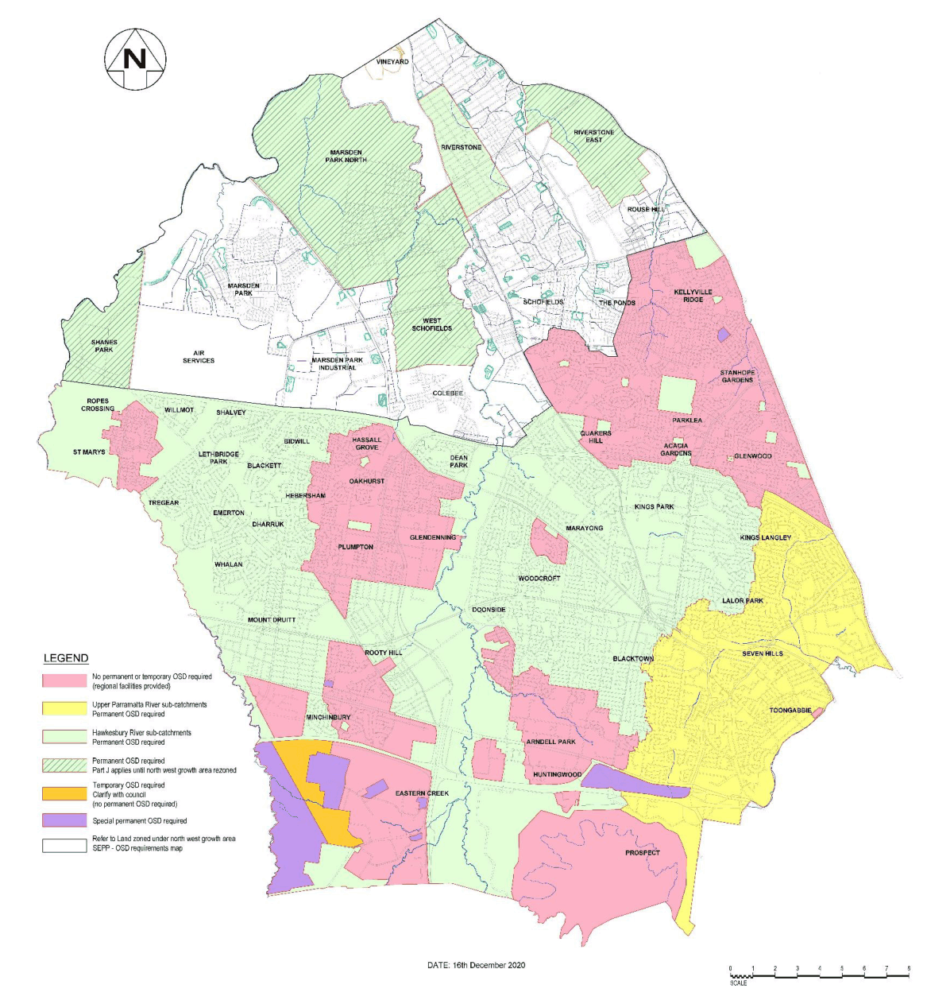

## 2 Application of this Part

### 2.1 Development to which this Part applies

The water quality controls in this Part apply to the following forms of development:

• All business and industrial development with a development footprint of greater than 150 square metres, excluding subdivisions and childcare centres.

• All residential development excluding subdivisions, single dwellings, secondary dwellings, dual occupancies, group homes, boarding houses and alterations or additions to other forms of residential development that are less than 150 square metres.

The water conservation controls in this Part apply to the following forms of development:

• All business and industrial development with a development footprint of greater than 150 square metres.

The on-site stormwater detention and waterway stability controls in this Part apply to the following forms of development:

• All business and industrial development, excluding subdivisions, with a development footprint of greater than 150 square metres and that is located within an on-site stormwater detention area as defined by the on-site stormwater detention map on Council’s website

• All residential development located within the Upper Parramatta River Catchment (see Figure 1), excluding the exceptions defined under Section 3.4.2 of the Upper Parramatta River Catchment Trust On-site Stormwater Detention Handbook version 4, as repeated below:

i. Single dwellings, extensions, additions and improvements on single residential lots created before November 1991 (when the OSD policy was adopted), except where OSD is required as a restriction on the property title

ii. The residual lot containing an existing dwelling that is excised as part of a subdivision of a lot created prior to 1991, provided that flows from the excised portion are directed away from the OSD system, noting that OSD is required for the new lots created. Subsequent single residential building/additions on the residual lot will also not be required to provide OSD

iii. The residual lot containing an existing industrial or commercial development which is excised as part of a subdivision of a lot created prior to 1991, provided that there is no significant development proposed on the residual lot and that flows from the residual lot are directed away from the OSD system, noting that OSD is required for the new lots created

iv. Dual occupancy dwellings on a lot with an existing residence involving less than 150 sqm of development area

v. Subdivisions of existing dual occupancies where no changes to the buildings or site are proposed

vi. Boundary adjustments and consolidation of allotments where no additional lots are created

vii. One-off minor developments, minor additions and repairs where the proposed development area is less than 150 sqm (subsequent minor developments or additions will require OSD). This exclusion is aimed principally at small areas within large commercial or industrial sites. It does not apply to any development where the development area includes more than 150 sqm of impervious surfaces nor to dual occupancies

viii. Change of use where no physical changes to the outside of the property are proposed

ix. Areas within large properties (usually commercial or industrial, but may be residential) not covered by the development application or construction certificate

x. New developments in subdivisions where OSD has already been provided for the entire subdivision

xi. Buildings in rural areas

xii. The grassed playing field and vegetated area of public sports and recreational facilities that are not part of a development.

• All residential development located within the Hawkesbury-Nepean River Catchment (see Figure 1), excluding:

i. Land identified in Figure 1 as not subject to OSD

ii. Subdivisions, single dwellings, secondary dwellings, dual occupancies, group homes, boarding houses and childcare centres and alterations or additions to other forms of residential development that are less than 150 sqm.

The erosion, sediment and pollution controls in this Part apply to the following forms of development:

• All development that will involve disturbance of the soil surface or that includes the cut or placement of fill or storage of materials.

The groundwater controls in this Part apply to the following forms of development:

• All development that is equal to or less than 40 metres from the top of bank of a watercourse that has a cut or fill proposed which is equal to or greater than 1 metre over the existing pre-developed surface.

• All development that is greater than 40 metres from the top of bank of a watercourse that has a cut or fill proposed which is equal to or greater than 1.5 metres over the pre-existing developed surface.

> [Picture on page 12: a picture, saved as a picture (images/part-j-water-sensitive-urban-design-and-integrated-water-page-12-1.gif, 150 dpi).]

#### Figure 1 Catchment areas subject to OSD

### 2.2 Integrated development

In accordance with Section 91 of the Environment Planning and Assessment Act 1979 certain approvals, permits or licences are required from the NSW Government in order for development to be carried out. The requirements for approvals, permits or licensing may change if legislation is amended, repealed or superseded. Advice from the appropriate NSW Government agency should be sought prior to any detailed planning.
