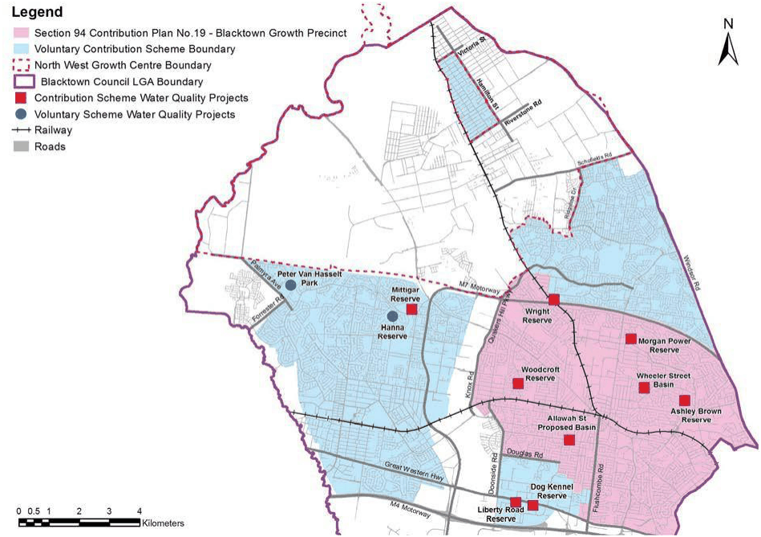
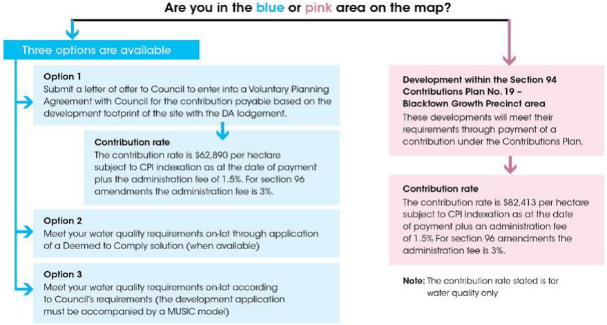

### Appendix 1 Precinct scale water quality offset scheme

### for infill development

The map shows the Section 94 Contributions Plan No. 19 – Blacktown Growth Precinct and Voluntary Contributions Scheme boundary. To establish your requirements, review the map in Figure 2 and determine which contributions area the development is located in and then use the flowchart in Figure 3 to determine your options (if available) and contributions. If the proposed development is close to a boundary please contact Council for clarification.

> [Picture on page 21: a picture, saved as a picture (images/part-j-water-sensitive-urban-design-and-integrated-water-page-21-10.gif, 150 dpi).]

Figure 2 Map illustrating the Contributions Plan and Voluntary Contributions Scheme boundaries

> [Picture on page 22: a picture, saved as a picture (images/part-j-water-sensitive-urban-design-and-integrated-water-page-22-1.gif, 150 dpi).]

Figure 3 Flowchart illustrating the options (if available) and contributions under the offset scheme
