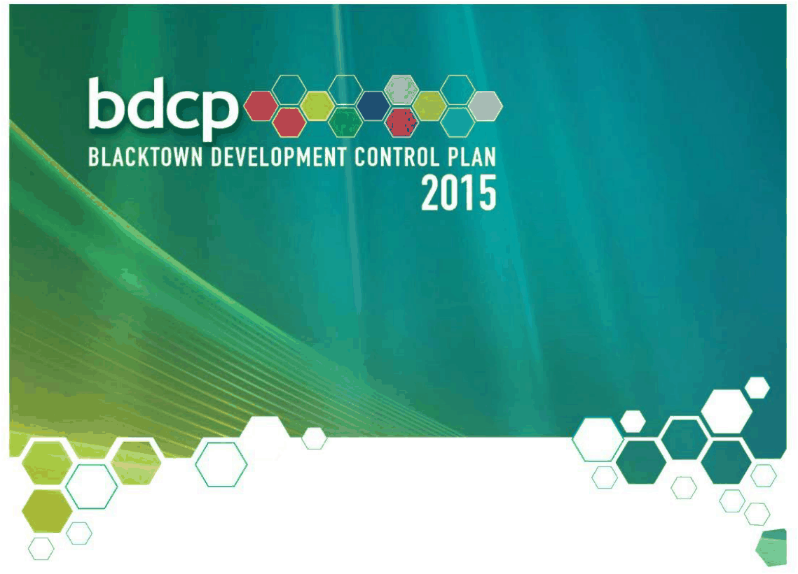

# Blacktown Development Control Plan 2015 - Part J Water Sensitive Urban Design and Integrated Water Cycle Management

> This chapter is split into 5 section file(s), one per numbered heading, in the order they appear in the PDF.

Source PDF: [Part-J-Water-Sensitive-Urban-Design-and-Integrated-Water-Cycle-Management.pdf](Part-J-Water-Sensitive-Urban-Design-and-Integrated-Water-Cycle-Management.pdf)

> [Picture on page 1: a picture, saved as a picture (images/part-j-water-sensitive-urban-design-and-integrated-water-page-1-1.gif, 150 dpi).]

Part J Water Sensitive Urban Design and

### Integrated Water Cycle Management

### Table of Contents

| 1 | Introduction ............................................................................................................................... 3 1.1 Objectives of this Part ..................................................................................... 3 1.2 Aims of this Part .............................................................................................. 4 1.3 Relationship to other documents ................................................................... 4 1.4 Definitions ........................................................................................................ 4 |
|---|---|
| 2 | Application of this Part ........................................................................................................... 10 2.1 Development to which this Part applies ....................................................... 10 2.2 Integrated development ................................................................................. 13 |
| 3 | Application requirements ....................................................................................................... 14 3.1 Strategies, assessments and/or plans to be submitted .............................. 14 3.2 Matters for consideration .............................................................................. 15 |
| 4 | Controls ................................................................................................................................... 16 4.1 General ........................................................................................................... 16 4.2 Water quality .................................................................................................. 16 4.3 Water conservation ........................................................................................ 17 4.4 On-site stormwater detention and waterway stability ................................. 18 4.5 Erosion, sediment and pollution control ...................................................... 18 4.6 Groundwater .................................................................................................. 19 |
| Appendix 1 Precinct scale water quality offset scheme for infill development ..................... 21 |  |
| Tables and Figures |  |
| Table 1 Strategies, assessments and/or plans to be submitted..................... 14 |  |
| Table 2 Required pollutant reduction targets ............................................... 16 |  |
| Figure 1 Catchment areas subject to OSD ..................................................... 20 |  |
| Figure 2 Map illustrating the Contributions Plan and Voluntary Contributions |  |
|  | Scheme boundaries ................................................................................ 21 |
| Figure 3 Flowchart illustrating the options (if available) and contributions |  |
|  | under the offset scheme ........................................................................ 22 |

<!-- sections -->
## Sections

1. [1 Introduction](01-1-introduction.md)
2. [2 Application of this Part](02-2-application-of-this-part.md)
3. [3 Application requirements](03-3-application-requirements.md)
4. [4 Controls](04-4-controls.md)
5. [1 Precinct scale water quality offset scheme](05-1-precinct-scale-water-quality-offset.md)
