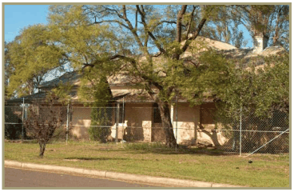
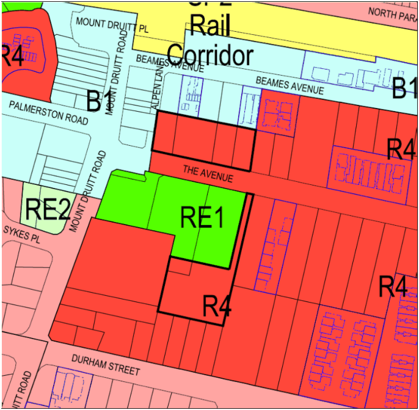
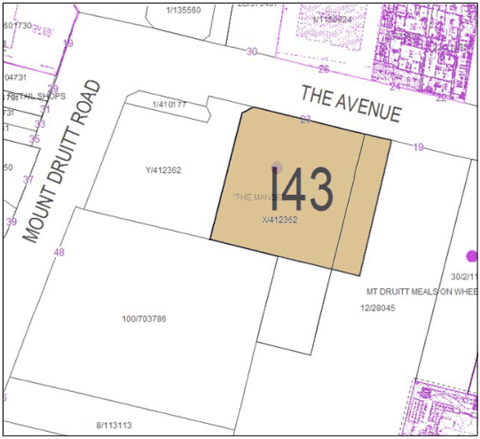

## 1 Development in the vicinity of “The Manse” – The

### Avenue, Mount Druitt

### 1.1 Introduction

“The Manse” was built circa 1880s following subdivision of the Druitt Estate and comprises a single storey brick residence in rectangular plan, with hipped roof and skillion verandah on two sides. The property was owned and occupied by the Kennedy family until circa 1895 when they donated it to the Presbyterian Church (Refer to Figure 1.1). “The Manse” is the oldest surviving building in Mount Druitt and is listed on the NSW State Heritage Register, Register of the National Trust and Schedule 5 of Blacktown Local Environmental Plan (LEP) 2015. This section has been prepared following Council’s purchase of the “The Manse”, associated rezoning of the buffer area immediately surrounding the building to RE1 Public Recreation and rezoning of land in the vicinity of the heritage item to permit medium/high density residential development. This section generally seeks to ensure that future development does not compromise the heritage significance of “The Manse”.

> [Picture on page 3: a picture, saved as a picture (images/part-k-supplementary-provisions-for-specific-sites-in-est-page-3-16.gif, 150 dpi).]

#### Figure 1.1 “The Manse” – The Avenue, Mount Druitt

This section aims to facilitate high quality residential development on the subject land that is consistent with the objectives of the R4 High Density Residential Zone and which recognises its location adjacent to the heritage item known as “The Manse”. The specific objectives of this section are to:

(a) Ensure that new development does not compromise the heritage significance of “The Manse”

(b) Provide development controls relating to height, form, scale, setback limits and visual setting for development adjacent to the buffer area surrounding “The Manse”, and also on the northern side of The Avenue, so as to facilitate a high quality of architectural design and ensure that development relates to site conditions and respects the heritage values of “The Manse”.

### 1.2 Relationship to other environmental planning instruments

This section supplements, and therefore should be read in conjunction with, the controls set out in Part A (Introduction and General Guidelines) and Part C (Development in the Residential Zones) of this DCP.

Where there is an inconsistency between the provisions of Part A, Part C and Part K of the DCP, the provisions of Part K will prevail.

### 1.3 Relationship to the Development Application process

Council will consider the provisions and requirements of this section in the assessment of development proposals for the subject land. Council may refuse consent to a development that does not comply with this section, or may modify the proposal by way of conditions so that it does comply. Council may also approve a development that does not strictly comply with the provisions of the section, provided the overall design principles are satisfied. Where a proposed development does not comply with the provisions of this section, the reasons for the non-compliance should be clearly set out in the documentation supporting the Development Application (DA).

### 1.4 Land to which this section applies

This section applies to land shown edged heavy black on the Location Plan (Figure 1.2 below). The land is currently zoned R4 High Density Residential under Blacktown LEP 2015.

> [Picture on page 4: a picture, saved as a picture (images/part-k-supplementary-provisions-for-specific-sites-in-est-page-4-16.gif, 150 dpi).]

#### Figure 1.2 Location plan

### 1.5 Design principles

Development should respect the existing character and heritage significance of “The Manse” and ensure that it remains the focal point of the immediate vicinity. Accordingly, any development should:

(a) Provide a buffer, both physical and through landscaped screening, between the historic building and any new development

(b) Promote and enhance view corridors to “The Manse” from surrounding public areas and any new development

(c) Provide for a sympathetic and gradual transition of building heights from “The Manse” to higher density development on adjoining land

(d) Be sympathetic to the existing heritage item in terms of bulk, scale, siting, detail and architectural form.

### 1.6 Design guidelines

The following design parameters are considered essential for the satisfactory development of land in the vicinity of “The Manse”: ■ Setback and siting

(a) No development, other than roadways and landscaping, shall occur within a buffer area of a minimum 5m wide from the boundary of the heritage curtilage of “The Manse”. The heritage curtilage is shown in Figure 1.3 below.

(b) Street setbacks to any proposed new development should not encroach on the building setback line to “The Manse”. This will assist in preserving the existing streetscape.

> [Picture on page 5: a picture, saved as a picture (images/part-k-supplementary-provisions-for-specific-sites-in-est-page-5-24.gif, 150 dpi).]

#### Figure 1.3 Heritage curtilage of “The Manse”

■ Building design The design of buildings shall, where possible, reflect the roof pitch, bulk, proportions, detailing and external materials of the heritage item. The external design of any new development should not mimic the design of “The Manse”, but be complementary to it.

■ Building materials Building materials shall be compatible with “The Manse”, particularly in terms of colour and texture.  Colour schemes should be employed to relate harmoniously with “The Manse”.

■ Lighting External lighting design shall have regard to the impact on surrounding land uses with a view to minimising light spillage and glare, particularly in regard to the adjoining heritage item.

■ Views and vistas Views to and from “The Manse” shall be retained as far as possible and enhanced with appropriate vegetation in accordance with a Landscaping Plan for the site.

■ Landscaping

(a) A Landscaping Plan shall be submitted as part of any DA for the subject land

(b) Landscaping shall be based on suitable native species of trees and shrubs, consistent with those found in the curtilage of “The Manse”. Introduced species of plants may be considered to complement the overall design

(c) Any proposed visual screening thorough planting, mounding or fencing between the heritage item and proposed new development will need to be incorporated in the Landscaping Plan accompanying any DA

(d) Modern fencing comprising Colorbond is inappropriate.
