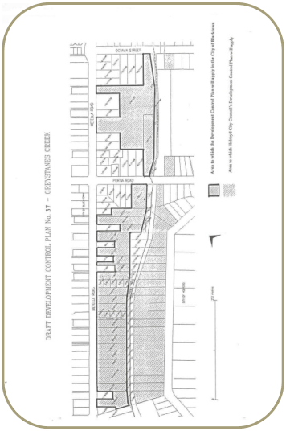
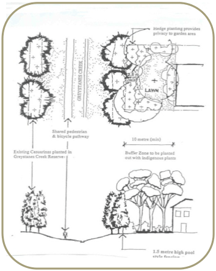
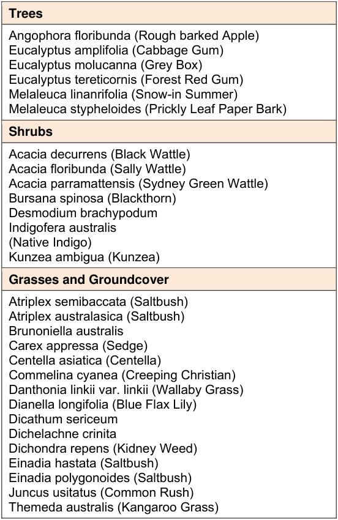

## 2 Greystanes Creek

### 2.1 Introduction

■ Land to which this section applies This section applies to new development (residential or otherwise) on land situated in the City of Blacktown outlined in heavy black as shown on the map in Figure 2.1. The term "new development" refers to all development for which Council consent is required.

■ Purpose of this section The purpose of this section is to provide guidelines that will ensure that development on land adjacent to Greystanes Creek Reserve is compatible with the Greystanes Creek Reserve Plan of Management by:

(a) Facilitating the potential for a wildlife corridor to develop along Greystanes Creek by re-establishing the native bushland vegetation of the creek environment on land adjacent to the Reserve

(b) Enhancing the visual appeal, landscape characteristics and scenic quality of the Reserve

(c) Providing a visual buffer between the Reserve and development on land adjacent to the Reserve

(d) Limiting erosion and stormwater runoff on land adjacent to the Reserve.

> [Picture on page 7: a picture, saved as a picture (images/part-k-supplementary-provisions-for-specific-sites-in-est-page-7-20.gif, 150 dpi).]

#### Figure 2.1 Land subject to the Greystanes Creek provisions

■ Relationship to other parts of Blacktown Development Control Plan 2015 This section applies only to properties adjacent to Greystanes Creek as shown on the plan map, and supplements the controls on residential development set out elsewhere in Blacktown DCP 2015 Part C (Development in the Residential Zones) to the extent that, if there is an inconsistency between this section and Part C, the requirements of this section prevail. Other plans which apply to this site are Blacktown Local Environmental Plan (LEP) 2015 and Section 94 Contributions Plan No. 3 - Open Space in Established Residential Areas.

### 2.2 Background

■ History Greystanes Creek is a major tributary of Toongabbie Creek, which in turn is a major tributary of the Parramatta River. The creek has its source at Prospect Hill and flows in a northward direction to its confluence with Toongabbie Creek. The creek forms part of the boundary between the City of Blacktown and the City of Holroyd. In early 1993, a portion of Greystanes Creek between Memphis Crescent and Octavia Road, Toongabbie was re-aligned as part of flood mitigation works and a program of revegetation to re-establish the native vegetation was commenced. A Plan of Management (PoM) for Greystanes Creek Reserve has been prepared in consultation with Holroyd City Council, Blacktown City Council and the Upper Parramatta River Catchment Trust. This PoM outlines future management strategies and works which will enhance the Greystanes Creek Reserve's value for recreation, wildlife habitat, nature conservation, water quality improvement, drainage and flood mitigation. Private property adjacent to the Greystanes Creek Reserve can play a vital role in augmenting these works, and this section of Blacktown DCP 2015 aims to ensure that new development within the City of Blacktown is compatible with the aims of the Greystanes Creek Reserve PoM. A similar policy has been prepared for land within the City of Holroyd.

■ Relationship of this section to the Development Application process The provisions and requirements of this section will be considered by Council in assessing development proposals for land adjacent to Greystanes Creek. Council may refuse consent to a development which does not comply with this section, or may modify the development proposal by way of conditions so that it does comply with this section. Council will also use this section in assessing how development satisfies the relevant objectives of Blacktown LEP 2015. This section is a general guide for the development of the area. Council will consider variations to this section provided the overall objectives of each criterion are satisfied.  Where a proposed development is unable to comply with the provisions of this section, it is essential that the applicant sets out the reasons for non-compliance in the documentation supporting the DA.

### 2.3 Development objectives and controls

■ Setbacks

#### Objectives

(a) To provide a visual buffer between the Reserve and development on adjacent land

(b) To extend the potential for a wildlife corridor onto land adjacent to Greystanes Creek Reserve.

#### Controls

Buildings and structures shall be setback 10m from the boundary adjacent to the Greystanes Creek Reserve.  Buildings and hard surfaces shall not be permitted within this 10m zone. This zone will constitute part of the overall landscaped area of the development. The 10m setback standard has been derived based on the size of a typical established tree's canopy in this locality. Consideration will be given to setbacks of less than 10m on those blocks that have a side boundary with the reserve. For medium density and dual occupancy developments affected by this section, the 10m setback requirement can be met in part by the siting of common open space at the rear of the development (abutting Greystanes Reserve), to the satisfaction of Council. For all other development requiring development consent, where it is demonstrated that the setback provisions cannot be met in full, alternative flexible solutions may be negotiated at the discretion of and to the satisfaction of Council. In considering such flexible approaches, the objectives of the setback requirement must not be compromised. The onus will be placed on the developer to present a solution that achieves the intent of this section of the DCP.

■ Fences

#### Objectives

(a) To minimise any physical barrier to the extension of the wildlife corridor from Greystanes Creek Reserve onto adjacent land

(b) To minimise the visual barrier between the Reserve and development on adjacent land.

#### Controls

Fencing of property along boundaries with the Greystanes Creek Reserve shall have a maximum height of 1.8m and be of an open pool type construction with a natural dull metallic or dark matt finish. This will extend the potential for a wildlife corridor by removing the physical barrier between plantings on the Reserve and adjacent land.  The open fencing and the colour of the finish will also enhance the scenic quality of the Reserve and increase safety by providing improved visibility. Details of proposed fencing treatments are to be provided with the DA.

■ Landscaping and site design

#### Objectives

(a) To extend the potential for a wildlife corridor by re-establishing the native bushland environment on land adjacent to the Greystanes Creek Reserve

(b) To enhance the visual appeal, landscape characteristic and scenic quality of the Reserve

(c) To provide for shade, acoustic and visual privacy on land adjacent to the Reserve.

#### Controls – retention of native vegetation

There shall be no removal of local indigenous trees or understorey vegetation, other than noxious weeds, within the proposed 10m buffer. All plans for development must ensure that local indigenous plant species are retained and protected. Vegetation to be retained is to be protected from damage during construction works, such as the compaction of soil and damage to root systems. Clause 5.9 (Preservation of trees or vegetation) of Blacktown LEP 2015 should be referred to before any removal or lopping of any tree takes place.

#### Controls – landscape works

Within the 10m buffer zone landscape works shall be undertaken in accordance with Figure 2.2 so as to re-establish local bushland vegetation.

> [Picture on page 11: a picture, saved as a picture (images/part-k-supplementary-provisions-for-specific-sites-in-est-page-11-1.gif, 150 dpi).]

#### Figure 2.2 Landscape treatment for new development adjacent to Greystanes

#### Creek Reserve

The landscape works shall consist of a garden bed located adjacent to the boundary fence. The garden bed is to have a minimum width of 2.5m, be planted only with those indigenous plant species listed in the Species List at Table 2.2 and shall include predominantly low maintenance shrubs and groundcover to provide privacy to garden areas whilst maintaining surveillance capability. The remainder of the 10m buffer area is also to be landscaped using the species listed. The planting is to be of sufficient density to replicate a natural bushland ecosystem. The following densities of planting are given as a guideline:

| Tree | 1 per 4 - 5sq.m |
|---|---|
| Shrubs | 2 per 1sq.m |
| Groundcover | 4 - 8 per 1sq.m |

#### Table 2.1 Planting densities

Council shall require that all vegetation planted in the landscaped area be grown from locally collected seed. A suitably experienced plant nursery shall undertake propagation of the seed.

> [Picture on page 12: a map, saved as a picture (images/part-k-supplementary-provisions-for-specific-sites-in-est-page-12-1.gif, 150 dpi); the street names and other small labels are on the picture.]
> Labels printed on the map (copied from the PDF, in no particular order):
> Trees · Angophora floribunda (Rough barked Apple) · Eucalyptus amplifolia (Cabbage Gum) · Eucalyptus molucanna (Grey Box) · Eucalyptus tereticornis (Forest Red Gum) · Melaleuca linanrifolia (Snow-in Summer) · Melaleuca stypheloides (Prickly Leaf Paper Bark) · Shrubs · Acacia decurrens (Black Wattle) · Acacia floribunda (Sally Wattle) · Acacia parramattensis (Sydney Green Wattle) · Bursana spinosa (Blackthorn) · Desmodium brachypodum · Indigofera australis · (Native Indigo) · Kunzea ambigua (Kunzea) · Grasses and Groundcover · Atriplex semibaccata (Saltbush) · Atriplex australasica (Saltbush) · Brunoniella australis · Carex appressa (Sedge) · Centella asiatica (Centella) · Commelina cyanea (Creeping Christian) · Danthonia linkii var. linkii (Wallaby Grass) · Dianella longifolia (Blue Flax Lily) · Dicathum sericeum · Dichelachne crinita · Dichondra repens (Kidney Weed) · Einadia hastata (Saltbush) · Einadia polygonoides (Saltbush) · Juncus usitatus (Common Rush) · Themeda australis (Kangaroo Grass)

#### Table 2.2 Species list for Greystanes Creek Reserve

Developers will be required to submit plans and details of proposed landscaping prepared by a suitably qualified person prior to the release of building plans.
