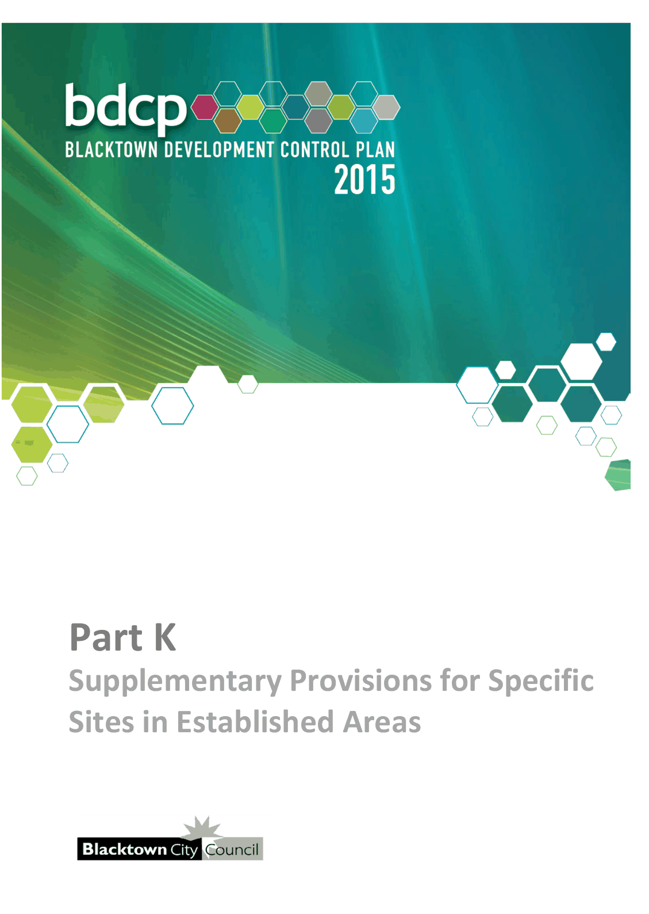

# Blacktown Development Control Plan 2015 - Part K Supplementary Provisions for Specific Sites in Established Areas

> This chapter is split into 2 section file(s), one per numbered heading, in the order they appear in the PDF.

Source PDF: [Part-K-Supplementary-Provisions-for-Specific-Sites-in-Established-Areas.pdf](Part-K-Supplementary-Provisions-for-Specific-Sites-in-Established-Areas.pdf)

> [Picture on page 1: a picture, saved as a picture (images/part-k-supplementary-provisions-for-specific-sites-in-est-page-1-1.gif, 150 dpi).]

### Part K

### Supplementary Provisions for Specific Sites in Established Areas

### Table of Contents

| 1 Development in the vicinity of “The Manse” – The Avenue, Mount Druitt ............ 3 |  |
|---|---|
| 1.1 | Introduction ....................................................................................................... 3 |
| 1.2 | Relationship to other environmental planning instruments ......................... 3 |
| 1.3 | Relationship to the Development Application process ................................. 4 |
| 1.4 | Land to which this section applies .................................................................. 4 |
| 1.5 | Design principles .............................................................................................. 5 |
| 1.6 | Design guidelines .............................................................................................. 5 |
| 2 Greystanes Creek ....................................................................................................... 7 |  |
| 2.1 | Introduction ....................................................................................................... 7 |
| 2.2 | Background ....................................................................................................... 8 |
| 2.3 | Development objectives and controls ............................................................. 9 |
| Figures |  |
| Figure 1.1 | “The Manse” – The Avenue, Mount Druitt ................................................... 3 |
| Figure 1.2 | Location plan ................................................................................................. 4 |
| Figure 1.3 | Heritage curtilage of “The Manse” ............................................................... 5 |
| Figure 2.1 | Land subject to the Greystanes Creek provisions ..................................... 7 |
| Figure 2.2 | Landscape treatment for new development adjacent to Greystanes |
| Tables | Creek Reserve .............................................................................................. 11 |
| Table 2.1 | Planting densities ........................................................................................ 11 |
| Table 2.2 | Species list for Greystanes Creek Reserve ............................................... 12 |

<!-- sections -->
## Sections

1. [1 Development in the vicinity of “The Manse” – The](01-1-development-in-the-vicinity-of-the-manse.md)
2. [2 Greystanes Creek](02-2-greystanes-creek.md)
