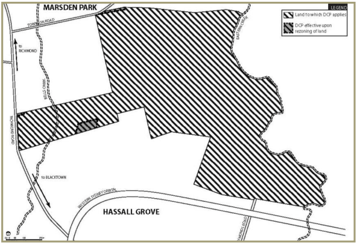

### 1.2 Land to which this Part applies

This Part applies to all land within Stonecutters Ridge (the site) as shown at Figure 1.1.

> [Picture on page 5: a picture, saved as a picture (images/part-l-stonecutters-ridge-page-5-14.gif, 150 dpi).]

#### Figure 1.1 Land to which this Part applies
