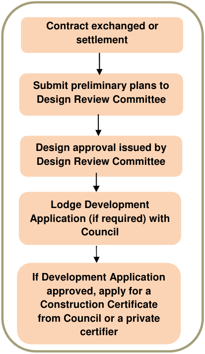

### 1.5 Developer design guidelines

In addition to the provisions and requirements of this Part, the developer intends to implement further building and landscape design guidelines via conditions attached to sales contracts, land release brochures for purchasers, and through the placing of covenants on titles. A set of Developer Design Guidelines (DDGs) has been established by Medallist Developments Pty Ltd (the developer) to ensure a high quality built product for all developments. The DDGs deal with individual residential lot development and buildings, and will be prepared prior to the sale of individual lots. The DDGs will be enforced via a covenant with the allotment owner/developer.

To assist residents and their designers, a Design Review Committee will be operated by the developer. All forms of development must be approved by the Design Review Committee, irrespective of whether a DA is required or not. The Committee will review development proposals for compliance with the DDGs prior to their formal submission to Council. The design approval process is illustrated at Figure 1.2.

> [Picture on page 7: a map, saved as a picture (images/part-l-stonecutters-ridge-page-7-6.gif, 150 dpi); the street names and other small labels are on the picture.]
> Labels printed on the map (copied from the PDF, in no particular order):
> Contract exchanged or · settlement · Submit preliminary plans to · Design Review Committee · Design approval issued by · Design Review Committee · Lodge Development · Application (if required) with · Council · If Development Application · approved, apply for a · Construction Certificate · from Council or a private · certifier

#### Figure 1.2 The design approval process
