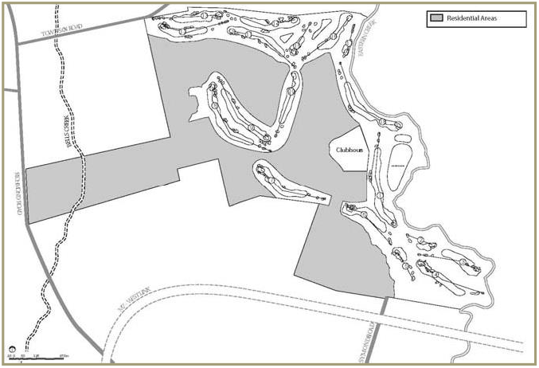

### 1.6 Development vision

The vision for Stonecutters Ridge is the growth of a strong and vibrant integrated residential golf course community. At its completion, the land to which this Part applies will be developed for:

(a) An 18-hole championship golf course with associated clubhouse facilities and tourist accommodation

(b) A new high quality public domain comprising public open space augmented by additional community open space, and new public roads, pedestrian paths and cycleway

(c) Approximately 1,000 residential lots accommodating a range of housing types

(d) New community and recreational facilities and small scale non-residential land uses to meet the needs of the future residential and tourist population.

The extent and location of future residential development areas within the site have been largely determined by the design and layout of the 18-hole championship golf course and the amount and location of land required to accommodate the associated clubhouse facilities and tourist accommodation (i.e. the “Clubhouse Precinct”). The layout of the golf course also influences road layout and design, connectivity and solar orientation. The relationship between the land that is to be occupied by the golf course, the Clubhouse Precinct and the residual residential developable areas is shown at Figure 1.3. A plan of the approved golf course layout is included at Appendix 2. The golf course plan is provided for information purposes only to assist in the detailed design and assessment of future residential subdivisions and built form.

> [Picture on page 8: a picture, saved as a picture (images/part-l-stonecutters-ridge-page-8-11.gif, 150 dpi).]

#### Figure 1.3 The golf course layout
