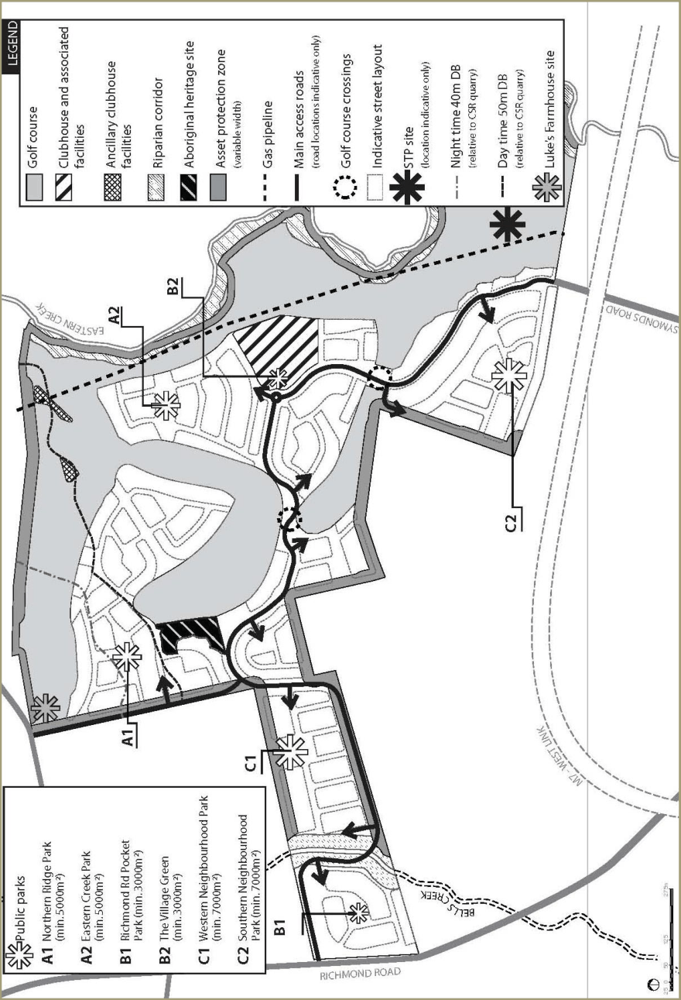
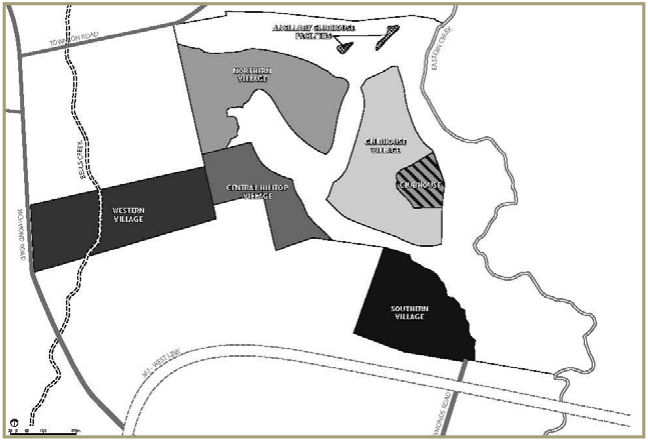
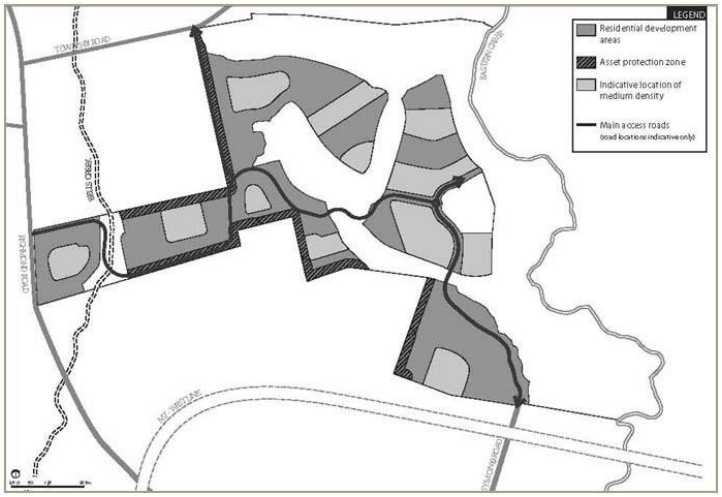
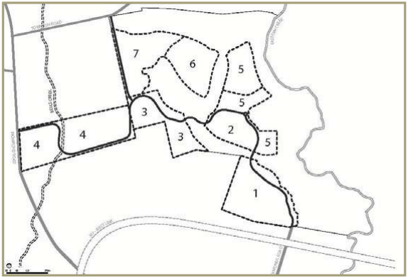
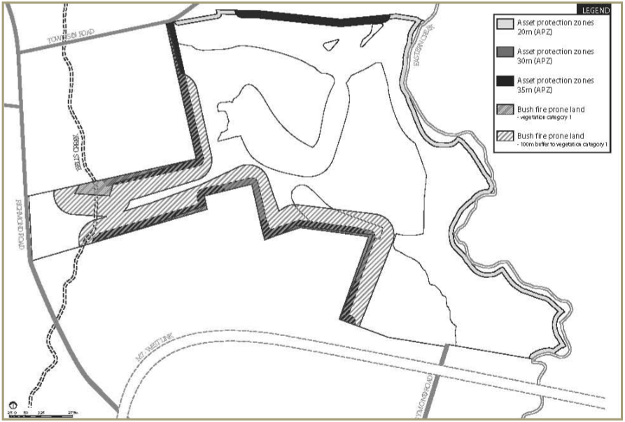
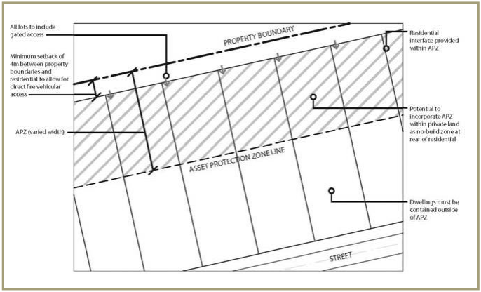
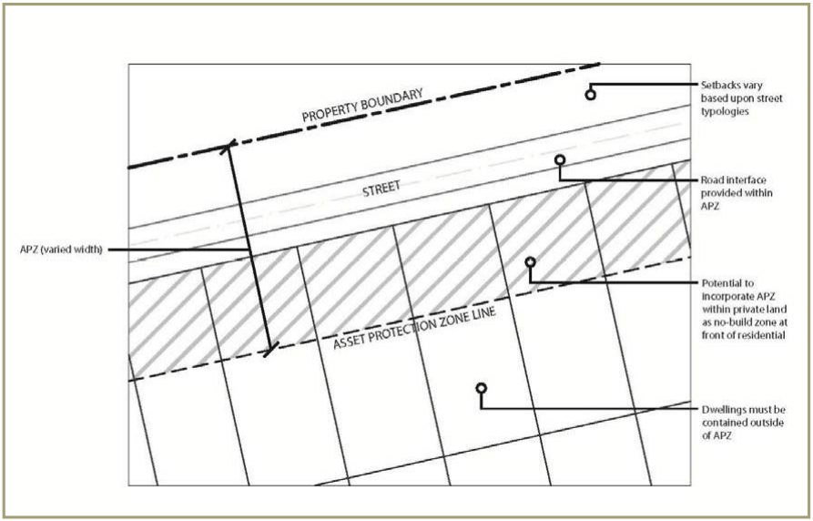

## 2 Subdivision

### 2.1 Urban design

This section of Part L contains the objectives and development controls relating to the overall site structure, including residential villages, subdivision layout principles, lot orientation and configuration, staging and the requirements for the establishment and management of bush fire asset protection zones.

#### 2.1.1 Urban structure

■ Objective To conceptually illustrate the intended development pattern for the land.

■ Controls

(a) Development is to be undertaken generally in accordance with the Urban Structure Plan at Figure 2.1

(b) DAs for subdivision are to demonstrate how the development principles shown on the Urban Structure Plan have been responded to

(c) The detailed subdivision design is to implement the Urban Structure Plan, having regard to the achievement of the other objectives and development controls set out in this Part of the DCP.

> [Picture on page 11: a picture, saved as a picture (images/part-l-stonecutters-ridge-page-11-1.gif, 150 dpi).]

#### Figure 2.1 Urban structure plan

#### 2.1.2 Residential villages

■ Objectives

(a) To help create a sense of community by identifying distinct residential villages within the overall development site, each with a strong focal point and individual sense of character/place

(b) To encourage a diversity  of housing types and sizes within each residential village and to ensure that attached dwellings and multi dwelling housing are located in areas with a high level of amenity.

■ Controls

(a) The minimum allotment size of all built forms is to be in accordance with Clause 4.1 (Minimum subdivision lot size) of Blacktown LEP 2015. This clause should be read in conjunction with the LEP Lot Size Map.

(b) Development of the residential areas of the site is to create 5 residential villages generally as shown at Figure 2.2

(c) Within the 5 residential villages, attached dwellings and multi dwelling housing is to be generally located around public parks, adjoining the golf course and/or in close proximity to the Clubhouse Precinct as shown at Figure 2.3

(d) The detailed subdivision design, including the number, size and orientation of residential lots, is to encourage the creation of the desired future character for each village as set out at Table 2.1

(e) The approximate number of residential allotments to be created within the overall site is 1,000.

| Village Desired future character |  |
|---|---|
| Western Village | The Western Village is located between Richmond Road and the site’s central ridgeline. Focal points of this village will be the Bells Creek Riparian Corridor, the 3,000sq.m Richmond Road Pocket Park (Park B1) and the 7,000sq.m Western Neighbourhood Park (Park C1). Residential development will comprise predominantly detached housing with attached dwellings and multi dwelling housing generally located around the two public parks. |
| Northern Village | The Northern Village is located in the northern portion of the site. Focal points of this village will be the 5,000sq.m Northern Ridge Park (Park A1), the Aboriginal heritage site and the golf course, which wraps around the residential development area in this location. Residential development will comprise a mix of dwelling types with areas of attached dwellings and multi dwelling housing generally located around the public park and where good amenity is afforded by the golf course. |

| Village Desired future character |  |
|---|---|
| Clubhouse Village | The Clubhouse Village is located in the eastern portion of the site adjoining the Clubhouse Precinct. Focal points of this village are the golf course clubhouse and associated community and recreational facilities (including a 3,000sq.m Village Green), the 5,000sq.m Eastern Creek Park (Park A2) and the extensive golf course frontage that encircles this village. Development comprises predominantly attached dwellings and multi dwelling housing to take advantage of the adjacent amenities. |
| Southern Village | The Southern Village is located in the southern portion of the site near the Symonds Road entry. The focal point of this village will be the 7,000sq.m Southern Neighbourhood Park (Park C2). Development will comprise predominantly detached housing with attached dwellings and multi dwelling housing located around the public park. |
| Central Hilltop | The Central Hilltop Village is located at the centre of the site. Focal points for this village will be small community pocket parks and the extensive views to the north and east out over the golf course. Development will comprise a mix of predominantly detached dwellings with areas of attached dwellings and multi dwelling housing located around open space areas and fronting the golf course. |
| Village |  |

#### Table 2.1 Desired future character of residential villages

> [Picture on page 13: a picture, saved as a picture (images/part-l-stonecutters-ridge-page-13-3.gif, 150 dpi).]

#### Figure 2.2 Residential villages plan

> [Picture on page 14: a picture, saved as a picture (images/part-l-stonecutters-ridge-page-14-1.gif, 150 dpi).]

#### Figure 2.3 Residential development areas

#### 2.1.3 Staging

■ Objective To ensure the orderly development of the land and assist in the coordinated programming and provision of necessary infrastructure and community services.

■ Controls

(a) the indicative staging of the residential development areas is shown at Figure 2.4

(b) core infrastructure, services and facilities are to be established at the early stages of development

(c) infrastructure and community facilities will be provided in accordance with the requirements of the relevant Development Agreement for the subject land.

> [Picture on page 15: a picture, saved as a picture (images/part-l-stonecutters-ridge-page-15-4.gif, 150 dpi).]

#### Figure 2.4 Indicative residential staging plan

Note: More than one stage may be under construction at any one point in time. The numbering on Figure 2.4 need not reflect the chronological order of development.

#### 2.1.4 Subdivision layout

■ Objectives

(a) To recognise the unique constraints and opportunities that the golf course design and layout establishes for the subsequent residential subdivisions

(b) To capitalise on the high level of residential amenity afforded by the golf course

(c) To establish a subdivision layout that utilises the residential development areas efficiently, maximises the natural attributes of the site and clearly defines and reinforces the public domain.

■ Controls The subdivision layout is to:

(a) Respond to the natural site topography, the location of existing significant trees, solar design and view maximisation principles, and interface with the golf course

(b) Create a legible and permeable street hierarchy

(c) Provide pedestrian connectivity within each residential village as well as between the residential areas and public open space areas, public transport nodes and community/recreation facilities as appropriate within the context of the golf course layout

(d) Use landscaping to strengthen the street hierarchy and other elements of the public domain

(e) Create a variety and mix of allotment sizes and dwelling types within each residential village

(f) Maximise opportunities for dwellings to front onto public parks, community open spaces and the golf course

(g) Ensure that public and community parks and key pedestrian links are conveniently located and highly visible

(h) Ensure that the location of roads and other infrastructure minimises land modification (i.e. cut and fill).

#### 2.1.5 Lot orientation and configuration

■ Objectives

(a) To recognise the influences of the golf course layout and associated road hierarchy on subsequent allotment configuration and design, particularly in relation to lot orientation

(b) To ensure that all residential lots are afforded a high level of amenity in terms of solar access, views/outlook and/or proximity to public and community open spaces, dependent upon their location in relation to the golf course layout.

■ Controls

(a) The preferred lot orientation is either on a north-south or east-west orientation. Residential lots with other orientations will generally be provided with other amenities such as views/outlook to public open space, community parks and/or the golf course

(b) Residential lots should be orthogonal in geometry. The use of battle-axe lots is to be minimised

(c) Preferred dimensions and lot configurations for different dwelling types are to be in accordance with the controls set out in Part C (Development in the Residential Zones) of the DCP

(d) Corner lots are to be designed to allow dwellings to positively address both street frontages (refer to Part C of the DCP) and to have 5m x 5m splay corners at intersections.

#### 2.1.6 Bush fire asset protection zones

■ Objectives

(a) To ensure the protection of life and property from the threat of fire

(b) To manage the ongoing fire risk on the site.

■ Controls DAs for subdivision within 100m of Bush Fire Prone Land (see Figure 2.5) are to demonstrate compliance with the bush fire provisions for development contained within the Rural Fire Service’s guide on Planning for Bush Fire Protection 2006.

■ Asset Protection Zones (APZs)

(a) The location and widths of APZs are to be provided in accordance with Figures 2.5, 2.6 and 2.7.

(b) APZs:

(i) Are to be located wholly within the development site

(ii) May incorporate flood prone land and parts of the land occupied by the golf course

(iii) May be used for open space and recreation subject to appropriate fuel management

(iv) May incorporate private residential land, but only within the building setback. No dwellings are to be located within the APZ.

(c) APZs are not required:

(i) In areas adjoining remnant woodlands where habitable buildings are not proposed (e.g. golf course or open space parkland within flood prone land), or

(ii) For habitable development adjoining the Aboriginal heritage site, which is to be carefully managed as part of the Environmental Management Plan for the golf course.

(d) The maintenance of APZs is the responsibility of individual allotment owners, except where maintained over the golf course or open space areas.

■ Access design criteria

(a) The relevant access design criteria at Section 4.1.3 of Planning for Bush Fire Protection is to be incorporated into the development and applied to public roads (including the perimeter road and the internal road system) and property access roads (i.e. roads located on private property)

(b) All APZs are to be bounded by a perimeter fire trail/road that is linked to the public road system at regular intervals in accordance with Planning for Bush Fire Protection (see Figures 2.6 and 2.7)

(c) Perimeter roads/trails are to be located wholly within the boundaries of the development site.

■ Water supply

(a) Reticulated water is to meet the standards contained within Section

4.1.3 of Planning for Bush Fire Protection

(b) External fire hydrants are to be located in accordance with Australian Standard 2419.1-1994.

■ Fuel management within APZs

(a) APZs are to be maintained in accordance with Planning for Bush Fire Protection

(b) Care should be taken with the landscaping of areas within the perimeter of the site to avoid the need for additional APZ setbacks.

> [Picture on page 18: a picture, saved as a picture (images/part-l-stonecutters-ridge-page-18-3.gif, 150 dpi).]

#### Figure 2.5 Asset protection zones

> [Picture on page 18: a picture, saved as a picture (images/part-l-stonecutters-ridge-page-18-5.gif, 150 dpi).]

#### Figure 2.6 Residential / APZ interface (option 1)

> [Picture on page 19: a picture, saved as a picture (images/part-l-stonecutters-ridge-page-19-1.gif, 150 dpi).]

#### Figure 2.7 Residential / APZ interface (option 2)
