### 2.2 Access and movement

This section of Part L outlines the objectives and development controls for the establishment of the street, pedestrian and cycle networks and public transport nodes within the site.

#### 2.2.1 Street network

■ Objectives

(a) To provide an interconnected network of streets that gives safe, convenient and legible access within and beyond the site

(b) To ensure that the hierarchy of the streets is clearly discernible through variations in carriageway width, on-street parking, incorporation of water sensitive urban design measures, street tree planting and pedestrian amenities

(c) To ensure that the layout of streets allows for development to front streets, parks and the golf course, and encourages surveillance around local parks and other public spaces by adjoining dwellings.

■ Controls

(a) The internal public street network is to comprise residential collector streets, local streets and access streets provided generally in accordance with the street hierarchy illustrated at Figure 2.8

(b) All streets are to be designed in accordance with the minimum requirements set out in Council’s Engineering Guide for Development. Council’s current design standards for residential collector streets, local streets and access streets are illustrated in the following sections

(c) Alternative designs that preserve the functional objectives and requirements of Council’s current design standards may be considered for implementation by Council where appropriate. Typical sections and plans of possible alternative designs are illustrated in the following sections. Alternative designs will only be considered by Council on a case by case basis

(d) Street reservations should have the potential to accommodate landscaping and water sensitive urban design measures where appropriate

(e) All road traffic noise levels should be designed in accordance with the Environmental Noise Management Manual and the NSW Road Noise Policy 2011

(f) All services within street reservations are to be designed and located in an integrated manner to avoid conflict with landscape and street tree planting

(g) Any DA proposing the positioning of trees within the road carriageway is to be accompanied by:

(i) Details relating to services provision (e.g. the location and design of street lighting, the impact on the manoeuvrability of garbage trucks) and location of future driveway accesses

(ii) A Road Safety Audit prepared in accordance with the RMS Guidelines

(h) Design measures, such as physical barriers, landscaping and signage, are required where threshold treatment is proposed to a public road, so as to prevent pedestrians mistaking them for pedestrian crossings. Any such proposed design measures are to meet the requirements of the RMS Technical Direction TDT 2001/04a. Any proposed threshold treatments need to be approved by Council via the Local Traffic Committee

(i) Access to small clusters of residential allotments may be provided via shared driveway or ‘mews’ arrangements. Where this is the case, the shared driveways/mews are to be owned and maintained by a community/resident association or the like. Where a shared driveway is proposed via a right of carriageway over private allotments (as opposed to the provision of a separate private allotment for the road), the subject shared driveway is to service no more than 3 allotments.

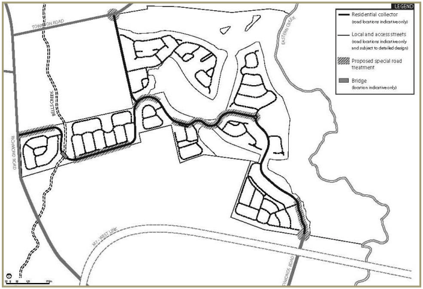

> [Picture on page 21: a picture, saved as a picture (images/part-l-stonecutters-ridge-page-21-1.gif, 150 dpi).]

#### Figure 2.8 Street hierarchy plan

#### 2.2.2 Residential collector

(a) The residential collector (main access road) will link the site

(b) The residential collector is to be designed in accordance with Council’s current design standards for collector streets as illustrated at Figure 2.9

(c) Alternative design solutions that preserve the functional objectives of Council’s current residential collector road standard may be considered by Council on a case by case basis. These locations include the main site entry points, around the ridge top zone and near the Clubhouse Precinct

(d) The alternative residential collector road designs that may be considered by Council include:

(i) A widening of the minimum road reserve from 18m to 19.3m or more to accommodate a wider landscaped zone (Figure 2.10)

(ii) A split carriageway to allow for a central landscaped median strip (Figures

2.11 and 2.12)

(e) Where a split carriageway is used, no direct access to lots may be provided (Figure 2.13). This is only applicable where the split carriageway is divided by a wide, landscaped median

(f) All split carriageways are to be designed to ensure that an emergency vehicle may pass safely if the split carriageway is blocked

(g) An indicative streetscape plan illustrating potential road and threshold treatments is shown at Figure 2.14

(h) Golf course crossing points are to be designed generally in accordance with Figures 2.15 and 2.16.

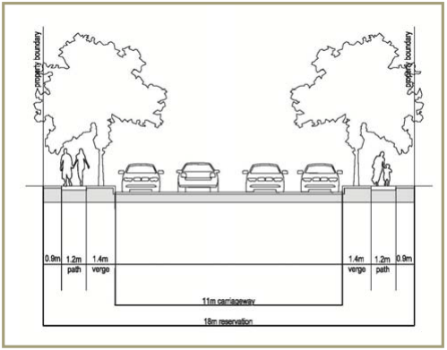

> [Picture on page 22: a picture, saved as a picture (images/part-l-stonecutters-ridge-page-22-1.gif, 150 dpi).]

Figure 2.9 Current Council design standard for residential collector street (typical

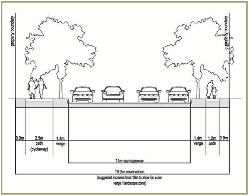

> [Picture on page 22: a picture, saved as a picture (images/part-l-stonecutters-ridge-page-22-3.gif, 150 dpi).]

section)

Figure 2.10 Residential collector street with wider road reserve (typical section)

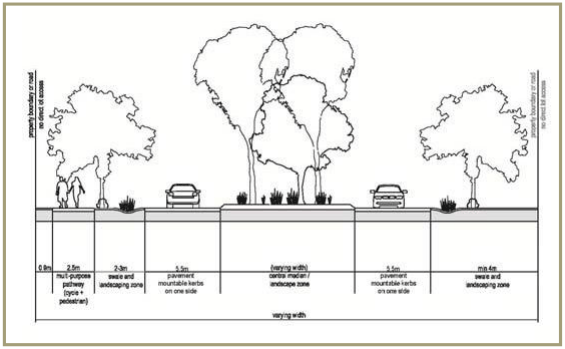

> [Picture on page 22: a picture, saved as a picture (images/part-l-stonecutters-ridge-page-22-6.gif, 150 dpi).]

Figure 2.11 Residential collector incorporating split carriageway (typical section)

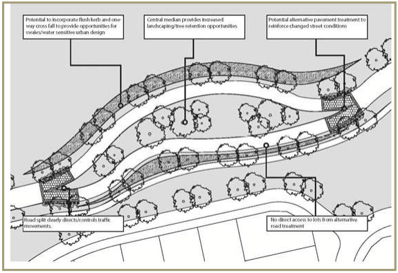

> [Picture on page 23: a picture, saved as a picture (images/part-l-stonecutters-ridge-page-23-1.gif, 150 dpi).]

Figure 2.12 Residential collector incorporating split carriageway (typical plan)

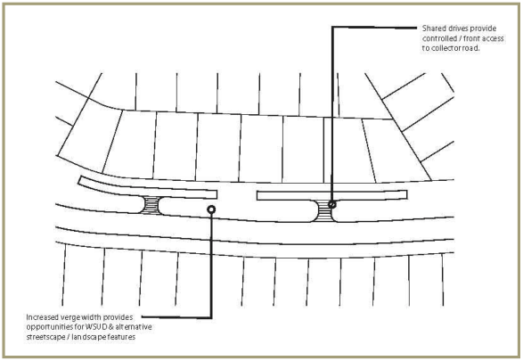

> [Picture on page 23: a picture, saved as a picture (images/part-l-stonecutters-ridge-page-23-3.gif, 150 dpi).]

Figure 2.13 Potential private shared driveway / community title road treatment along

collector roads

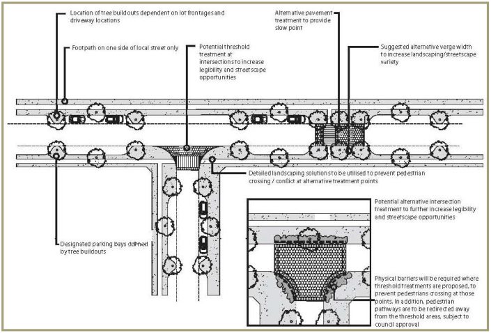

> [Picture on page 24: a picture, saved as a picture (images/part-l-stonecutters-ridge-page-24-1.gif, 150 dpi).]

#### Figure 2.14 Indicative streetscape plan

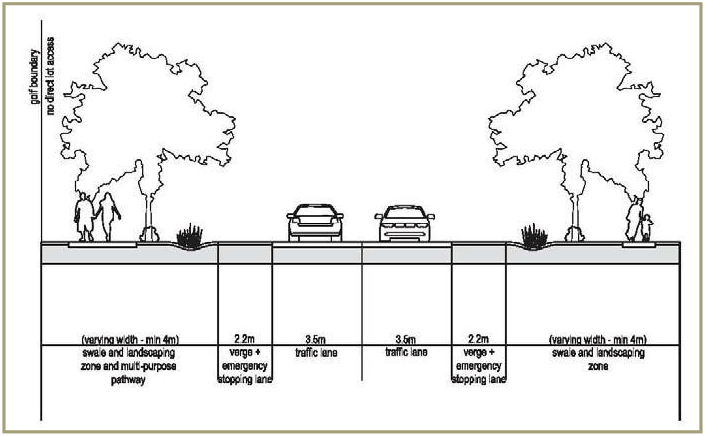

> [Picture on page 24: a picture, saved as a picture (images/part-l-stonecutters-ridge-page-24-3.gif, 150 dpi).]

#### Figure 2.15 Golf crossing of street (typical section)

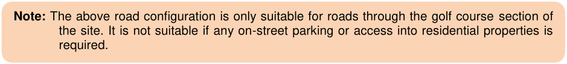

> [Picture on page 24: a picture, saved as a picture (images/part-l-stonecutters-ridge-page-24-5.gif, 150 dpi).]
> Words printed on the picture (copied from the PDF):
> Note: The above road configuration is only suitable for roads through the golf course section of
> the site. It is not suitable if any on-street parking or access into residential properties is
> required.

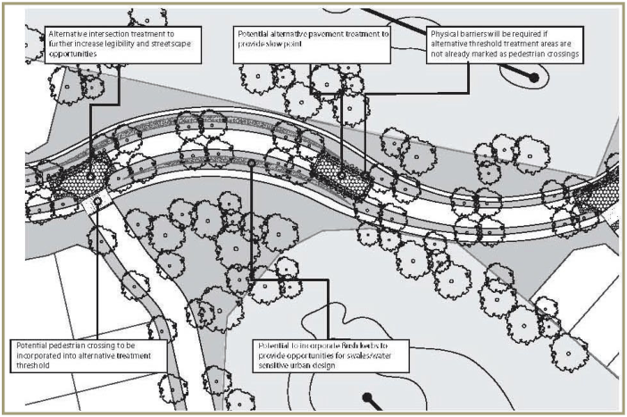

> [Picture on page 25: a picture, saved as a picture (images/part-l-stonecutters-ridge-page-25-1.gif, 150 dpi).]

#### Figure 2.16 Golf crossing of street (typical plan)

■ Local streets

(a) Local streets will provide circulation and access within the residential development areas

(b) Local streets are to be designed in accordance with Council’s current design standards for local streets as illustrated at Figure 2.17

(c) Alternative design solutions that preserve the functional objectives of Council’s current local street design standard may be considered to allow a widening of the minimum road reserve to accommodate designated parking bays with on-street trees (within the footpath) on both sides.

■ Access streets and culs-de-sac

(a) Access streets are to provide local residential access to a maximum of 8 dwellings and serve a shared vehicular-pedestrian-cyclist use

(b) The shorter road length and narrower road width associated with access streets is intended to encourage a safe, low vehicle speed environment in which the residential function is dominant

(c) Access streets are to be designed in accordance with Council’s current design standards for access streets as illustrated at Figure 2.18

(d) Alternative design solutions that preserve the functional objectives of Council’s current access street standard may be considered to incorporate water sensitive urban design elements as illustrated at Figure 2.19

(e) Culs-de-sac are to be designed in accordance with Council’s current design standards as illustrated at Figure 2.20

(f) The use of culs-de-sac is to be minimised. The maximum number of dwellings to be served by a cul-de-sac is 30.

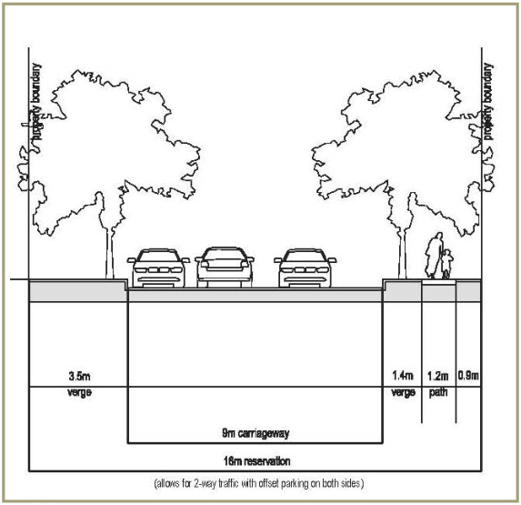

> [Picture on page 26: a picture, saved as a picture (images/part-l-stonecutters-ridge-page-26-3.gif, 150 dpi).]

#### Figure 2.17 Current Council design standard for local street (typical section)

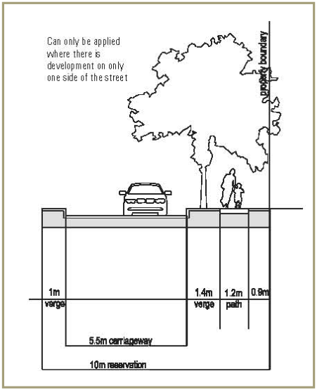

> [Picture on page 26: a picture, saved as a picture (images/part-l-stonecutters-ridge-page-26-5.gif, 150 dpi).]

#### Figure 2.18 Current Council design standard for access street (typical section)

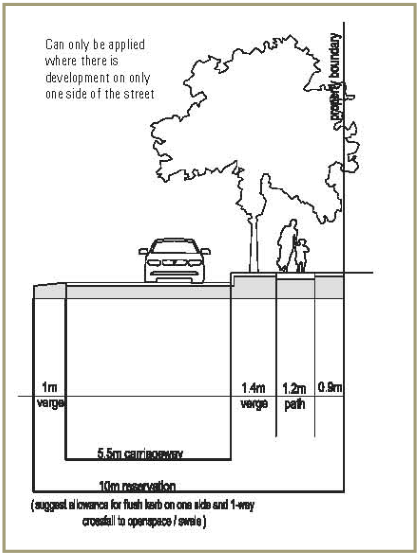

> [Picture on page 27: a picture, saved as a picture (images/part-l-stonecutters-ridge-page-27-1.gif, 150 dpi).]

Figure 2.19 Access street incorporating water sensitive urban design (typical section)

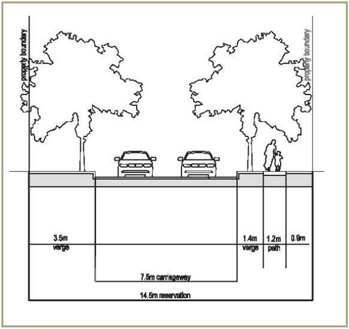

> [Picture on page 27: a picture, saved as a picture (images/part-l-stonecutters-ridge-page-27-3.gif, 150 dpi).]

#### Figure 2.20 Current Council design standard for cul-de-sac (typical section)

#### 2.2.3 Pedestrian and cycle network

■ Objectives

(a) To encourage walking and cycling by providing for the safe, efficient and convenient movement of pedestrians and cyclists within and beyond the site

(b) To recognise the opportunities and constraints for pedestrian and cycle movement within the site generated by the interrelationship of the public domain with the golf course layout.

■ Controls

(a) Multi-purpose pathways and pedestrian/cycle connectivity is to be provided generally in accordance with the Pedestrian Connectivity and Public Transport Network Plan at Figure 2.21 and in accordance with Council’s Path Paving Policy

(b) At least 3,700m of multi-purpose pathways are to be provided in total

(c) The multi-purpose pathway is to be a minimum of 2.5m wide and designed in accordance with the typical section at Figure 2.22

(d) Designated pedestrian only pathways within public domain areas are to be generally 1.5m wide, depending on location and anticipated level of usage. A narrower width (i.e. 1.2m) will only be considered in areas where it can be demonstrated that there will be relatively little pedestrian activity

(e) The multi-purpose pathways and designated pedestrian only pathways are to be generally constructed from concrete. However, alternate materials for pathways (such as resin stabilised crushed sandstone/granite (or similar), or concrete or hot mix/asphalted concrete) may be considered depending on location, expected traffic volumes and adjoining land uses. The use of alternate materials for pathways in public roads and reserves must be approved by Council prior to construction

(f) Themed elements such as boardwalks, eco-pathways, and educational tracks should be utilised in appropriate locations. Size and width will vary depending on location, usage, topography and surrounding environs

(g) Pedestrian and cycle routes and facilities in public spaces are to be safe, well lit, clearly defined, functional and accessible to all

(h) Pedestrian and cycle pathways and pedestrian refuge islands are to be designed to be fully accessible by all in terms of access points and gradients, generally in accordance with Australian Standard 1428:1-4 and Council’s Engineering Guide for Development

(i) Pathways are to be constructed as part of the infrastructure works for each residential stage with detailed designs to be submitted with DAs

(j) A multi-purpose pathway, including a bridge over Eastern Creek to the Nirimba Education Precinct, is to be provided within the site.

#### 2.2.4 Public transport

■ Objective To facilitate the use of public transport through the site by the provision of bus stops.

■ Controls

(a) 4 bus stops are to be provided generally in accordance with Figure 2.21. The final location of bus stops will be determined by Council’s Local Traffic Committee

(b) At least 80% of all residential lots are to be within 400m safe walking distance from an existing or proposed bus stop

(c) The bus route through the site is to be accommodated on roads that have a minimum carriageway width of 11m.

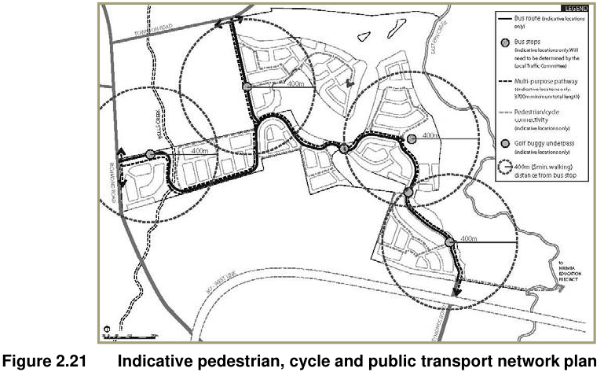

> [Picture on page 29: a picture, saved as a picture (images/part-l-stonecutters-ridge-page-29-13.gif, 150 dpi).]

#### Figure 2.21 Indicative pedestrian, cycle and public transport network plan

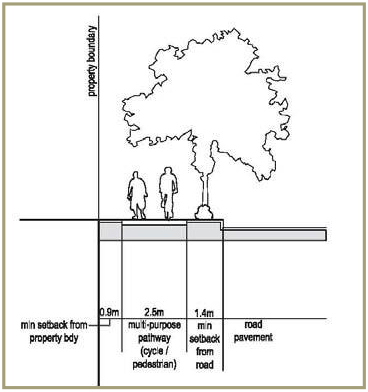

> [Picture on page 29: a picture, saved as a picture (images/part-l-stonecutters-ridge-page-29-15.gif, 150 dpi).]

#### Figure 2.22 Multi-purpose pathway (typical section)
