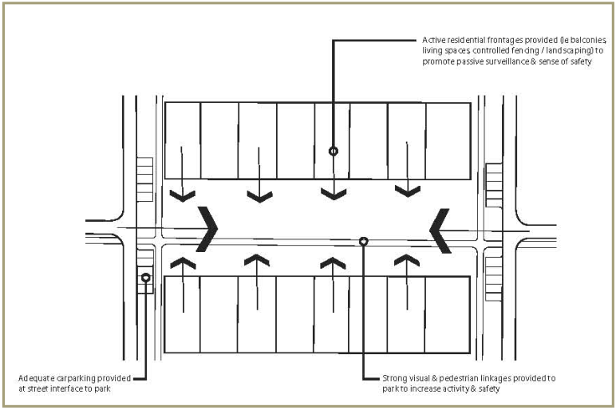
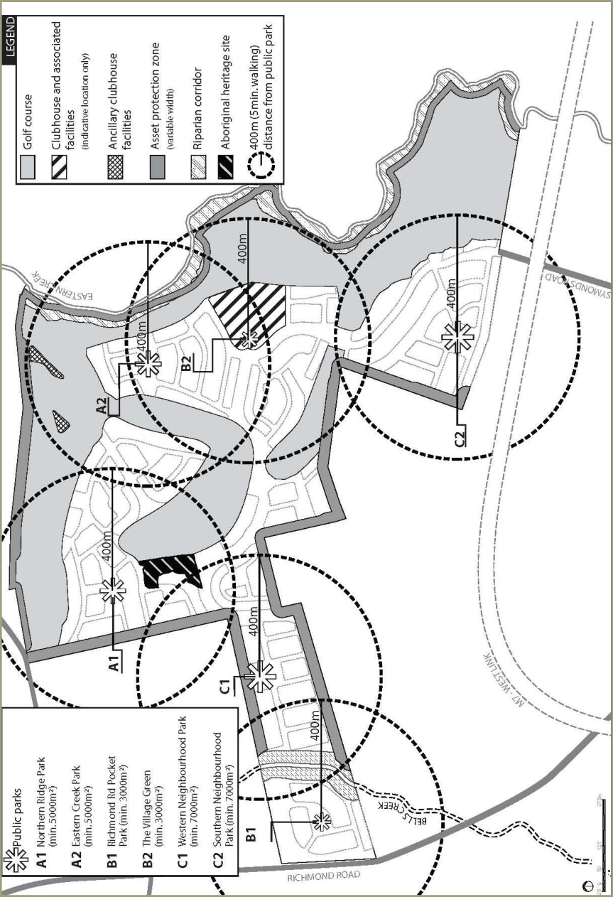
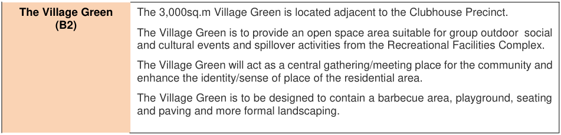
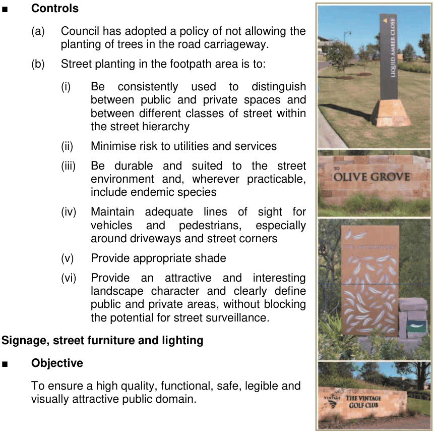

### 2.3 Open space and public domain

This section of Part L outlines the objectives and development controls for the provision of public open space, community parks, street tree planting, signage, street furniture, entry statements and public art.

#### 2.3.1 Public and community parks

■ Objectives

(a) To provide an equitable distribution of public open space and recreation opportunities

(b) To augment the provision of public parks with the establishment of additional community parks within the residential villages

(c) To ensure a high quality of design and embellishment of public parks and community parks.

■ Controls

#### Public parks

(a) Public parks are to be located as focal points within each residential village and are to be generally bordered by streets on all sides with houses oriented towards them (Figure 2.23)

(b) A minimum of 3 ha of public open space is to be provided within the development site, distributed (location and size) as shown on the Open Space Structure Plan at Figure 2.24

(c) Public parks are to be linked by pedestrian and/or cycle routes

(d) The design and embellishment of the public parks is to achieve their desired future character as described in Table 2.2.

#### Community parks (i.e. open space under community ownership / control)

(a) Residential subdivisions are to maximise opportunities for the provision of community parks within the residential villages. Community parks are additional to the public parks shown at figure 2.24, and where provided are to be owned and maintained by the relevant home owners’ association or the like

(b) Community parks are to be designed and landscaped to provide a range of passive recreation opportunities.

#### General

(a) Existing significant trees should be incorporated into public parks and community parks wherever possible

(b) The selection of landscape species for public open space areas   is to consider bush fire risk

(c) A Landscape Plan is to be submitted for each public park at the time of subdivision of the adjoining residential village. The Landscape Plan is to provide details on:

(i) Earthworks

(ii) Plant species and sizes

(iii) Utilities and services

(iv) Hard and soft landscaping treatments

(v) Entry statements

(vi) Street furniture

(vii) Play equipment

(viii) Public art

(ix) Signage.

> [Picture on page 31: a picture, saved as a picture (images/part-l-stonecutters-ridge-page-31-13.gif, 150 dpi).]

#### Figure 2.23 Public park and residential interface (indicative concept)

> [Picture on page 32: a picture, saved as a picture (images/part-l-stonecutters-ridge-page-32-1.gif, 150 dpi).]

#### Figure 2.24 Open space structure plan

| Public park Desired future character |  |
|---|---|
| Western | The 7,000sq.m Western Neighbourhood Park provides a major community focus for the western ridge residential village. The park is to be designed such that it is suitable for the entire community, but with special provision for older children for informal games and sporting activities, and spaces suitable to kick a ball. The park is linked to the Asset Protection Zone. A multi-purpose pathway allows linkages to the Bells Creek riparian zone, creating a large area suitable for activities such as walking and jogging. The park is to contain a wider range of amenities and facilities than other parks, including seating, shelters and shade, water drinking fountains, lighting, BBQs, play equipment, tennis courts, and the like. |
| Neighbourhood Park |  |
| (C1) |  |
| Southern | The 7,000sq.m Southern Neighbourhood Park provides the major community focus for the southern residential village. The park is to be relatively flat and suitable for ball games or other sporting activities. The park is to contain amenities similar to those in the Western Neighbourhood Park and is to be easily accessible by pedestrian and cyclists. |
| Neighbourhood Park |  |
| (C2) |  |
| Northern Ridge Park | The 5,000sq.m Northern Ridge Park is located in the ridge zone of the site and is to provide a focus for the northern residential village. The park is to be located to ensure retention of existing significant trees and Grevillea juniperina where possible. This park is to assist in the creation of a ‘stepping stone’ effect between stands of native vegetation. The park is to have a large area suitable for the entire community but with special provision of safe and stimulating playground opportunities for young children. The park will generally have good vistas in all directions and will provide opportunities for picnic areas, passive recreation and walking. The park is to be furnished with play equipment, water drinking fountains, shade, fencing, benches, paved areas, pathways and landscape treatment. |
| (A1) |  |
| Eastern Creek Park | The 5,000sq.m Eastern Creek Park is located in the north-eastern residential village. The park is to be located to maintain existing well-established vegetation and is to be designed to be suitable for a range of passive recreation uses. Like the Northern Ridge Park, the park is to be furnished with play equipment, water drinking fountains, shade, fencing, benches, paved areas, pathways and landscape treatment. |
| (A2) |  |
| Richmond Road | The 3,000sq.m Richmond Road Pocket Park is located near the main entrance to the site on Richmond Road. The park is to be suitable for passive recreation, walking, relaxing and family activities, such as picnics and barbecues. The park is to be suitably embellished to include seating, shelter, landscaping and play equipment. |
| Pocket Park (B1) |  |

> [Picture on page 34: a picture, saved as a picture (images/part-l-stonecutters-ridge-page-34-1.gif, 150 dpi).]
> Words printed on the picture (copied from the PDF):
> The Village Green The 3,000sq.m Village Green is located adjacent to the Clubhouse Precinct.
> (B2)
> The Village Green is to provide an open space area suitable for group outdoor  social
> and cultural events and spillover activities from the Recreational Facilities Complex.
> The Village Green will act as a central gathering/meeting place for the community and
> enhance the identity/sense of place of the residential area.
> The Village Green is to be designed to contain a barbecue area, playground, seating
> and paving and more formal landscaping.

#### Table 2.2 Desired future character of public parks

#### 2.3.2 Street tree planting

■ Objective To ensure that high quality street planting is provided throughout the Release

> [Picture on page 34: a picture, saved as a picture (images/part-l-stonecutters-ridge-page-34-6.gif, 150 dpi).]

Area.

■ Controls

(a) Council has adopted a policy of not allowing the planting of trees in the road carriageway.

(b) Street planting in the footpath area is to:

(i) Be consistently used to distinguish between public and private spaces and between different classes of street within the street hierarchy

(ii) Minimise risk to utilities and services

(iii) Be durable and suited to the street environment and, wherever practicable, include endemic species

(iv) Maintain adequate lines of sight for vehicles and pedestrians, especially around driveways and street corners

(v) Provide appropriate shade

(vi) Provide an attractive and interesting landscape character and clearly define public and private areas, without blocking the potential for street surveillance.

#### 2.3.3 Signage, street furniture and lighting

■ Objective To ensure a high quality, functional, safe, legible and visually attractive public domain.

#### Figure 2.25 Indicative examples of signage

■ Controls

(a) Street furniture is to be incorporated into the design of public and community parks and should include seating and shade structures, drinking fountains, street lighting, street and information signs, planter boxes, feature fencing and the like (Figure 2.25)

(b) Signage, street furniture and lighting is to be:

(i) Designed to reinforce the distinct identity of the development

(ii) Coordinated in design and style

(iii) Located so as to minimise visual clutter and obstruction of the public domain

(iv) Of a colour and construction agreed by Council

(c) Locating entry signage and the like within a public road reserve is subject to Council agreement

(d) The location and design of signage and street furniture is to be indicated on the Landscape Plan and on engineering construction drawings.

#### 2.3.4 Entry statements / public art

■ Objective To help establish a unique sense of community identity and sense of place.

■ Controls

(a) Major entry statements are to be provided at the site’s main entries from Symonds, Richmond and Townson Roads

(b) Secondary entry statements are to be provided at key entry points to each of the residential villages

(c) The entry statements should consist of landscaping, built features,  water features, public art, feature lighting, signage and the like

(d) Public art is to be generally located within open space areas, in particular within the Bells Creek riparian corridor, at entry statements, along the residential collector streetscapes and within the Clubhouse Precinct

(e) Unless it can be demonstrated that the public art will have a minimal maintenance burden on Council, public art is to be located on private or community titled land with a positive covenant addressing maintenance responsibilities

(f) Public art should express elements such as the local environment, site heritage, community context and the golf experience

(g) The location and detailing of any entry statements and public art is to be indicated on the Landscape Plan.
