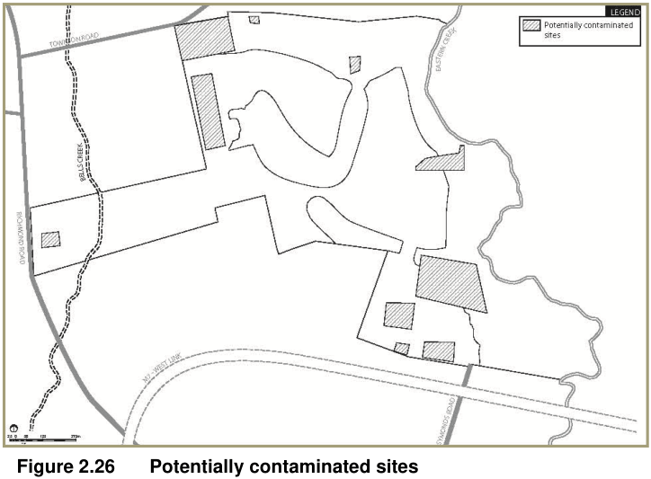

### 2.4 Environmental management

This section outlines the objectives and development controls relating to water cycle management, flood prone land, soils and salinity, tree retention and contamination.

#### 2.4.1 Water cycle management

All development shall comply with the controls provided in Blacktown DCP 2015 Part J Water Sensitive Urban Design and Integrated Water Cycle Management.

#### 2.4.2 Salinity management

■ Objectives

(a) to ensure that development will not significantly increase the salt load in existing watercourses within the site

(b) to ensure that measures are implemented as part of the development to prevent any degradation of the existing soil and groundwater.

■ Controls

(a) All works are to conform with the Western Sydney Salinity Code of Practice, June 2003 (WSROC)

(b) Each subdivision application is to be accompanied by a salinity report prepared by a suitably qualified consultant, reporting on the conditions of the site, the impact of the proposed subdivision on salinity, the mitigation measures that will be required during the course of construction and a requirement that the consultant signs off on the project upon completion of works

(c) Groundwater and salinity levels should be monitored, especially in the footslopes and floodplain adjacent to bells creek and eastern creek.

#### 2.4.3 Tree retention

■ Objective To ensure the protection and enhancement of existing significant trees.

■ Controls

(a) A Tree Survey Plan is to be submitted with each subdivision DA

(b) The Tree Survey Plan is to identify the location, type and condition of all existing trees, and is to indicate those trees proposed to be removed and those to be retained

(c) Existing significant trees are to be retained wherever possible within public and community parks and within the streetscapes, in particular within the Bells Creek riparian corridor and within the ridgetop zone.

#### 2.4.4 Contamination management

■ Objectives

(a) To minimise the risks to human health and the environment from the development of potentially contaminated land

(b) To ensure that potential site contamination issues are adequately addressed at the subdivision stage.

■ Controls

(a) Potentially contaminated sites are identified at Figure 2.26

(b) A Contamination Assessment Report is required to be submitted with any subdivision DA which includes tested samples over the subject area under consideration.

> [Picture on page 37: a picture, saved as a picture (images/part-l-stonecutters-ridge-page-37-8.gif, 150 dpi).]

#### Figure 2.26 Potentially contaminated sites

#### 2.4.5 Development on flood prone lands

■ Objective To minimise the potential impact of flooding on residential development.

■ Controls

(a) No residential allotments are to be located within the Bells Creek 1 in 100 year ARI flood level as shown on Figure 2.27

(b) Roads, multi-purpose pathways and open space may extend within the 1 in 100 year ARI flood level

(c) Where a road is located within the 1 in 100 year ARI flood level, the level of the invert of the gutter is to be at or above the 1 in 100 year flood level

(d) Where a road is located within the 1 in 100 year ARI flood level, the overland flow implications of this are to be addressed as part of any subdivision DA

(e) Residential allotments located between the 1 in 100 year ARI flood level and the Probable Maximum Flood (PMF) level are to be provided with an adequate evacuation route to higher ground.
