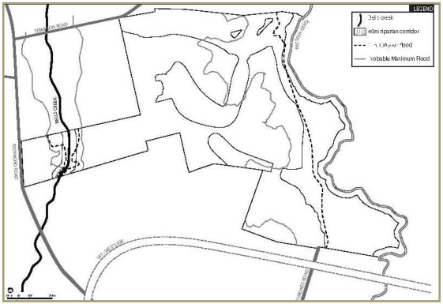
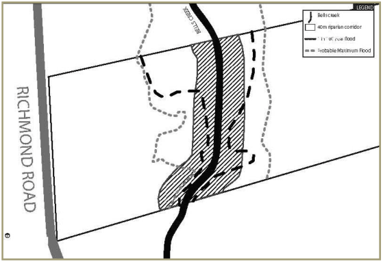
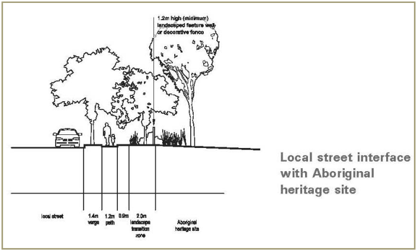
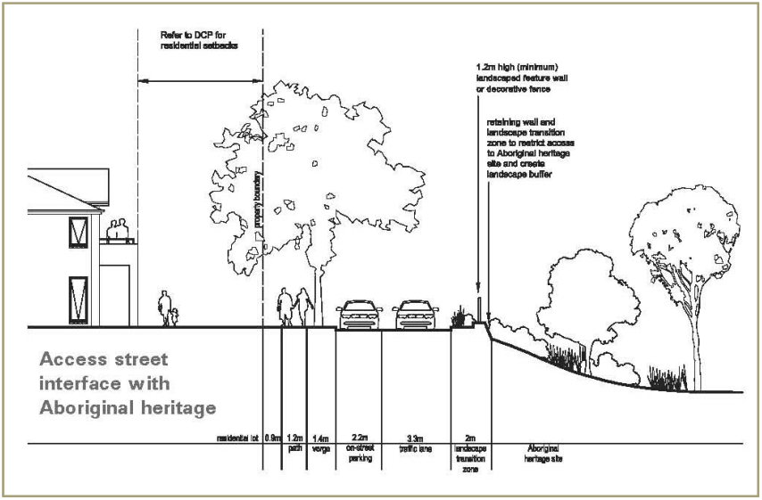
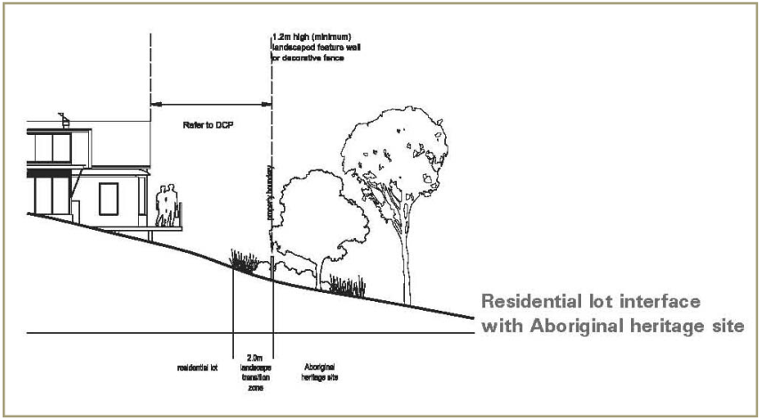

### 2.5 Special area controls

This section of Part L outlines the objectives and development controls relating to special areas within the site, including land in close proximity to the Bells Creek riparian corridor, the Aboriginal heritage site, the CSR quarry buffer and the Caltex oil / gas pipeline.

#### 2.5.1 Bells Creek riparian corridor

■ Objectives

(a) To protect and enhance the environmental qualities of Bells Creek

(b) To ensure that the development does not result in any net impact on the water quality and quantity of Bells Creek.

■ Controls

(a) A 40m environmental riparian corridor is to be provided along either side of Bells Creek as shown at Figure 2.27. The width of the corridor is to  be measured from the top of the bank

(b) Any road crossing of Bells Creek is to be provided via a clear span bridge (with piers) with a length of approximately 40m. The design of  the bridge should have regard to the NSW Fisheries publication Fish Passage Requirements for Waterway Crossing 2003

(c) The Bells Creek riparian corridor is to be revegetated with appropriate native tree and shrub species having regard to its drainage function and vegetation management for bush fire protection

(d) A Landscape Plan for the Bells Creek corridor is to be submitted to Council as part of the residential subdivision DA for either of the adjoining residential areas. The Landscape Plan is to:

(i) Identify existing trees to be retained

(ii) Indicate the location, type and size and all new plant species

(iii) Address the ongoing management of the corridor

(e) The Bells Creek riparian corridor is to be appropriately designed and signposted to minimise public access

(f) A description of the aquatic vegetation (including trees/snags, macrophytes and algae), habitats and gravel beds in Bells Creek is required to accompany any future subdivision DA for land which adjoins the creek, together with an assessment of how these features of the creek will be impacted by future subdivision and development

(g) Future development adjoining Bells Creek is to have regard to the NSW Fisheries Policy and Guidelines for Fish Habitat Conservation and Management 2013.

> [Picture on page 39: a picture, saved as a picture (images/part-l-stonecutters-ridge-page-39-1.gif, 150 dpi).]

> [Picture on page 39: a picture, saved as a picture (images/part-l-stonecutters-ridge-page-39-2.gif, 150 dpi).]

#### Figures 2.27 Bells Creek riparian corridor

#### 2.5.2 Aboriginal heritage site

The location of the Aboriginal heritage site is shown on the Urban Structure Plan  at Figure 2.1. This location has been determined in accordance with the Archaeological Assessment of Indigenous Cultural Values at Schofields NSW dated May 2002. ■ Objectives

(a) To protect and enhance the significance of the Aboriginal heritage site, which is the subject of a Voluntary Conservation Agreement (VCA)

(b) To ensure the interface between the residential areas and the Aboriginal heritage site is appropriately treated.

■ Controls

(a) No development on land to which this Part applies is to occur unless Council is satisfied that arrangements have been made for the ongoing protection and management of the Aboriginal heritage site

(b) All development on land covered by the VCA is to be undertaken in accordance with the VCA and Associated Plan of Management dated

2003\. Das are to include an assessment of the impact of development on the implementation requirements of the VCA and Plan of Management

(c) Council shall refer any DA for development on land covered by or directly adjoining the VCA to the NSW Department of Planning and Environment for comment

(d) Residential development adjacent to the land covered by the VCA is to be designed generally in accordance with the typical sections shown at Figures 2.28 to 2.30

(e) All fencing, edge treatments and interpretive signage are to be provided in accordance with the VCA and Plan of Management

(f) The boundary between the Aboriginal heritage site and the golf course is to be delineated by an appropriately designed fence to deter access.

> [Picture on page 40: a picture, saved as a picture (images/part-l-stonecutters-ridge-page-40-15.gif, 150 dpi).]

#### Figure 2.28 Aboriginal heritage site / local street interface (typical section)

> [Picture on page 41: a picture, saved as a picture (images/part-l-stonecutters-ridge-page-41-1.gif, 150 dpi).]

Figure 2.29 Aboriginal heritage site / access street interface (typical section)

> [Picture on page 41: a picture, saved as a picture (images/part-l-stonecutters-ridge-page-41-3.gif, 150 dpi).]

Figure 2.30 Aboriginal heritage site / residential lot interface (typical section)

#### 2.5.3 European and Aboriginal archaeological significance

■ Objectives

(a) To record the European heritage significance of Luke’s Farmhouse, which lies at the northern entrance to the Release Area on Figure 2.1

(b) To further investigate the Aboriginal archaeological significance of the site as a whole

(c) To ensure that information regarding the heritage significance of the site is incorporated into the redevelopment of the site.

■ Controls

(a) An archival record is to be kept of all relics associated with Luke’s Farmhouse

(b) Any subdivision DA is to be accompanied by an Aboriginal Archaeological Report supported by the comments of the local Aboriginal groups

(c) Interpretive signage, that provides information on the history and heritage significance of the site, is to be provided within the public domain areas on the site. Where possible, such signage should be provided in close proximity to the site of any relics or remains that have been uncovered

(d) A monument is to be provided in a prominent public space on the site, in recognition of the first Aboriginal land grants to Colebee and  Nurragingy.

#### 2.5.4 CSR quarry buffer

The CSR quarry buffer is shown on the Urban Structure Plan at Figure 2.1. ■ Objective To ensure an appropriate buffer is maintained between residential development and the CSR quarry to the north.

■ Controls

(a) an Agreement has been entered into between Medallist Developments and CSR that outlines CSR’s right to continue its extraction operations within the Office of Environment and Heritage licence requirements and that, if Medallist seeks to develop in areas that are affected by the CSR site, it must implement mitigation measures to ensure that CSR stays within its licensing requirements in regard to impacts on nearby residents. Subdivision in the Northern Residential Village (within 150m of the northern boundary of the Stonecutters Ridge) is to be consistent with this Agreement

(b) Access to Townson Road must be designed to minimise conflict with quarry traffic.

#### 2.5.5 Caltex oil / gas pipeline

The Caltex oil / gas pipeline is shown on the Urban Structure Plan at Figure 2.1.

■ Objective To ensure that any works within the Caltex oil / gas pipeline easement that may be required in association with the future development of the site do not impact on the structural stability, operation or maintenance of the oil / gas pipeline.

■ Controls

(a) Any works proposed within the Caltex oil / gas pipeline easement require Agility / Caltex approval and supervision

(b) The design of any services that may cross the pipeline easement and any landscaping proposals are to be approved by Agility / Caltex in writing.

#### 2.5.6 Richmond Road frontage

■ Objectives

(a) To provide an appropriate and visually appealing urban design response for the Richmond Road frontage

(b) To ensure a good level of amenity is provided for any dwellings adjoining Richmond Road.

■ Controls

(a) Development along the Richmond Road frontage of the site is to  present to Richmond Road in a manner that establishes a sense of place

(b) The design of the main public entry from Richmond Road is to create an address and identity consistent with the character of the site as a high quality golf course lifestyle community. The Richmond Road entry statement is to incorporate a combination of landscaping, built features, water features (as appropriate), public art, feature lighting and signage

(c) Details of the Richmond Road entry statement are to be provided on a landscape plan submitted with the relevant DA

(d) Any DA proposing the subdivision of land within 100m of the Richmond Road site boundary is to include details relating to:

(i) Means and location of vehicular access to any future residential allotments

(ii) Means by which it is proposed to ensure that the visual impact of development when viewed from Richmond Road is appropriately managed

(iii) A report prepared by a suitably qualified acoustic consultant that makes recommendations as to what, if any, acoustic treatment will be required to ensure appropriate internal acoustic amenity for future residents

(e) If it is necessary on the basis of a recommendation of the acoustic consultant that a landscaped setback be provided on the Richmond Road site frontage, the landscaped setback is to be owned / maintained by the community

(f) Any fencing proposed along or near to the Richmond Road site frontage is to be designed such that it is not visually intrusive when viewed from Richmond Road. A continuous blank expanse of unbroken wall / fencing along this frontage will not be acceptable

(g) Any DA proposing the construction of any building within 100m of the Richmond Road site boundary is to include details relating to any architectural building treatments that may be required to ensure appropriate internal acoustic amenity for future residents.

#### 2.5.7 Weed management

■ Objective To manage weeds on the site during and after construction, to prevent the spread of weeds to Bells Creek and Eastern Creek.

■ Controls Subdivision DAs are to be accompanied by a Weed Management Plan that:

(a) Identifies weed control measures during and after development

(b) Requires land to be revegetated after disturbance or construction activities, to reduce the likelihood of weed species growing on the site

(c) Requires any topsoil brought onto the site to be certified as being free of weeds before use.
