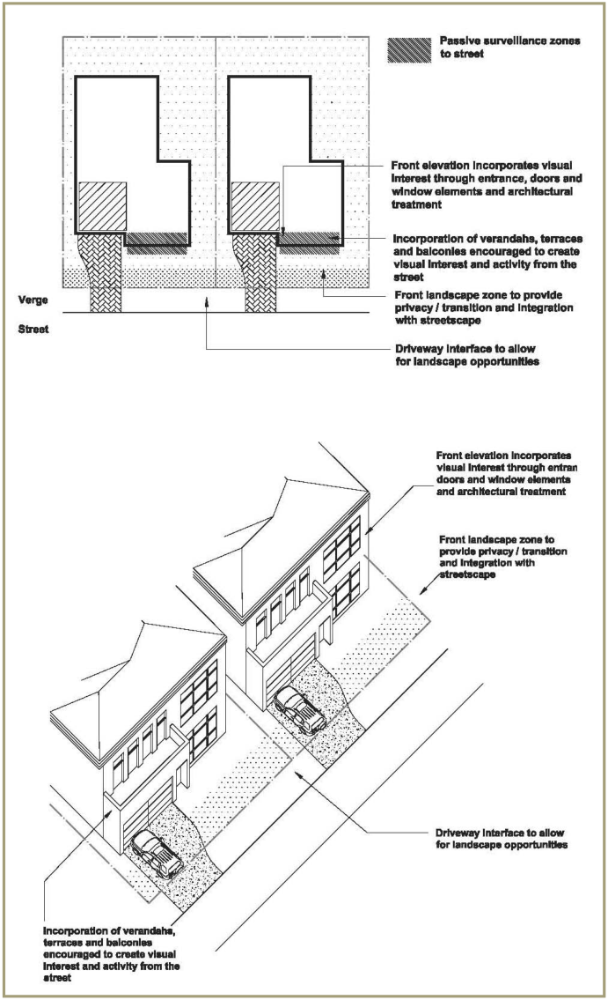
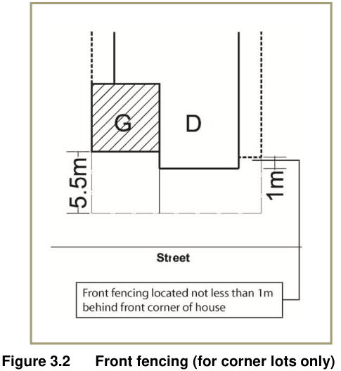
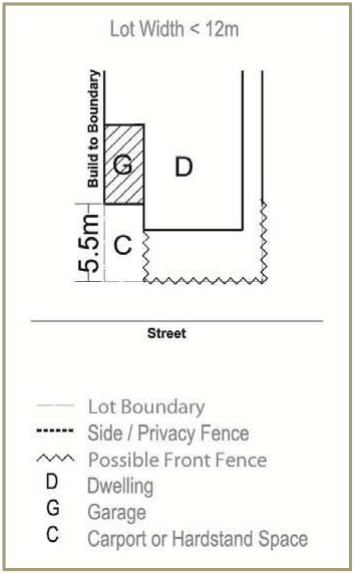
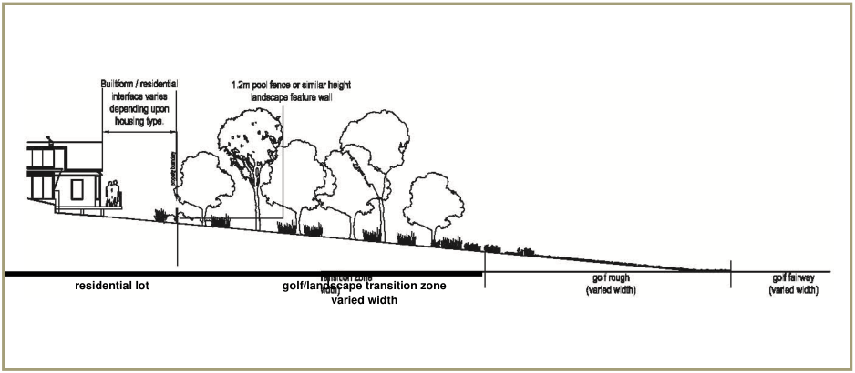
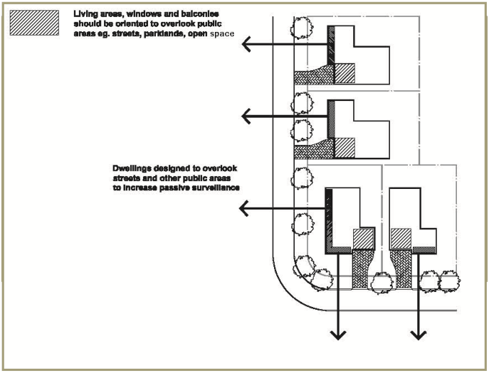
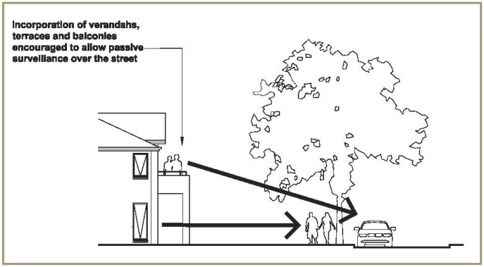
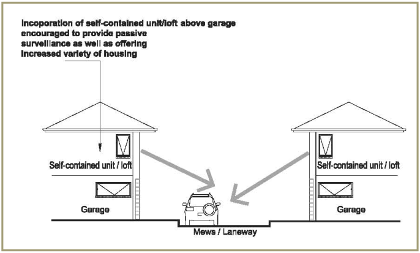

### 3.5 Quality streetscapes

This section of the DCP outlines objectives and development controls relating to  architectural design, residential streetscapes, driveways and garages, fences and walls, and safety and surveillance.

#### 3.5.1 Architectural design, materials and finishes

■ Objective To encourage innovative contemporary designs which enhance the built form, landscape and environmental character.

■ Controls

(a) Building facades are to be articulated and roof form is to be varied to provide visual variety. Suitable elements for articulated appearance include verandahs, windows, awnings, eaves and wall line variation. Suitable elements for roof forms include hips, skillions, flat roofs, curved roofs, and gables

(b) Proposed dwelling colours, materials and finishes are to be from a neutral palette of colours. Bright and highly reflective colours are to be avoided

(c) Multi-coloured roof tiles are not permitted

(d) Mirror-imaging of dwelling facades is not permitted

(e) the repetition of identical housing designs in a group of dwellings will not be permitted.

Note: Additional design guidelines relating to dwelling architectural design, materials and finishes are included in the Developer Design Guidelines (DDGs) for the estate.

#### 3.5.2 Residential streetscapes

■ Objective To create attractive streetscapes.

■ Controls

(a) Residential streetscapes are to be designed having regard to the principles illustrated at Figure 3.3

(b) The front elevation of dwellings are to incorporate entrances, verandahs, porches and balconies and the like to provide articulation, visual interest and to allow casual surveillance of the street

(c) Outer most projections (omps) (e.g. Balconies, awnings, pergolas, bay windows and the like) may extend into the required front setback by up to one third of the setback distance, to create extra visual interest and enhance opportunities for social interaction

(d) Building facades on corner sites shall address both streets and incorporate elements within the roof and wall to create an articulated appearance

(e) Long, unarticulated facades fronting the street are not permitted

(f) Landscape treatment is to be provided within the front setback zone to provide a clear delineation between the private and public domain

(g) Front setback areas are to contain landscaping.

> [Picture on page 49: a picture, saved as a picture (images/part-l-stonecutters-ridge-page-49-1.gif, 150 dpi).]

#### Figure 3.1 Dwelling / street interface

#### 3.5.3 Driveways and garages

■ Objective To provide a range of convenient and safe parking options which are adequate for residents and visitors, and are not visually obtrusive.

■ Controls

(a) Where a carport or garage entry forms part of the front facade of a dwelling, the carport or garage is to be setback a minimum of 5.5m from the front boundary to enable a car to be parked in the driveway

(b) Carports and garages are to be treated as an important element of the dwelling façade and interface to the public domain. They are to be integrated with and complementary, in terms of design and material, with the dwelling design. Garage doors are to be visually recessed though the use of materials, colours and overhangs

(c) The maximum width of a driveway at the property boundary is to be 4m

(d) Where facing the street, the maximum width of a garage or carport is to be 6m per dwelling

(e) To reduce the dominance of garages, the number of (front) garages will be limited to one where a dwelling is proposed on a lot with a frontage  of 10m or less and the garage fronts the primary street.

■ Shared driveways

(a) Shared driveways / mews courts are to be owned and maintained by a community / resident association or the like

(b) The maximum number of dwellings to be served from a shared driveway is 10. The width of such a driveway is to be in  accordance  with council’s engineering guide for development

(c) The maximum travelling distance from a public road to a garbage collection area within a shared driveway/mews court is to be in accordance with the requirements of Part G.

(d) Opportunities for casual surveillance from dwellings are to be incorporated into the design of shared driveways (mews courts) and where rear access is proposed

(e) The location of driveways is to be determined in conjunction with proposed locations of street gully pits and tree bays, to minimise any impact on available on-street parking.

#### 3.5.4 Fences and walls

■ Objectives

(a) To enhance the streetscape, amenity, setting and outlook of dwellings

(b) To provide a clear distinction between private and public space and to encourage casual surveillance of the street.

■ Controls

(a) All front fencing is to be consistent in design and style with its dwelling. On corner allotments, the front fencing style is to be continued along the secondary street frontage to at least 1m behind the building line of the dwelling (refer to figure 3.4)

(b) Front and side fencing is to have regard to the principles shown at figure 3.5

(c) The maximum height of a solid fence in front of the building line is to be 0.8m

(d) Front fences and walls are to not impede safe sight lines for traffic

(e) All boundary fencing behind the front building line (the one furthest from the front property line, where there is a staggered frontage) shall be 1.8m high

(f) Fencing that adjoins mews or rear accessways is to permit casual surveillance

(g) Any fence visible to a public place, including common property and mews, must be of a decorative finish to council’s satisfaction

(h) Fencing for lots adjoining the golf course should have regard to figure 3.6

(i) Retaining walls are to be kept to a minimum to reduce earthworks. All retaining walls are to be clearly identified on plans. Use of materials  that complement the natural environment, are visually appealing and  are highly durable are encouraged

(j) Refer to part a of blacktown dcp 2015 for cut and fill requirements

(k) Colorbond or timber paling or lapped / capped fencing can only be used internally between dwelling lots.

> [Picture on page 52: a picture, saved as a picture (images/part-l-stonecutters-ridge-page-52-1.gif, 150 dpi).]

#### Figure 3.2 Front fencing (for corner lots only)

> [Picture on page 52: a picture, saved as a picture (images/part-l-stonecutters-ridge-page-52-3.gif, 150 dpi).]

#### Figure 3.3 Front fencing and walls

> [Picture on page 53: a picture, saved as a picture (images/part-l-stonecutters-ridge-page-53-1.gif, 150 dpi).]
> Words printed on the picture (copied from the PDF):
> residential lot
> golf/landscape transition zone
> varied width

#### Figure 3.4 Residential lot interface with golf course

Note: Additional design guidelines relating to fences and walls are included in the Developer Design Guidelines (DDGs).

#### 3.5.5 Safety and surveillance

■ Objectives

(a) To ensure that the siting and design of buildings and spaces decreases the opportunities for committing crime

(b) To ensure that development encourages people to use streets, parks and other public places without fear of personal risk.

■ Controls

(a) Dwellings should be designed to overlook streets, lanes and other  public or communal areas to provide casual surveillance as illustrated at figures

3.7 to 3.9 inclusive. In the case of corner lots, habitable windows are also to be oriented to overlook the side street

(b) Use of roller shutters is not permitted on doors and windows facing the street. Any security railings must be designed to complement the architecture of the building

(c) Developments are to avoid the creation of areas for concealment and blank walls facing the street

(d) Pedestrian and communal areas are to have sufficient lighting to ensure a high level of safety (refer to section 2.3 open space & public domain). These areas must be designed to minimise opportunities for concealment

(e) All developments are to incorporate the principles of crime prevention through environmental design (cpted). When assessing applications, council must consider department of urban affairs and planning guidelines for crime prevention and the assessment of development applications 2001.

> [Picture on page 54: a picture, saved as a picture (images/part-l-stonecutters-ridge-page-54-6.gif, 150 dpi).]

#### Figure 3.5 Passive surveillance of the streetscape

> [Picture on page 54: a picture, saved as a picture (images/part-l-stonecutters-ridge-page-54-8.gif, 150 dpi).]

#### Figure 3.6 Verandahs and balconies provide overlooking of streets

and parks

> [Picture on page 55: a picture, saved as a picture (images/part-l-stonecutters-ridge-page-55-1.gif, 150 dpi).]

Figure 3.7 Self-contained lofts provide passive surveillance of mews court and rear

accessways
