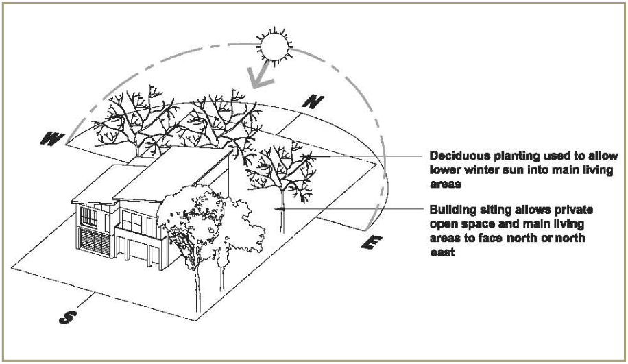
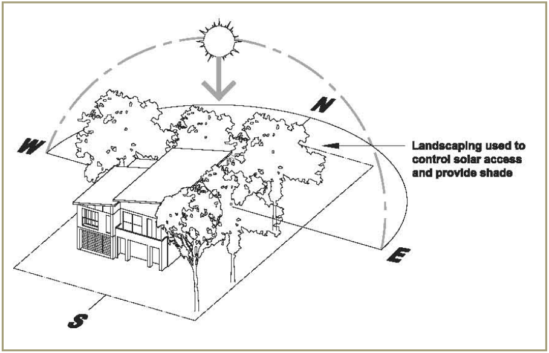
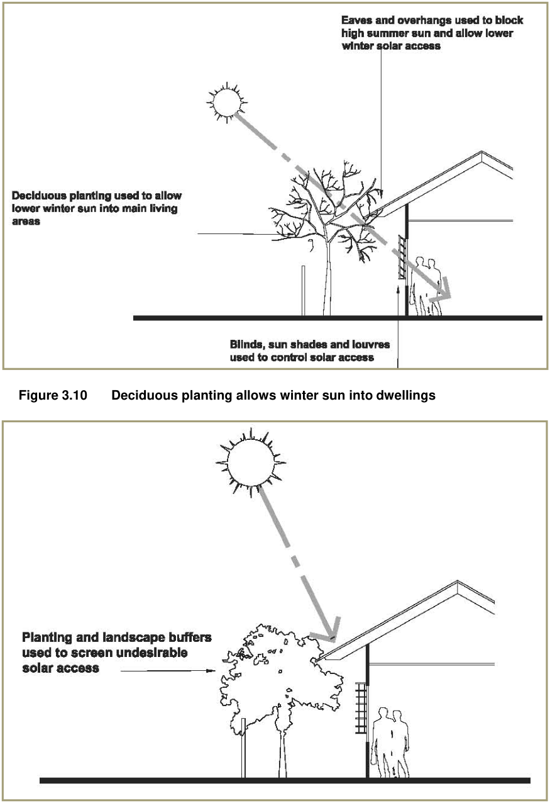
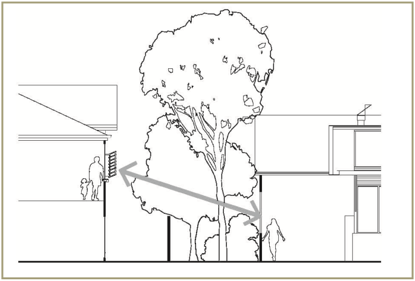

### 3.6 Environmental and residential amenity

This section of the DCP outlines objectives and development controls relating to solar access, BASIX, visual and acoustic privacy, landscaping (private domain), bush fire construction standards, servicing, construction management and waste.

#### 3.6.1 Solar access

■ Objectives

(a) to recognise that the golf course layout has influences on lot orientation and thus solar access for some dwellings, and to ensure that residential amenity in terms of direct solar access is considered within the broader context of the high level of amenity that can be afforded within this community in terms of views, outlook and proximity to open space

(b) To ensure that dwellings are sited to maximise solar access to living rooms and private open space

(c) To minimise the negative impact of overshadowing on neighbouring buildings’ internal and outdoor areas.

■ Controls

(a) The orientation of dwellings is to be consistent with the solar access principles illustrated at figures 3.10 to 3.13 inclusive

(b) 50% of the area of a private open space (of both the proposed development and adjoining site) should receive at least 3 hours of sunlight between 9am and 3pm at the winter solstice (21 June). This requirement also applies to common open space. Furthermore, a centrally located courtyard must obtain the same proportion of solar access for it to be considered a suitable useable area. This solar  access requirement may be reduced where Council is satisfied that other significant amenity is afforded to future residents (e.g. views / outlook to public open space and the golf course) and that BASIX requirements can nevertheless be met

(c) Landscaping design, species selection and eaves and overhangs are to be used to allow lower winter sun into main living areas

(d) Dwellings should also be designed to avoid overshadowing of adjacent properties and to protect sunlight access to any habitable room or private outdoor living space of adjacent buildings.

> [Picture on page 56: a picture, saved as a picture (images/part-l-stonecutters-ridge-page-56-15.gif, 150 dpi).]

#### Figure 3.8 Solar access (winter)

> [Picture on page 57: a picture, saved as a picture (images/part-l-stonecutters-ridge-page-57-1.gif, 150 dpi).]

#### Figure 3.9 Solar access (summer)

> [Picture on page 58: a picture, saved as a picture (images/part-l-stonecutters-ridge-page-58-1.gif, 150 dpi).]

#### Figure 3.10 Deciduous planting allows winter sun into dwellings

#### Figure 3.11 Planting, louvres and blinds to screen summer sun

#### 3.6.2 BASIX

■ Objective To ensure that developments are environmentally sustainable in terms of energy and water efficiency.

■ Controls

(a) All applications for dwellings are to be accompanied by a BASIX Certificate

(b) Developments are to incorporate all commitments stipulated in the BASIX Certificate.

#### 3.6.3 Visual and acoustic privacy

Visual privacy principles are illustrated at Figure 3.14. ■ Objective To ensure that buildings are designed to protect visual and acoustic privacy.

■ Controls

#### Visual privacy

(a) Direct overlooking of main habitable areas and private open spaces should be minimised through building layout, window and balcony location and design, and the use of screening devices, including landscaping

(b) Habitable room windows with a direct sightline to the habitable room windows in an adjacent dwelling within 9.0m are to:

(i) Be offset from the edge of one window to the edge of the other by a distance sufficient to limit views into the adjacent window, or

(ii) Have a sill height of 1.7m above floor level, or

(iii) Have fixed obscure glazing in any part of the window below 1.7m above floor level

(c) Fixed screen or opaque windows can be built closer than non-habitable room windows.

#### Acoustic privacy

(a) The design of attached dwellings must minimise the opportunity for sound transmission through the building structure, with particular attention given to protecting bedrooms and living areas

(b) In attached dwellings, bedrooms of one dwelling are not to share walls with living spaces or garages of adjoining dwellings, unless it is demonstrated that the shared walls and floors meet noise transmission and insulation requirements

(c) Living areas and service equipment must be located away from bedrooms of neighbouring dwellings.

> [Picture on page 60: a picture, saved as a picture (images/part-l-stonecutters-ridge-page-60-1.gif, 150 dpi).]

#### Figure 3.12 Visual privacy between buildings

#### 3.6.4 Landscaping (private domain)

■ Objectives

(a) To contribute to effective management of stormwater and energy efficiency, and to improve visual amenity

(b) To encourage the use of native species of flora and low maintenance landscaping

(c) To retain and integrate existing landscape elements such as vegetation and topographic features in the design of new development

(d) To assist in the management of salinity

(e) To ensure the provision of high quality private open space meets residents’ needs for outdoor activities, privacy, outlook and amenity.

■ Controls

(a) Use of low flow watering facilities are encouraged to avoid over- watering by residents

(b) Low water demand drought resistant vegetation is to be used in common landscaping areas, including native salt tolerant trees

(c) Trees planted on the north side of private open space areas and habitable rooms should be deciduous

(d) A minimum of one tree is to be provided where possible within the front setback area of every dwelling. This may include existing trees that are to be retained within the front setback area

(e) Use of smart irrigation systems that respond to soil moisture and climate conditions to reduce over-watering is encouraged

(f) Landscape design is to take into consideration grouping of plants with similar water needs

(g) Large trees are to be kept a safe distance from housing to prevent uneven drying of soil and foundation cracking

(h) Subsoil drains are to be installed around the perimeter of residences and connected to the stormwater system to prevent accumulation of water and concentration of salts.

Note: Additional design guidelines relating to landscaping of the private domain are included in the Developer Design Guidelines (DDGs).

#### 3.6.5 Bush fire construction standards

■ Objective To ensure the protection of life and property from the threat of fire.

■ Controls

(a) Development within 100m of land identified as bush fire prone is to be constructed in accordance with the relevant Bushfire Attack Level (BAL) in accordance with Australian Standard 3595-2009 – Construction of buildings in bushfire prone areas

(b) Any structures (e.g. fences, garden sheds, decks, pergolas, pool surrounds etc) located within the Asset Protection Zones (APZs) are to be non-combustible (i.e. non-combustible under Australian Standard

1530.1 and not deemed combustible pursuant to Clause 12 of Volume 1 of the Building Code of Australia).

#### 3.6.6 Servicing

■ Objectives

(a) To ensure that adequate provision is made for site facilities

(b) To ensure that site facilities are functional and accessible to all  residents and are easy to maintain

(c) To ensure that site facilities are thoughtfully integrated into development and are unobtrusive.

■ Controls

(a) Underground services are required for all domestic serving utilities, including electrical services

(b) Garbage and mailbox structures are to be integrated with the overall design of buildings and/or landscaping.

■ Objectives

(a) To avoid the generation of waste through design, material selection and building practices

(b) To plan for the types, amount and disposal of waste to be generated during excavation and construction of development

(c) To encourage waste minimisation, including source separation, reuse and recycling

(d) To ensure efficient storage and collection of waste and quality design of facilities.

■ Controls

(a) A Waste Management Plan and associated documentation in accordance with Blacktown DCP 2015 Part G - Site Waste Management and Minimisation is to be submitted with all development applications, where relevant.

(b) Development must demonstrate that the design takes into account refuse storage and collection without reducing the amenity of the dwelling or neighbouring lots

(c) Storage areas for rubbish bins are to be located away from the front of development where they have a significant negative impact on the streetscape, on the visual presentation of the building entry and on the amenity of residents, building users and pedestrians

(d) Any private road is to be designed and built in accordance with Council’s Engineering Guide for Development. Details must be shown on the engineering design plans for development. Engineering certification must be submitted prior to the issue of the occupation or subdivision certificate (whichever occurs first).
