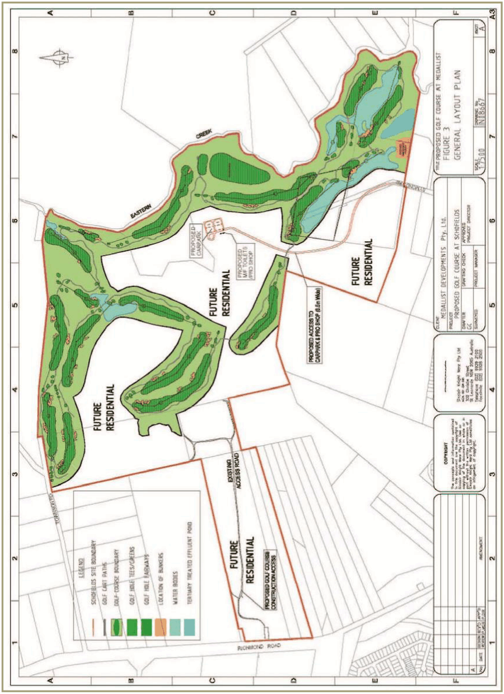

### Appendix 2 Approved golf course layout plan

The golf course layout plan below was approved by Council on 17 November 2004.

> [Picture on page 65: a picture, saved as a picture (images/part-l-stonecutters-ridge-page-65-3.gif, 150 dpi).]

#### Revised March 2022
