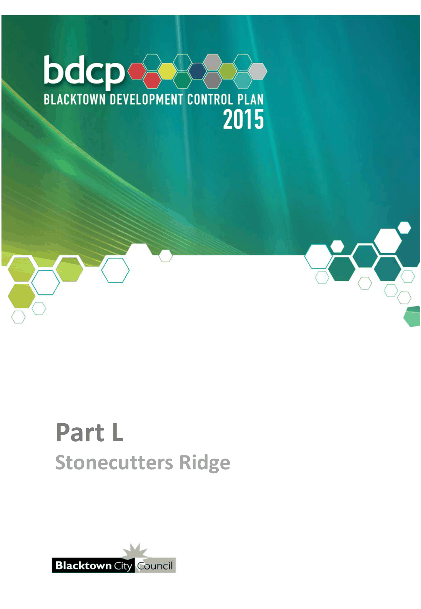

# Blacktown Development Control Plan 2015 - Part L Stonecutters Ridge

> This chapter is split into 21 section file(s), one per numbered heading, in the order they appear in the PDF.

Source PDF: [Part-L-Stonecutters-Ridge_Waste.pdf](Part-L-Stonecutters-Ridge_Waste.pdf)

> [Picture on page 1: a picture, saved as a picture (images/part-l-stonecutters-ridge-page-1-1.gif, 150 dpi).]

### Part L

### Stonecutters Ridge

### Table of Contents

| 1 | Introduction ............................................................................................................... 5 1.1 Purpose and aims of this Part ......................................................................... 5 1.2 Land to which this Part applies ...................................................................... 5 1.3 How to use this document .............................................................................. 5 1.4 Relationship to other planning documents .................................................... 6 1.5 Developer design guidelines .......................................................................... 6 1.6 Development vision ......................................................................................... 7 1.7 Development objectives .................................................................................. 8 |
|---|---|
| 2 | Subdivision ............................................................................................................. 10 2.1 Urban design .................................................................................................. 10 2.2 Access and movement .................................................................................. 19 2.3 Open space and public domain .................................................................... 30 2.4 Environmental management ......................................................................... 36 2.5 Special area controls ..................................................................................... 38 |
| 3 | Built form controls .................................................................................................. 45 3.1 Dwelling houses (minimum 450sq.m site area) ........................................... 45 3.2 Dwelling houses (330sq.m to 450sq.m site area) ........................................ 46 3.3 Dual occupancy housing ............................................................................... 46 3.4 Attached dwellings and multi dwelling housing .......................................... 46 3.5 Quality streetscapes ...................................................................................... 47 3.6 Environmental and residential amenity ........................................................ 55 |
| Appendix 1 Development Application checklist ...................................................... 63 |  |
|  | A.1.1 Subdivision DAs ............................................................................................ 63 |
|  | A.1.2 Building DAs .................................................................................................. 64 |
| Appendix 2 Approved golf course layout plan ......................................................... 65 |  |
| Figures |  |
| Figure 1.1 Land to which this Part applies .............................................................. 5 |  |
| Figure 1.2 The design approval process ................................................................. 7 |  |
| Figure 1.3 The golf course layout ............................................................................. 8 |  |
| Figure 2.1 Urban structure plan ............................................................................. 11 |  |
| Figure 2.2 Residential villages plan ....................................................................... 13 |  |
| Figure 2.3 Residential development areas ............................................................ 14 |  |

| Figure 2.4 | Indicative residential staging plan ........................................................ 15 |
|---|---|
| Figure 2.5 | Asset protection zones ......................................................................... 18 |
| Figure 2.6 | Residential / APZ interface (option 1) ................................................... 18 |
| Figure 2.7 | Residential / APZ interface (option 2) ................................................... 19 |
| Figure 2.8 | Street hierarchy plan ............................................................................. 21 |
| Figure 2.9 | Current Council design standard for residential collector street (typical section) ..................................................................................... 22 |
| Figure 2.10 | Residential collector street with wider road reserve (typical section) ..................................................................................... 22 |
| Figure 2.11 | Residential collector incorporating split carriageway (typical section) ..................................................................................... 22 |
| Figure 2.12 | Residential collector incorporating split carriageway (typical plan) .......................................................................................... 23 |
| Figure 2.13 | Potential private shared driveway / community title road treatment along collector roads ................................................... 23 |
| Figure 2.14 | Indicative streetscape plan ................................................................... 24 |
| Figure 2.15 | Golf crossing of street (typical section) ............................................... 24 |
| Figure 2.16 | Golf crossing of street (typical plan) .................................................... 25 |
| Figure 2.17 | Current Council design standard for local street (typical section) ..................................................................................... 26 |
| Figure 2.18 | Current Council design standard for access street (typical section) ..................................................................................... 26 |
| Figure 2.19 | Access street incorporating water sensitive urban design (typical section) ..................................................................................... 27 |
| Figure 2.20 | Current Council design standard for cul-de-sac (typical section) ..................................................................................... 27 |
| Figure 2.21 | Indicative pedestrian, cycle and public transport network plan ......... 29 |
| Figure 2.22 | Multi-purpose pathway (typical section) .............................................. 29 |
| Figure 2.23 | Public park and residential interface (indicative concept) .................. 31 |
| Figure 2.24 | Open space structure plan .................................................................... 32 |
| Figure 2.25 | Indicative examples of signage ............................................................ 34 |
| Figure 2.26 | Potentially contaminated sites ............................................................. 37 |
| Figures 2.27 | Bells Creek riparian corridor ................................................................. 39 |
| Figure 2.28 | Aboriginal heritage site / local street interface (typical section) ..................................................................................... 40 |

| Figure 2.29 | Aboriginal heritage site / access street interface (typical section) ..................................................................................... 41 |
|---|---|
| Figure 2.30 | Aboriginal heritage site / residential lot interface (typical section) ..................................................................................... 41 |
| Figure 3.1 | Dwelling / street interface...................................................................... 49 |
| Figure 3.2 | Front fencing (for corner lots only) ...................................................... 52 |
| Figure 3.3 | Front fencing and walls ......................................................................... 52 |
| Figure 3.4 | Residential lot interface with golf course ............................................ 53 |
| Figure 3.5 | Passive surveillance of the streetscape ............................................... 54 |
| Figure 3.6 | Verandahs and balconies provide overlooking of streets and parks................................................................................................ 54 |
| Figure 3.7 | Self-contained lofts provide passive surveillance of mews court and rear accessways ........................................................ 55 |
| Figure 3.8 | Solar access (winter) ............................................................................. 57 |
| Figure 3.9 | Solar access (summer) .......................................................................... 57 |
| Figure 3.10 | Deciduous planting allows winter sun into dwellings ......................... 58 |
| Figure 3.11 | Planting, louvres and blinds to screen summer sun ........................... 58 |
| Figure 3.12 | Visual privacy between buildings ................................................................ 60 |
| Tables |  |
| Table 2.1 | Desired future character of residential villages ................................... 13 |
| Table 2.2 | Desired future character of public parks ............................................. 34 |
| Table 3.1 | Built form controls (detached dwellings minimum 450sq.m) ............. 45 |
| Table 3.2 | Built form controls (detached dwellings minimum 330sq.m to 450sq.m) ................................................................................................. 46 |
| Table 3.3 | Built form controls for attached dwellings and multi dwelling housing ................................................................... 47 |

<!-- sections -->
## Sections

1. [1.1 Purpose and aims of this Part](01-1-1-purpose-and-aims-of-this-part.md)
2. [1.2 Land to which this Part applies](02-1-2-land-to-which-this-part-applies.md)
3. [1.3 How to use this document](03-1-3-how-to-use-this-document.md)
4. [1.4 Relationship to other planning documents](04-1-4-relationship-to-other-planning-documents.md)
5. [1.5 Developer design guidelines](05-1-5-developer-design-guidelines.md)
6. [1.6 Development vision](06-1-6-development-vision.md)
7. [1.7 Development objectives](07-1-7-development-objectives.md)
8. [2.1 Urban design](08-2-1-urban-design.md)
9. [2.2 Access and movement](09-2-2-access-and-movement.md)
10. [2.3 Open space and public domain](10-2-3-open-space-and-public-domain.md)
11. [2.4 Environmental management](11-2-4-environmental-management.md)
12. [2.5 Special area controls](12-2-5-special-area-controls.md)
13. [3 Built form controls](13-3-built-form-controls.md)
14. [3.1 Dwelling houses (minimum 450sq.m site area)](14-3-1-dwelling-houses-minimum-450sq-m-site.md)
15. [3.2 Dwelling houses (330sq.m to 450sq.m site area)](15-3-2-dwelling-houses-330sq-m-to-450sq-m-site.md)
16. [3.3 Dual occupancy housing](16-3-3-dual-occupancy-housing.md)
17. [3.4 Attached dwellings and multi dwelling housing](17-3-4-attached-dwellings-and-multi-dwelling.md)
18. [3.5 Quality streetscapes](18-3-5-quality-streetscapes.md)
19. [3.6 Environmental and residential amenity](19-3-6-environmental-and-residential-amenity.md)
20. [1 Development Application checklist](20-1-development-application-checklist.md)
21. [2 Approved golf course layout plan](21-2-approved-golf-course-layout-plan.md)
