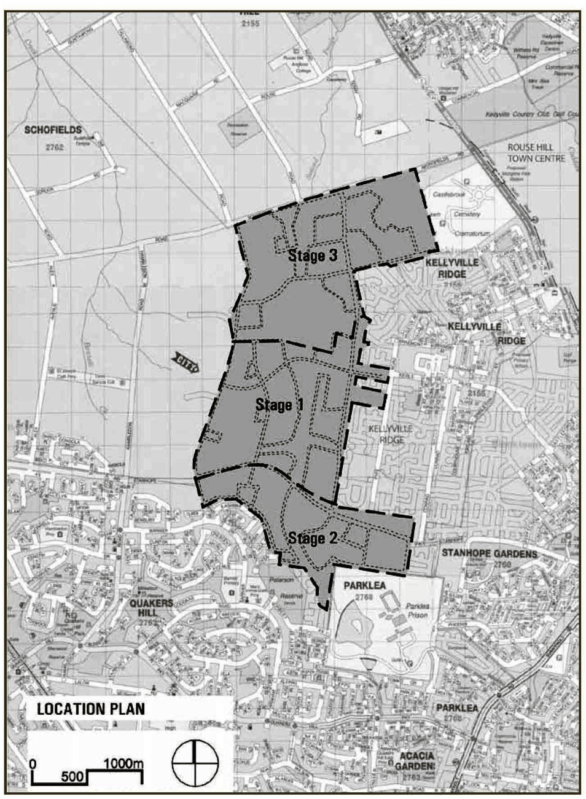
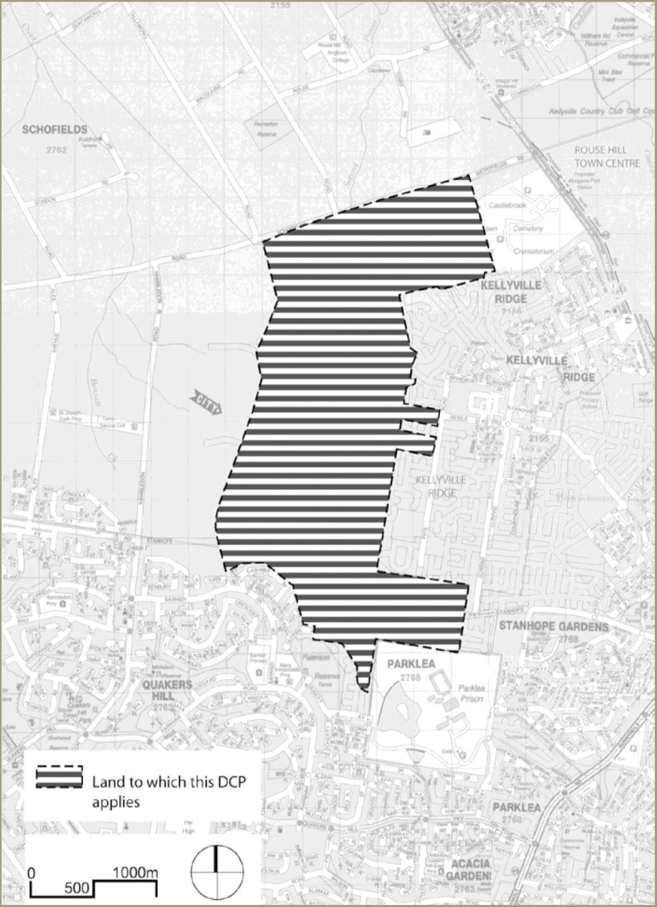

## 1 Introduction

This Part of Blacktown Development Control Plan (DCP) 2015 has been developed to provide detailed development controls and standards to encourage innovative development within the suburb of The Ponds. This will be done within the context of:

(a) Ensuring the proper management, development and conservation of natural and man-made resources within the area

(b) Conserving and managing the cultural and ecological significance of the area

(c) Creating a flourishing environment for communities to live in.

### 1.1 Structure of this Part

The following sections of this Part present the development principles and establish corresponding development controls. Each section has its own set of objectives and development controls that will be used to demonstrate the appropriate application of the controls. Figure 1.1 indicates the location of The Ponds. This Part is structured to provide guidance on:

(a) Development principles and objectives (overall structure)

(b) Urban design and site planning controls

(c) Housing controls (dwelling houses, dual occupancy, attached dwellings, multi dwelling housing, detached studios)

(d) Commercial / community uses.

Section 7 details information to be provided with any Development Application (DA) covered by the development guidelines identified in this Part of the DCP.

> [Picture on page 5: a picture, saved as a picture (images/part-m-the-ponds-page-5-1.gif, 150 dpi).]
> Words printed on the picture (copied from the PDF):
> ..

#### Figure 1.1 Location plan

### 1.2 Land to which this Part applies

The Ponds overall site comprises approximately 330ha of land which slopes from its east and west edges down to Second Ponds Creek that runs north/south through the centre of the site. This Part applies to the land shown hatched on Figure 1.2. The land is zoned under the provisions of Blacktown Local Environmental Plan (LEP) 2015. Accordingly, Blacktown City Council is the consent authority for the site. When a DA is lodged which relates to land to which this Part applies, Council will take the provisions of Blacktown DCP 2015 into consideration in determining the DA. Variations may be sought in special circumstances where that development standard may not provide the best solution.  The extent of, and reasons for, such variations must be fully documented and submitted to Council for consideration.

> [Picture on page 7: a picture, saved as a picture (images/part-m-the-ponds-page-7-1.gif, 150 dpi).]

#### Figure 1.2 Area to which this Part applies

### 1.3 Relationship to planning instruments and policies

This Part is made under, and conforms with, Blacktown LEP 2015. The Blacktown LEP 2015 takes precedence over the DCP to the extent of any inconsistency. Where there is an inconsistency between this Part and any other Part of the DCP in force, the provisions of this Part should prevail to the extent that it applies to the land to which this Part relates. Where an element is not covered by this Part then other sections of Blacktown DCP 2015 may apply. This Part is to be read in conjunction with the following:

(a) Blacktown Local Environmental Plan 2015

(b) Blacktown Development Control Plan 2015

(c) Other relevant Council policies

(d) Relevant Section 94 Contributions Plans adopted by Blacktown City Council

(e) Relevant State Environmental Planning Policies.

### 1.4 General objectives

The Ponds site provides an opportunity to create a diverse residential and complementary use development that integrates with the existing landscape qualities of the site. It is intended that this Part of the DCP will achieve the following:

(a) Outline the broad strategic planning intentions for The Ponds site and to provide detailed development controls

(b) Outline criteria which would be relevant to broad types of development, covering issues including urban character, landscaping, transport, traffic and access, car parking, ecologically sustainable development, indigenous heritage, waste management and pollution control

(c) Meet ecological, social and economic needs of the community and ensure intergenerational equity between all stages of the development

(d) Specify criteria to be applied in the assessment of development proposals and to ensure that such development is consistent with the planned character of each locality

(e) Specify the minimum standard of information to be submitted with any DA and to ensure a clear process for applicants to follow.
