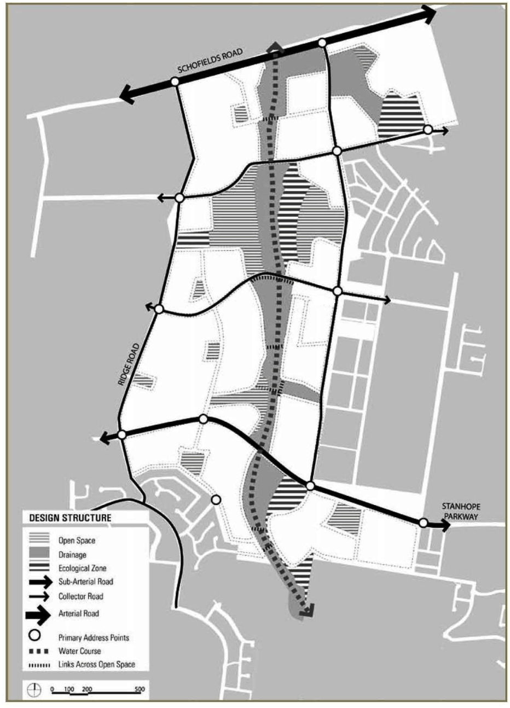

## 2 Development principles and objectives

The aim of this Part of the DCP is to provide detailed planning and development controls to encourage innovative development which optimises the available land resource. It also aims to ensure the appropriate management, development and conservation of natural and man-made resources within the area to which this Part relates. The following sections describe underlying principles to achieve the desired built form and public domain.

### 2.1 Overall The Ponds DCP framework

The plan design allows for a potential yield of approximately 3,400 new residential lots. Two primary schools and various community facilities are proposed to support the new residential community. A number of new residential neighbourhood areas will be created in one of the main urban development fronts in the Sydney metropolitan area. The Second Ponds Creek trunk drainage corridor forms a linear open space through the proposed new residential areas and establishes connections to many of the proposed community facilities. The linear parkland commences from Schofields Road and extends to Paterson Reserve, being a distance of approximately 3km. The parkland comprises an average width in the order of 100m and encompasses much larger areas where there are existing significant stands of vegetation, worthy of conservation. The treatment of the proposed linear parkland is critical to the success of this new suburban living environment. The design structure is described in Figure 2.1.

> [Picture on page 10: a picture, saved as a picture (images/part-m-the-ponds-page-10-1.gif, 150 dpi).]

#### Figure 2.1 Design structure
