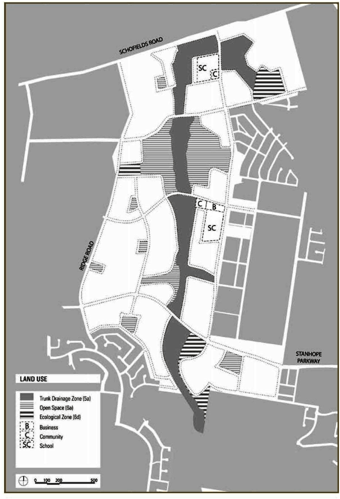
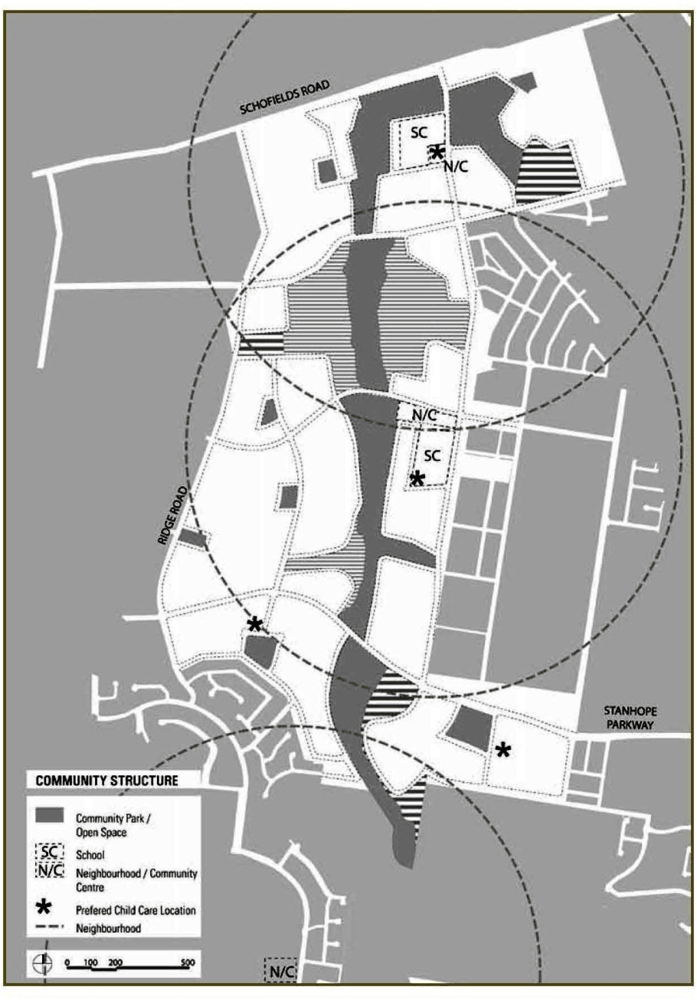
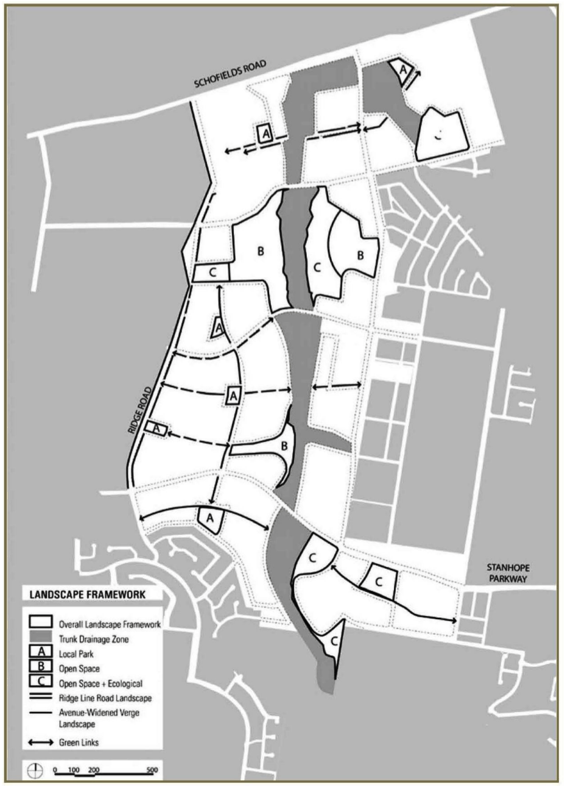
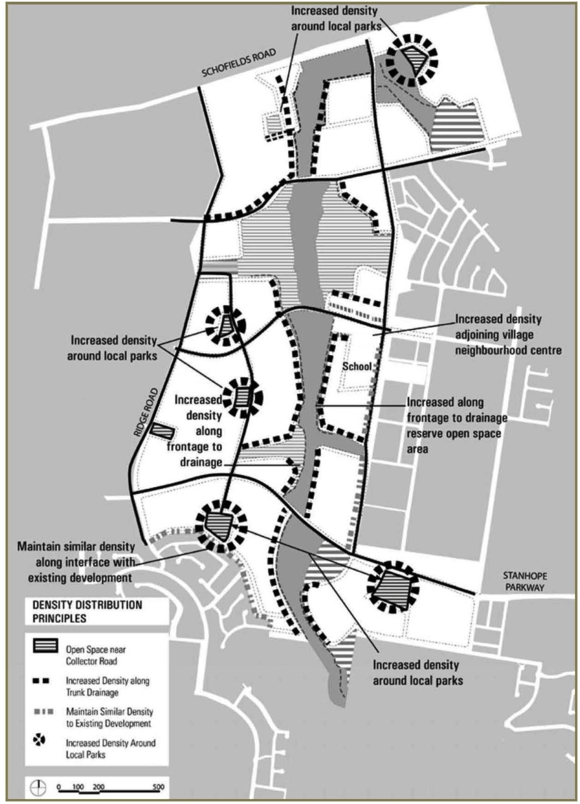
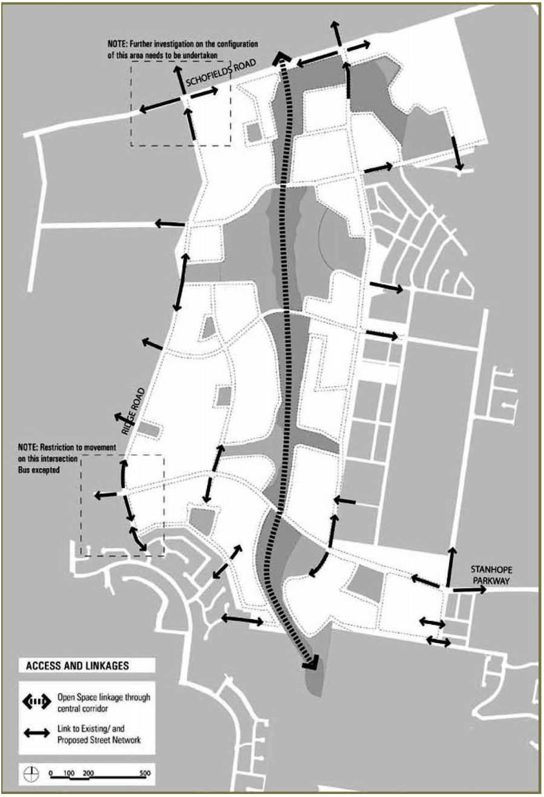
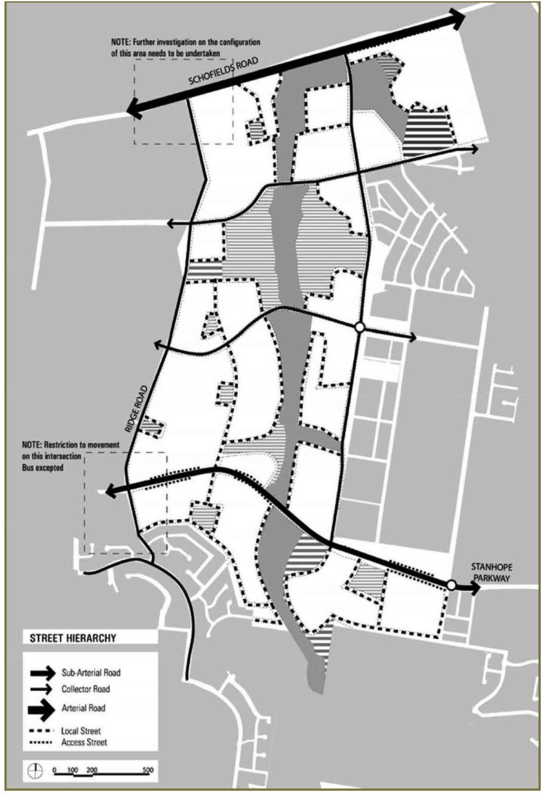
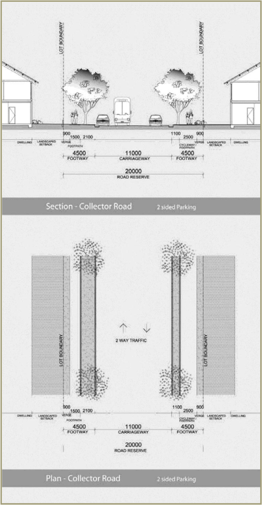
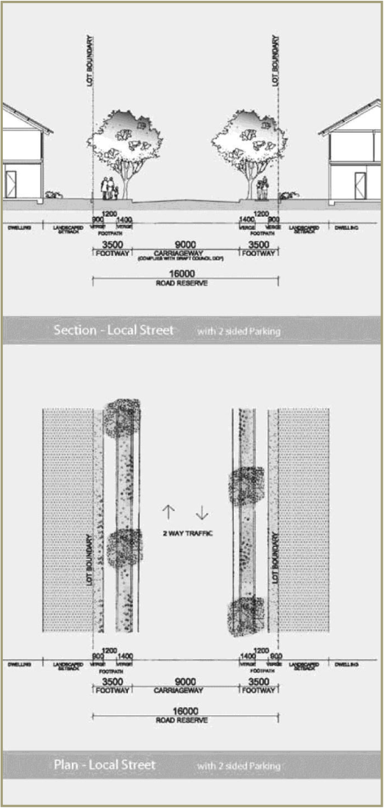
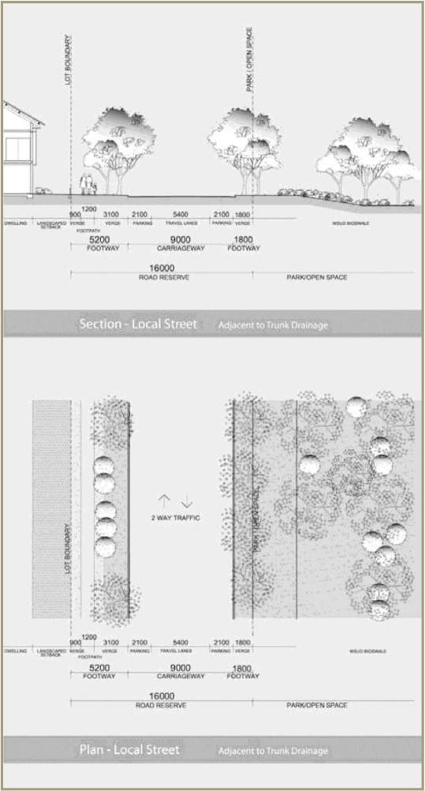
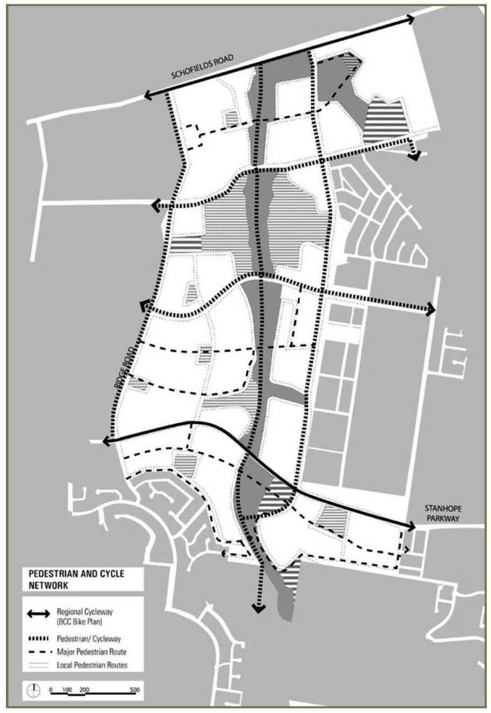

## 3 Urban design

The public infrastructure and spaces which provide the overall framework for the development of the site should achieve the following:

(a) Provide the necessary public domain and infrastructure to support a community

(b) Provide pedestrian, cycle and public transport access to housing, jobs, open space and services

(c) Increase choice in available transport options and reduce dependence on cars

(d) Support the efficient and viable operation of existing local public transport services

(e) Manage and mitigate salinity

(f) Manage stormwater and flood sustainability by incorporating water sensitive urban design (WSUD).

The following sections set out the objectives and development controls that relate to those general elements. Refer to Figure 2.1 Design structure.

### 3.1 Land use

#### 3.1.1 Neighbourhood and community facilities

■ Objectives

(a) Facilitate sustainable communities to ensure intergenerational equity

(b) Locate facilities which will support community needs and facilitate interaction for residents

(c) Locate community facilities within residential precincts that are usable and provide a range of social, active and passive functions.

■ Controls

(a) Community facilities such as child care should be generally located as indicated on figure 3.2

(b) A development application is required for each community facility and/or child care site.

> [Picture on page 12: a picture, saved as a picture (images/part-m-the-ponds-page-12-1.gif, 150 dpi).]

#### Figure 3.1 Land use

> [Picture on page 13: a picture, saved as a picture (images/part-m-the-ponds-page-13-1.gif, 150 dpi).]

#### Figure 3.2 Neighbourhood and community facilities

#### 3.1.2 Primary school

■ Objectives

(a) Ensure that school buildings are of a scale and character consistent with the business centre and community facilities. Respond to natural systems, protecting and enhancing areas of natural, indigenous and scenic importance

(b) Integrate the primary schools with the neighbourhood centres and community uses.

■ Control A Development Application is required for each school site.

#### 3.1.3 Open space and conservation areas

■ Objectives

(a) Respond to natural systems, protecting and enhancing areas of natural, indigenous and scenic importance

(b) Provide for diversity of interests catering for a wide range of users

(c) Ensure an equitable distribution of open space throughout the development.

■ Controls

(a) Provide a range of open space and conservation areas in accordance with figure 3.3:

(i) Trunk drainage zone

(ii) A - Neighbourhood parks

(iii) B - Open space

(iv) C - Open Space and ecological areas

(b) Open space and conservation design is to have consideration to stormwater, WSUD, salinity and sodicity management requirements

(c) Detailed designs of each open space and conservation area are to be submitted to Council for approval

(d) Designs are to include the identification of areas of native vegetation and aboriginal heritage and how the area will be developed without an overall adverse impact on these issues.

#### 3.1.4 Residential density distribution

■ Objectives

(a) Provide a variety of housing types to meet the needs of the community

(b) Ensure attached dwellings and multi dwelling housing are generally located near open space and centre-based facilities.

■ Control Attached dwellings and multi dwelling housing are to be located generally around local centres, local parks, schools, on collector roads, near bus routes and the central trunk drainage zone (refer to Figure 3.4 Residential density distribution).

> [Picture on page 16: a picture, saved as a picture (images/part-m-the-ponds-page-16-1.gif, 150 dpi).]

#### Figure 3.3 Open space and conservation areas

> [Picture on page 17: a picture, saved as a picture (images/part-m-the-ponds-page-17-1.gif, 150 dpi).]

#### Figure 3.4 Residential density distribution

### 3.2 Circulation network

#### 3.2.1 Site access and linkages

■ Objective Provide linkages that create connections within the site and to adjoining places.

■ Controls

(a) Site access and provision for future linkages are to be provided as indicated on Figure 3.5 Access and linkages plan

(b) Access is to be provided to the existing development at Quakers Hill and Stanhope Gardens, as well as future development areas to the east and west as indicated on Figure 3.5.

#### 3.2.2 Streets

The hierarchy of roads, streets and paths collectively constitute the overall circulation system for the site and accommodate vehicular and pedestrian traffic into and throughout the development. The selection of plant and hardscape materials for the circulation system will be based on aesthetic, practical and safety considerations. Variation in the landscape character will be created through differing plant species and layout (refer to Appendix 2). The road hierarchy (refer to Figure 3.6) has been devised to comply with a design environment appropriate to road function and to facilitate a safe environment for all users. In accordance with the road hierarchy, the streetscape character types listed in Table 3.2 have been defined reflecting their function and proposed streetscape.

> [Picture on page 19: a picture, saved as a picture (images/part-m-the-ponds-page-19-1.gif, 150 dpi).]

#### Figure 3.5 Access and linkages plan

> [Picture on page 20: a picture, saved as a picture (images/part-m-the-ponds-page-20-1.gif, 150 dpi).]

#### Figure 3.6 Street hierarchy plan

#### 3.2.3 Street character

■ Objectives

(a) Provide acceptable levels of access, safety and convenience to all users ensuring acceptable levels of amenity

(b) Make adequate provision for bus services to service the site

(c) Provide a legible, safe and convenient network of "all weather" pathways for pedestrian and cyclists, including users with disabilities and limited mobility in accordance with the provisions of the Disability Discrimination Act 1992

(d) Cater for the integrated provision of landscaping, public utilities and drainage.

■ Controls

(a) The road and street hierarchy is to conform with that shown on tables

3.1 and 3.2 and figures 3.6 to 3.10 inclusive

(b) No direct vehicular access, except at controlled intersections, will be permitted to arterial or sub-arterial roads

(c) Corner lots are to have a minimum 5m splay kerb return with a minimum 8.5m radius.

| Road type | Minimum carriageway width (m) | Minimum verge width (m) each side | Minimum road reserve (m) | Minimum footpath required (m) |
|---|---|---|---|---|
| Collector roads | 11m | 4.5m | 20m | 1.5m (2.5m including cycleway) |
| Local streets | 9m | 3.5m, with 1.8m adjacent to a reserve | 16m | 1.2m - 1.5m |
| Access street* | 5.6m | 3.5m | 13.1m | 1.2m |
| Private driveways | 5.0m** | 1.5m | 8m (not dedicated) | nil*** |

#### Table 3.1 Road carriageway and reserve widths

\* For a maximum length of 80m ** Up to 15 dwellings *** Except where street connects to an adjoining street

|  | Street type | Streetscape character | Criteria |
|---|---|---|---|
| 1 | Sub-arterial road | Wide leafy 'Parkway' avenue with a central planted median | Formal median and verge planting |
| 2 | Collector road | Wide residential street with leafy, parkway character, trees should be large, in scale with the road and its environment | Formal avenue tree planting in verge |
| 3 | Local streets | Planted with a variety of less formal evergreen canopy tree species, designed to make them more individual and intimate | Treed avenues in alternate staggered arrangements |
| 3a | Local street with greenway adjacent to road edge | Equivalent to the local street with verge incorporating bio-swales, detention zones and permeable zones | Continuous informal / staggered canopy tree planting. Informal tree planting of Indigenous riparian vegetation with open canopy on one side of the road |
| 4 | Access street | Regular spaced, closed canopies | Canopy tree planting |
| 5 | Private driveway | Plant as a traditional 'driveway' | Include planting to the entryway verge and one tree minimum |

#### Table 3.2 Street character

#### 3.2.4 Street intersections

■ Objectives

(a) Ensure a hierarchy of intersections consistent with the street hierarchy

(b) Facilitate safe vehicle and pedestrian crossings.

■ Controls

(a) A traffic management plan showing intersection controls is to be submitted with the first subdivision application for council approval

(b) All 4-way intersections are to comply with the traffic management plan.

#### 3.2.5 Public transport

■ Objectives

(a) Facilitate the provision of a future efficient bus service

(b) Provide bus stops at appropriate intervals and in locations determined in consultation with the service providers and council.

■ Controls

(a) At least 90% of all dwellings are to be within 400m safe walking distance from a future bus route

(b) The pedestrian routes and their road crossings are to be located conveniently to designated bus stops.

> [Picture on page 23: a picture, saved as a picture (images/part-m-the-ponds-page-23-1.gif, 150 dpi).]

#### Figure 3.7 Typical collector road

> [Picture on page 24: a picture, saved as a picture (images/part-m-the-ponds-page-24-1.gif, 150 dpi).]

#### Figure 3.8 Typical local street

> [Picture on page 25: a picture, saved as a picture (images/part-m-the-ponds-page-25-1.gif, 150 dpi).]

#### Figure 3.9 Typical local street adjacent to trunk drainage

#### 3.2.6 Pedestrian and cycle network

■ Objectives

(a) Provide a network of pedestrian and cycle linkages to allow residents easy and safe access to the main open space and other public amenity features of the site, including access to public transport

(b) Provide an all-weather pedestrian network of suitable material, width and design that can link into existing or possible future pedestrian networks

(c) Provide legible and convenient pedestrian and cycleway connections that link existing and new neighbourhoods and connect open spaces.

■ Controls

(a) Provide on-grade pedestrian and cyclist crossings at  stanhope parkway to future developments

(b) Pedestrian and cycle links are to be generally provided as indicated on figure 3.10 pedestrian and cycle network

(c) For reasons of safety, significant pedestrian links across sub-arterial routes should be at signalised intersections

(d) Road crossings are to be located where there is adequate sight distance and suitable lighting provided at road crossings

(e) Cycleways to be built in accordance with council specifications

(f) Provide off-road cycle paths within open space areas, and parallel to stanhope parkway and schofields road.

> [Picture on page 27: a picture, saved as a picture (images/part-m-the-ponds-page-27-1.gif, 150 dpi).]

#### Figure 3.10 Pedestrian and cycle network
