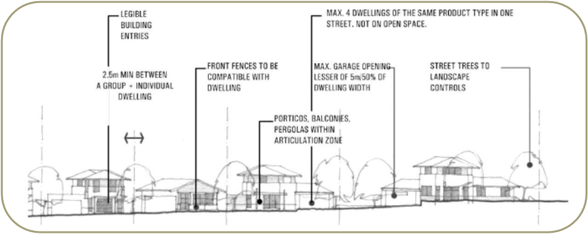
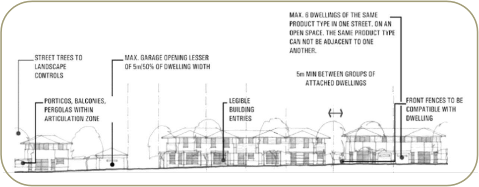
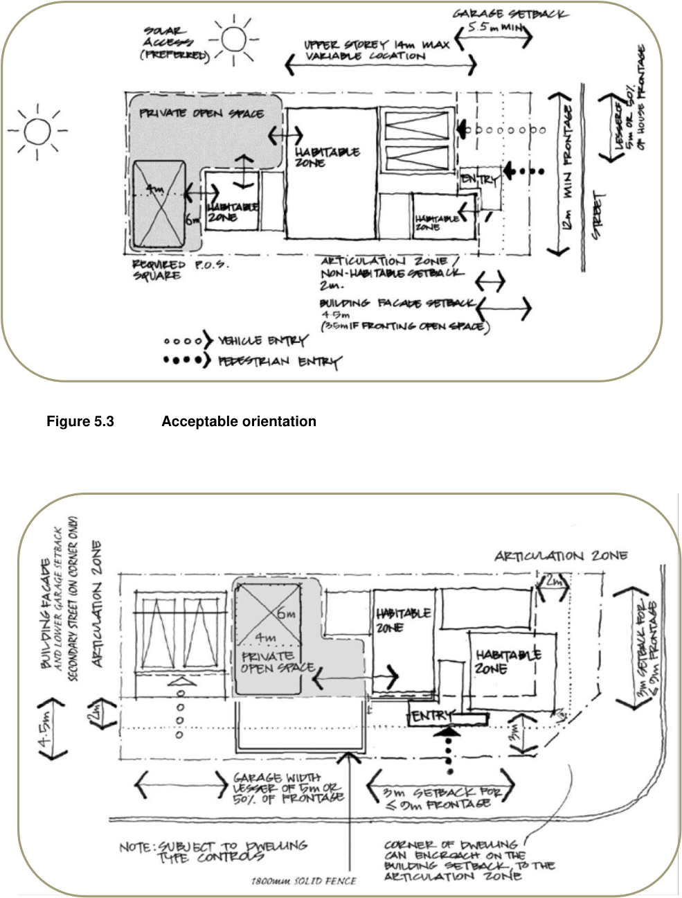
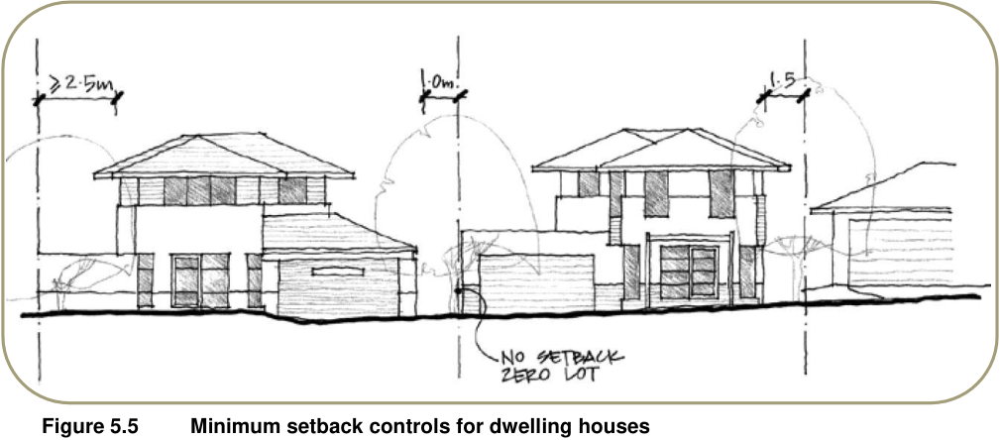
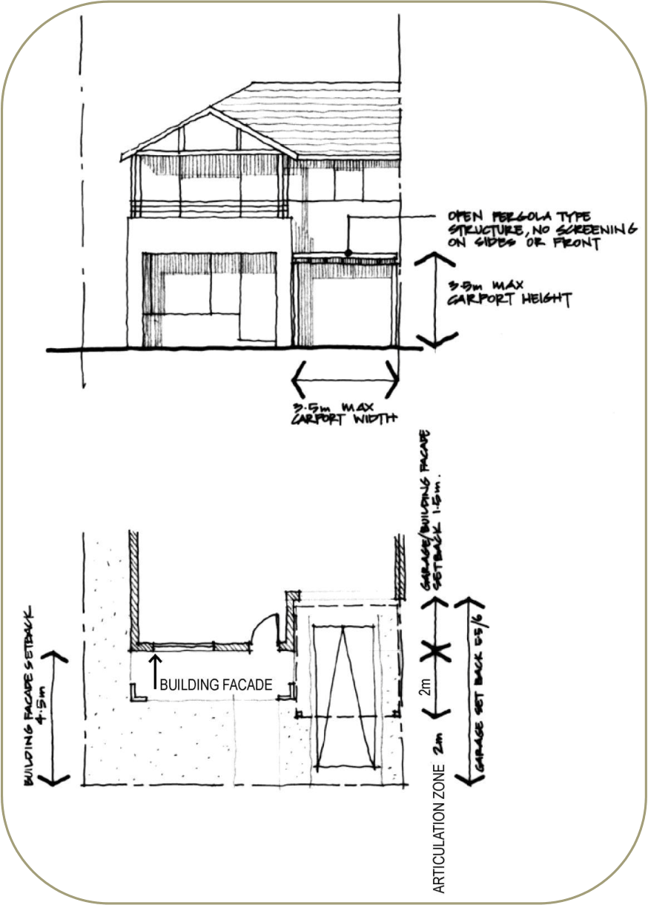
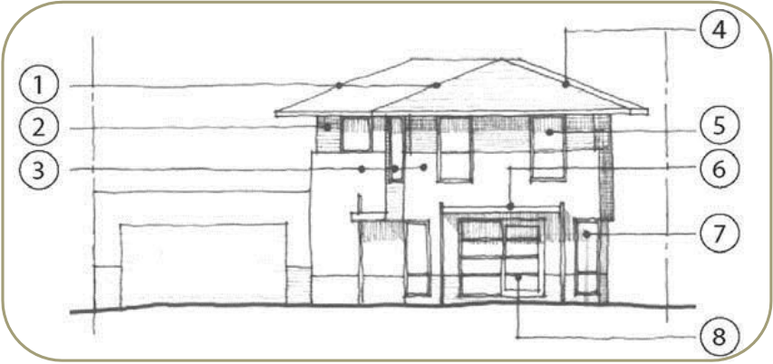
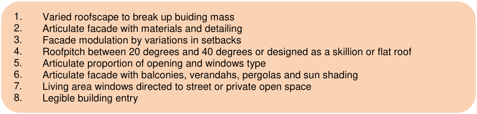

## 5 Housing

### 5.1 Introduction

The pattern, scale and types of dwellings are important elements in creating a successful residential community. The following section sets out the objectives and development controls that relate to the design and development of dwelling houses, dual occupancies, attached dwellings, multi dwelling housing and detached studios. Refer to Figures 5.1 and 5.2 which indicate streetscape principles.

> [Picture on page 31: a picture, saved as a picture (images/part-m-the-ponds-page-31-9.gif, 150 dpi).]

#### Figure 5.1 Streetscape planning principles – typical block (typical street)

> [Picture on page 31: a picture, saved as a picture (images/part-m-the-ponds-page-31-11.gif, 150 dpi).]

#### Figure 5.2 Streetscape planning principles – typical block (facing open space)

> [Picture on page 32: a picture, saved as a picture (images/part-m-the-ponds-page-32-1.gif, 150 dpi).]

#### Figure 5.3 Acceptable orientation

#### Figure 5.4 Acceptable orientation – corner allotment

### 5.2 Dwelling houses

Under Blacktown LEP 2015 “dwelling house” means a building containing only one dwelling.

> [Picture on page 33: a picture, saved as a picture (images/part-m-the-ponds-page-33-4.gif, 150 dpi).]

#### Figure 5.5 Minimum setback controls for dwelling houses

| Control | Requirements |
|---|---|
| Minimum frontage width | 12m |
| Minimum lot depth | 20m |
| Private open space (POS) | 80sq.m - 1, 2 or 3 bedrooms 100sq.m - 4 bedrooms or more Generally to be located at the side or rear of dwelling |
| Minimum width of POS | 2.5m - directly accessible from living areas |
| Minimum dimension of principal POS | 4m x 6m |
| Setbacks (min/m): • Primary frontage (building) • Primary frontage (garage) • Fronting open space • Side and rear (main dwelling) • Side and rear (garage) • Corner lots (secondary street frontage) | 4.5m - building facade 2m - articulation zone (minor architectural features) 5.5m - garage door 3.5m - building facade 900mm - single storey 1.5m - two storey Zero 3m - for a max length of 9m 4m - along both street frontages for length of frontage beyond 9m 3m - where frontage is to open space |
| Maximum building height | 9m in accordance with Clause 4.3 of Blacktown LEP 2015 |
| Maximum building depth of second storey component | 14m |
| Maximum height of carport | 3.5m |
| Car parking spaces | 2 - at least one space needs to be covered |
| Garage minimum internal dimension | Single - 5.5m x 3.0m Double - 5.5m x 5.5m |
| Maximum carport and garage door width | Not more than 5m wide or 50% of the dwelling width whichever is the lesser |
| Floor level above the 1:100 year flood level | 500mm |

#### Table 5.1 Development controls for dwelling houses

> [Picture on page 35: a picture, saved as a picture (images/part-m-the-ponds-page-35-1.gif, 150 dpi).]

#### Figure 5.6 Carport controls

### 5.3 Dual occupancies

#### 5.3.1 Definitions

The definitions below reflect the provisions of Blacktown LEP 2015. Dual  occupancy means a dual occupancy (attached) or a dual occupancy (detached). Dual occupancy (attached) means 2 dwellings on one lot of land that are attached to each other, but does not include a secondary dwelling. Dual occupancy (detached) means 2 detached dwellings on one lot of land, but does not include a secondary dwelling. Dwelling means a room or suite of rooms occupied or used or so constructed or adapted as to be capable of being occupied or used as a separate domicile. Secondary dwelling means a self-contained dwelling that:

(a) Is established in conjunction with another dwelling (the principal dwelling), and

(b) Is on the same lot of land as the principal dwelling, and

(c) Is located within, or is attached to, or is separate from, the principal dwelling.

#### 5.3.2 Subdivision of dual occupancies

Under Clause 4.1C of Blacktown LEP 2015, the subdivision of dual occupancies is generally prohibited, except in the case of detached dual occupancies where the following both apply:

(a) The frontage of each dwelling comprising the dual occupancy faces a differently named street

(b) The size of each lot resulting from the subdivision is not less than 300sq.m. It is noted that nothing in Blacktown LEP 2015 prevents the subdivision of a detached dual occupancy development if the 2 resultant lots meet the minimum allotment size specified in Clause 4.1 of the LEP.

| Control | Requirement |
|---|---|
| Minimum lot depth | 20m |
| Private open space (POS) | 80sq.m for each dwelling - 1, 2 or 3 bedroom dwellings 100sq.m for each dwelling - 4 bedroom dwellings |
| Minimum dimension of principal POS | 4m x 6m - directly accessible from living areas |
| Minimum width of POS | 2.5m |
| Setbacks (minimum/metre): • Primary frontage (building) • Primary frontage (garage) • Fronting open space • Side and rear (main dwelling) • Side and rear (garage) • Corner lots (secondary street frontage) | 4.5m - building facade, 2m - articulation zone (minor architectural feature) 5.5m - garage door 3.5m - building facade 1m - single storey 1.5m - 2 storey Zero - for maximum length of 10m and internalised within development 3m - for maximum length of 9m on the secondary street frontage 4m - along both street frontages for length of frontage beyond 9m 3m - along both street frontages for length of frontage beyond 9m where frontage is to public or community open space |
| Easement for zero lot line | 1m - single storey 1.5m - two storey |
| Maximum number of storeys | 2, developments must comply with Clause 4.3 of Blacktown LEP 2015 |
| Maximum building depth for any second storey component | 14m |
| Maximum height of carport | 3.5m |
| Resident car parking spaces | 1 per dwelling - 1 or 2 bedrooms 2 per dwelling - 3 or more bedrooms |
| Visitor car parking | Visitor parking can be stacked in driveway where garage spaces are provided. Otherwise 1 visitor space to serve both dwellings is to be provided off the driveway |
| Garage and parking space minimum dimensions | Covered - 3m width, 5.5m length Uncovered - 2.5m width, 5.2m length |
| Floor level above the 1:100 year flood level | 500mm |
| Maximum carport and garage door width | Not more than 5m wide or 50% of the dwelling width, whichever is lesser |

#### Table 5.2 Development controls for dual occupancy housing

### 5.4 Attached dwellings and multi dwelling housing

#### 5.4.1 Definition

Attached dwelling means a building containing 3 or more dwellings, where:

(a) Each dwelling is attached to another dwelling by a common wall, and

(b) Each of the dwellings is on its own lot of land, and

(c) None of the dwellings is located above any part of another dwelling. Multi dwelling housing means 3 or more dwellings (whether attached or detached) on one lot of land, each with access at ground level, but does not include a residential flat building.

#### 5.4.2 Development controls for attached dwellings and multi dwelling housing

| Control | Requirement |
|---|---|
| Minimum frontage width | 26m - Applications proposing the development of irregular shaped sites will be treated on their merits in terms of their compliance within the spirit of the site requirements below |
| Maximum depth | No greater than 2.75 times the width of the site On sites approaching the max allowable depth ratio, Council may require buildings to be offset one from the other to create a development that is aesthetically pleasing |
| Maximum number of attached dwellings in one group | 4 6 when opposite public or community open space |
| Minimum gap between group of attached dwellings comprising 2 or more dwellings per group | 5m |
| Minimum gap between group of attached dwellings and a detached dwelling | 2.5m |
| Maximum number of dwellings of same facade type in a single street block | 4 |
| Private open space (POS) Minimum dimension of principal POS Minimum width of POS | 50sq.m - 1 bedroom 60sq.m - 2 bedrooms 70sq.m - 3 or more bedrooms Generally to be located at the side or rear of dwelling 6m x 4m - directly accessible from living areas 2.5m |

| Control | Requirement |
|---|---|
| Setbacks (minimum/metre): • Primary frontage (building) • Primary frontage (garage) • Fronting open space • Side and rear • Side and rear (garages) • Corner lots (secondary street frontage) | 4.5m - building facade 2m articulation zone (minor architectural feature) 5.5m - garage door 3.5m - building façade 1m - single storey 1.5m - two storey Zero - for a max length of 10m and internalised within development 3m - for a max length of 9m on the secondary street façade 4m - along both street frontages for length of frontages beyond 9m 3m - along both street frontages for length of frontage beyond 9m where frontage is to open space |
| Easment for zero lot line | 1m - single storey 1.5m - two storey |
| Minimum gap between groups of attached buildings | 5m |
| Maximum number of storeys | 2 (excludes attic), developments must comply with Clause 4.3 of Blacktown LEP 2015 |
| Maximum building depth of any second storey component | 14m |
| Maximum carport and garage door width | Not more than 5m wide or 50% of the dwelling width whichever is the lesser |
| Car parking spaces | 1 per dwelling - 1 and 2 bedrooms 2 per dwelling - 3 bedrooms or more |
| Visitor car parking | 1 space per 2.5 dwellings |
| Floor level above the 1:100 year flood level | 500mm |
| Garage and parking space, minimum dimension | Covered - 3m width, 5.5m length Uncovered - 2.5m width, 5.2m length |

Table 5.3 Development controls for attached dwellings and multi dwelling housing

### 5.5 Common issues

#### 5.5.1 External appearance

■ Objectives

(a) Enhance the streetscape amenity and residential character of the site

(b) Create a high standard of architectural design for both individual dwellings and groups of dwellings

(c) Consider proportions in the design of building elevations

(d) Reinforce significant street intersections, particularly in open space and other key strategic areas, through articulation of corner buildings.

> [Picture on page 40: a picture, saved as a picture (images/part-m-the-ponds-page-40-4.gif, 150 dpi).]

> [Picture on page 40: a picture, saved as a picture (images/part-m-the-ponds-page-40-5.gif, 150 dpi).]
> Words printed on the picture (copied from the PDF):
> 1.
> 2.
> 3.
> 4.
> 5.
> 6.
> 7.
> 8.
> Varied roofscape to break up buiding mass
> Articulate facade with materials and detailing
> Facade modulation by variations in setbacks
> Roofpitch between 20 degrees and 40 degrees or designed as a skillion or flat roof
> Articulate proportion of opening and windows type
> Articulate facade with balconies, verandahs, pergolas and sun shading
> Living area windows directed to street or private open space
> Legible building entry

#### Figure 5.7 Architectural treatment of dwelling facades

■ Controls (Figure 5.7)

(a) Articulate the building façade using:

(i) Variations in setbacks

(ii) Materials and detailing

(iii) Building entrances

(iv) Balcony and other elements

(v) Shutters, awnings and louvres

(vi) Attention to proportion of openings, window type and size

(b) Corner buildings should be articulated by addressing both street frontages, with corner elements such as verandahs, pergolas and attic storey

(c) Windows to living area should be directed either to the street or rear private open space (and private driveway) to provide visual surveillance to the street and other open space areas

(d) Generally no bathrooms, ensuite or laundry window to face a public road.

(e) Building entries are to be clearly visible from the street

(f) Modulation of the façade should be integral to the design of the building, not ‘stuck on’

(g) Attention to both the building base and roof is required. Roofs are to be either pitched between 20 and 40 degrees with simple forms that avoid small pieces of roof with messy flashing details, or designed as a flat or skillion roof

(h) Communication devices, including antennae, satellite dishes and similar elements are not to be visible from the street

(i) An upper storey eave overhang of at least 450mm is required, except on party walls and zero lot line walls

(j) Lightweight material such as boarded cladding may be used to add interest to the façade. Materials such as fibre cement cladding is to be rendered with either a reveal joint or no joints

(k) Carports and garages should be constructed of materials that complement the colour and finishes of the main dwelling.

#### 5.5.2 Safety – Crime prevention through environmental design (CPTED)

requirements ■ Objective Enhance safety, maximise surveillance and minimise opportunities for crime.

■ Controls

(a) Building entries to be clearly visible from the street. They are not to be obscured by carports or other elements. A covered entry is encouraged. Entries are to be adequately lit

(b) Where garages are located behind dwellings in car courts with private driveway access, measures must be taken to minimise opportunities for crime

(c) Provide lighting both to streets and private driveways sufficient for surveillance.

#### 5.5.3 Privacy

■ Objective Ensure that buildings are designed and sited to provide privacy between neighbours and between building occupants and the public.

■ Controls

(a) Windows to upper storeys to be located on front or rear facades where possible

(b) Second storey windows to living areas that face directly to windows, balconies or private open space of adjoining properties to be offset

(c) First floor balconies or living room windows not permitted to directly overlook private open space of adjoining dwellings unless suitable screening is provided

(d) Maintain adequate privacy between studio accommodation located on private driveways.

#### 5.5.4 Solar access

■ Objective Maximise solar access to private open space and living areas of dwellings.

■ Controls

(a) Areas of private open space should achieve at least 3 hours of sunlight to 50% of the required private open space between 9am and 3pm on 21 June

(b) Dwellings to be designed to avoid unreasonable overshadowing of adjacent properties. Buildings should be designed to ensure that 50% of the on-site private open space area of adjoining sites receive a minimum of 3 hours of sunlight between 9.00am and 3.00pm on 21 June

(c) An application proposing a 2 storey dwelling must include shadow diagrams showing the impact of the proposal on the site and adjoining site between 9am and 3pm on 21 June.

#### 5.5.5 Landscaping

■ Objectives

(a) Maximising microclimate benefits to residential lots

(b) Enhance streetscape amenity

(c) Ensure planting success and continuity

(d) Minimise requirements for irrigation and fertilisers.

■ Controls

(a) Indigenous species to make up a large percentage of the plant material mix

(b) Plant species to be predominantly selected from the schedule at appendix 2

(c) A landscaping plan to be submitted for all development other than single dwelling houses.

#### 5.5.6 Fencing

■ Objectives

(a) Ensure front fences contribute to the streetscape and create a clear distinction between the public and private domain

(b) Ensure that rear and side fencing will assist in providing privacy to open space areas

(c) Ensure that fence height, location and design will not affect traffic and pedestrian visibility at intersections.

■ Controls

(a) Fences to the street frontage are to be a maximum of 0.9m in height except for corner lots

(b) Fences to corner lots are to be a maximum 0.9m high on the primary street frontage and on the secondary street frontage to a point 4m from the dwelling frontage where it may then increase to 1.8m in height

(c) Side and rear boundary fencing constructed behind the building alignment setback should be a maximum 1.8m high and constructed of materials to complement the design of the dwelling. Metal sheeting is not permitted

(d) Front fences may be of solid construction to a maximum height of 0.6m. The balance of the fence is to have a minimum opening ratio of 50%. Metal sheeting is not permitted

(e) Retaining walls visible to a public place are to be masonry

(f) Courtyard retaining walls will require fencing to be positioned on top of the retaining wall.

#### 5.5.7 Water efficiency

■ Objective Minimise water consumption in accordance with State Government requirements.

■ Control The provisions of BASIX will apply with regard to water requirements.

#### 5.5.8 Energy efficiency

■ Objective Minimise energy usage and greenhouse emissions.

■ Controls

(a) The provisions of BASIX will apply with regard to energy requirements

(b) Maximise cross flow ventilation in all dwelling designs

(c) Incorporate outdoor clothes line and drying areas into all dwellings.

#### 5.5.9 Services

■ Objective Ensure that services are not visually intrusive.

■ Controls

(a) Should an electrical substation (located within the site area or on the street frontage of the site) be necessary, the requirements of both Council and Integral Energy shall be met

(b) All electrical reticulation within the site shall be underground

(c) Provision shall be made to illuminate all common accessways and driveways to the satisfaction of Council. All common accessways shall be lit at the vehicular footway crossing by an approved means from dusk till dawn.

#### 5.5.10 Materials selection

■ Objective Select materials that minimise the use of non renewable resources.

■ Controls

(a) The selection of materials for pipe infrastructure, foundation and brickwork must have sulphate resistant properties to cope with the saline conditions

(b) Specify, where possible, the use of recycled and renewable materials.

#### 5.5.11 Salinity and sodicity

■ Objective Manage and mitigate the impacts of, and on, salinity.

■ Control Salinity shall be considered during the siting, design and construction of dwellings, including: drainage, vegetation type and location, foundation selection and cut and fill activities, to ensure the protection of the dwelling from salinity damage and to minimise the impacts that the development may have on the salinity process.
