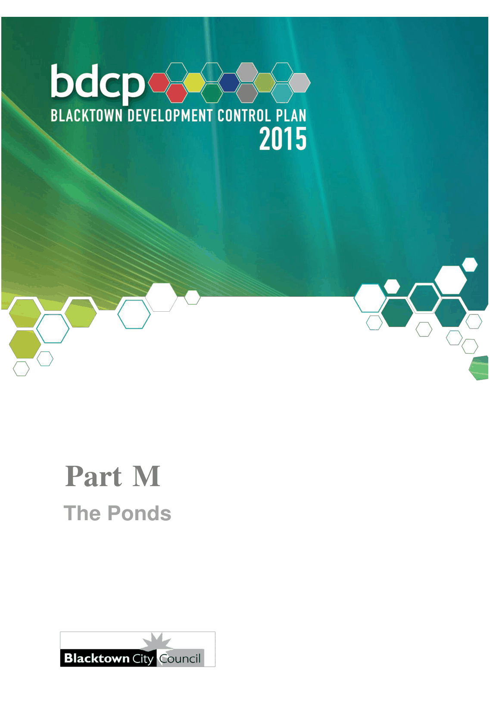

# Blacktown Development Control Plan 2015 - Part M The Ponds

> This chapter is split into 9 section file(s), one per numbered heading, in the order they appear in the PDF.

Source PDF: [Part-M-The-Ponds_Waste.pdf](Part-M-The-Ponds_Waste.pdf)

> [Picture on page 1: a picture, saved as a picture (images/part-m-the-ponds-page-1-1.gif, 150 dpi).]

### Part M

### The Ponds

### Table of Contents

| 1 | Introduction ............................................................................................................... 4 1.1 Structure of this Part ....................................................................................... 4 1.2 Land to which this Part applies....................................................................... 6 1.3 Relationship to planning instruments and policies ....................................... 8 1.4 General objectives ........................................................................................... 8 |
|---|---|
| 2 | Development principles and objectives .................................................................. 9 2.1 Overall The Ponds DCP framework ................................................................ 9 |
| 3 | Urban design ........................................................................................................... 11 3.1 Land use ......................................................................................................... 11 3.2 Circulation network ....................................................................................... 18 |
| 4 | Site planning ........................................................................................................... 28 4.1 Land capability – salinity and sodicity ......................................................... 28 4.2 Aboriginal heritage ........................................................................................ 28 4.3 Contamination ................................................................................................ 29 4.4 Cut and fill ...................................................................................................... 29 4.5 Flora and fauna .............................................................................................. 29 |
| 5 | Housing ................................................................................................................... 31 5.1 Introduction .................................................................................................... 31 5.2 Dwelling houses............................................................................................. 33 5.3 Dual occupancies .......................................................................................... 36 5.4 Attached dwellings and multi dwelling housing .......................................... 38 5.5 Common issues ............................................................................................. 39 |
| 6 | Commercial / community uses............................................................................... 45 |
| 7 | Information to be submitted with a Development Application ............................. 46 |
| Appendix 1 Definitions .................................................................................................. 48 |  |
| Appendix 2 Recommended vegetation species .......................................................... 50 |  |
| Figures |  |
| Figure 1.1 Location plan ........................................................................................... 5 |  |
| Figure 1.2 Area to which this Part applies ............................................................... 7 |  |
| Figure 2.1 Design structure .................................................................................... 10 |  |

| Figure 3.1 | Land use ................................................................................................. 12 |
|---|---|
| Figure 3.2 | Neighbourhood and community facilities ............................................ 13 |
| Figure 3.3 | Open space and conservation areas .................................................... 16 |
| Figure 3.4 | Residential density distribution ............................................................ 17 |
| Figure 3.5 | Access and linkages plan ..................................................................... 19 |
| Figure 3.6 | Street hierarchy plan ............................................................................. 20 |
| Figure 3.7 | Typical collector road ............................................................................ 23 |
| Figure 3.8 | Typical local street ................................................................................ 24 |
| Figure 3.9 | Typical local street adjacent to trunk drainage ................................... 25 |
| Figure 3.10 | Pedestrian and cycle network ............................................................... 27 |
| Figure 5.1 | Streetscape planning principles – typical block (typical street) ........................................................................................ 31 |
| Figure 5.2 | Streetscape planning principles – typical block (facing open space) ............................................................................... 31 |
| Figure 5.3 | Acceptable orientation .......................................................................... 32 |
| Figure 5.4 | Acceptable orientation – corner allotment ........................................... 32 |
| Figure 5.5 | Minimum setback controls for dwelling houses .................................. 33 |
| Figure 5.6 | Carport controls ..................................................................................... 35 |
| Figure 5.7 | Architectural treatment of dwelling facades ........................................ 40 |
| Tables |  |
| Table 3.1 | Road carriageway and reserve widths ................................................. 21 |
| Table 3.2 | Street character ..................................................................................... 22 |
| Table 5.1 | Development controls for dwelling houses ......................................... 34 |
| Table 5.2 | Development controls for dual occupancy housing ........................... 37 |
| Table 5.3 | Development controls for attached dwellings and multi dwelling housing ................................................................... 39 |

<!-- sections -->
## Sections

1. [1 Introduction](01-1-introduction.md)
2. [2 Development principles and objectives](02-2-development-principles-and-objectives.md)
3. [3 Urban design](03-3-urban-design.md)
4. [4 Site planning](04-4-site-planning.md)
5. [5 Housing](05-5-housing.md)
6. [6 Commercial / community uses](06-6-commercial-community-uses.md)
7. [7 Information to be submitted with a Development](07-7-information-to-be-submitted-with-a.md)
8. [1 Definitions](08-1-definitions.md)
9. [2 Recommended vegetation species](09-2-recommended-vegetation-species.md)
