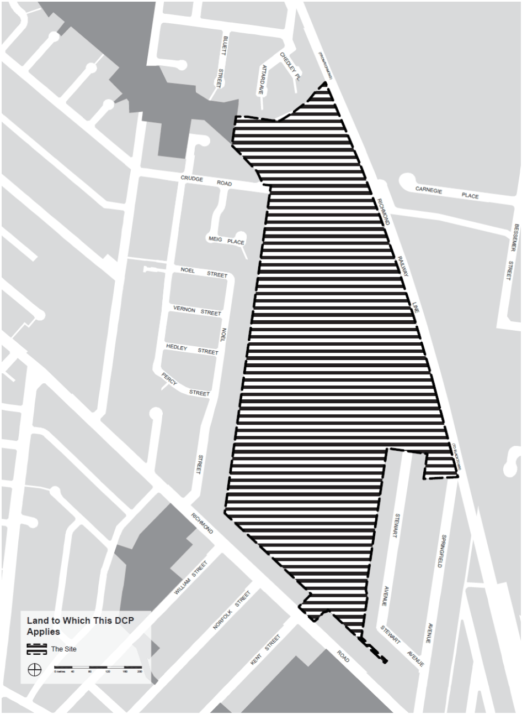

## 1 Introduction

This Part of the Blacktown Development Control Plan (DCP) 2015 has been prepared in accordance with the provisions of the Environmental Planning and Assessment Act 1979. Part N has been developed to provide guidance to facilitate the urban redevelopment of the former Ashlar Golf Course (the Ashlar Site).  This will be done within the context of giving guidance for:

(a) Achieving the aims of the Blacktown Local Environmental Plan (LEP) 2015 and relevant SEPPs

(b) Supporting development that complies with zone objectives and provides a harmonious living environment

(c) Encouraging a range of residential accommodation types that  meet the needs of the local community

(d) Delivering public domain improvements, including improved local road connectivity, public open space network, bicycle and pedestrian connections and stormwater and flood management.

### 1.1 Structure of this Part

The following sections of this Part of Blacktown DCP 2015 present the development objectives and corresponding development controls. Each section has its own set of objectives and development controls that will be used to assess the appropriate application of the controls. Part N of the Blacktown DCP 2015 contains the following structure:

(a) Section 1 – Introduction

(b) Section 2 – Urban Design Development Controls

(c) Section 3 – Built Form Development Controls.

### 1.2 Land to which this Part applies

The Ashlar Site comprises 38.38ha of land. The topography is gently undulating and comprises modified watercourses and a number of artificial waterbodies. Part N of the Blacktown DCP 2015 applies to the land shown hatched on Figure 1 – Land to which this Part of the Blacktown DCP Applies. Blacktown City Council is the consent authority for development on the Ashlar Site. When a Development Application (DA) is lodged which relates to land to which this Part applies, Council will take the provisions of Blacktown DCP 2015 into consideration in determining the DA.

### 1.3 Relationship to Blacktown Development Control Plan

Where there is an inconsistency with the Part N and any other Part of the DCP, the provisions of the Part N prevail to the extent of the inconsistency. Where an element is not covered by Part N then other sections of Blacktown DCP 2015 may apply.  Part N must be read in conjunction with the following:

(a) Blacktown Local Environmental Plan (LEP) 2015

(b) Relevant State Environmental Planning Policies

(c) Any planning agreement that has been entered into under section 93F of the Environmental Planning and Assessment Act 1979

(d) Blacktown Development Control Plan 2015.

### 1.4 General objectives

Part N of the DCP provides a basis for the redevelopment of the Ashlar Site by providing details in relation to the following matters:

(a) The broad strategic planning principles and development controls for development on the Ashlar Site

(b) The development controls to be applied in the assessment of DA

(c) The required information to be submitted with any DA and to ensure a clear process for applicants to follow.

> [Picture on page 6: a picture, saved as a picture (images/part-n-ashlar-precinct-page-6-1.gif, 150 dpi).]

#### Figure 1.1 Land to which this Part of the Blacktown DCP applies
