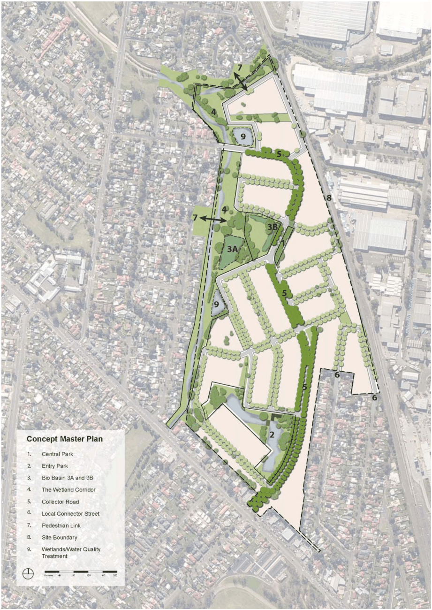
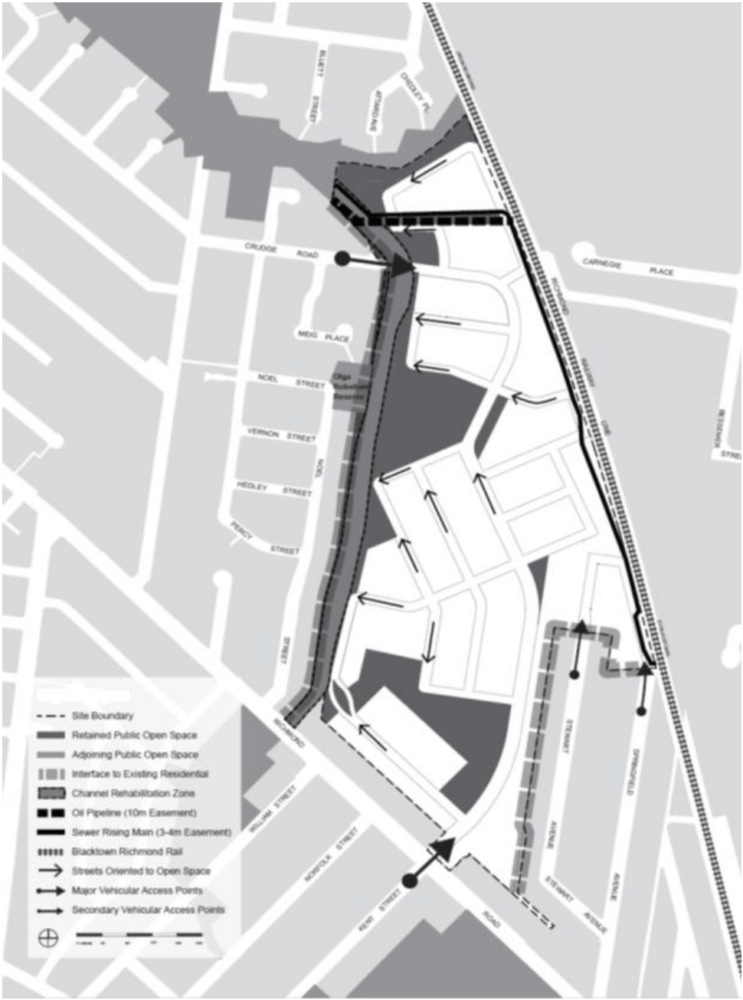
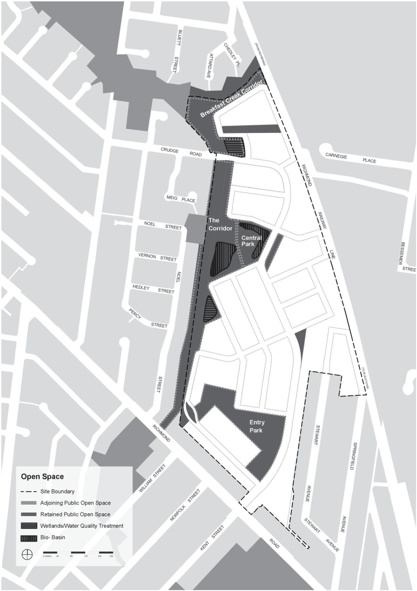
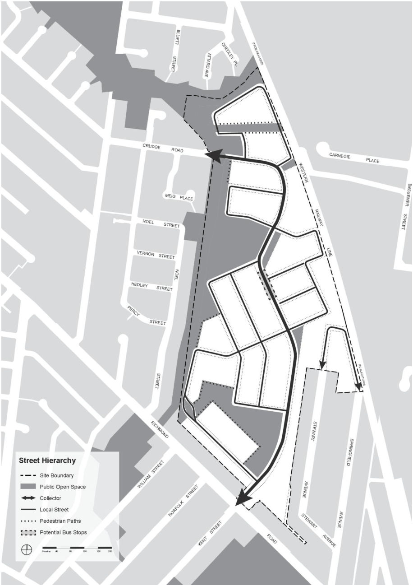
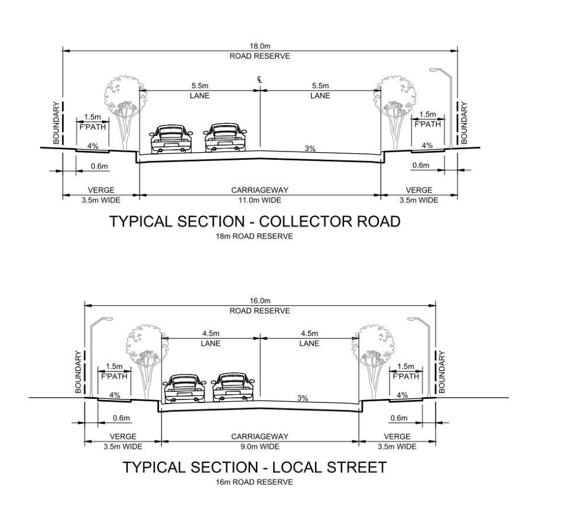

## 2 Urban design

This section describes the principles to achieve the desired built form and public domain.

### 2.1 Concept master plan

The Ashlar Site must connect with the surrounding areas and integrate into the existing urban fabric, creating a new neighbourhood with a diversity of housing types connected to the open space system. The existing concrete drainage channel must be deconstructed and transformed into a wetland corridor with a series of ponds, wetlands and parks with regional cycle paths. The Breakfast Creek corridor must be restored to a quality natural riparian system, promoting and celebrating the native flora and fauna associated with the ecosystem. Significant and diverse open spaces must be delivered. The open space system should be designed to integrate with the hydrological systems and retained trees within the landscape. The open space system comprises an Entry Park, the Wetland Corridor, Central Park and Breakfast Creek Wetlands. Community uses and facilities should be incorporated into the open space system at the Ashlar Site and should include infrastructure for recreation including cycle paths, play areas and BBQ equipment. A dedicated pedestrian and cycle movement network must be developed to connect the wetlands and parklands via the western riparian corridor with the Blacktown Showground and regional open space system. A range of housing types including detached dwellings, semi-detached, attached, multi-dwelling housing and residential flat buildings should be delivered at the Ashlar Site. Opportunities should also be provided for mixed use development and community facilities. All forms of development should provide interesting and diverse streetscapes. ■ Objectives

(a) Capitalise on the existing and natural features of the Ashlar Site, trees and hydrology, for place-making, site-responsive development and community amenity

(b) Provide high quality public domain and infrastructure to cater for a range of users in the community

(c) Encourage housing choice and diversity

(d) Promote walking, cycling and public transport

(e) Provide an overall density that is appropriate for an urban infill site within the Blacktown City Centre

(f) Provide a range of housing types to accommodate diverse ages and incomes

(g) Provide a range and mix of lot sizes to suit a variety of dwelling types

(h) Ensure denser forms of residential development are located near open spaces and areas of highest amenity

(i) Encourage housing affordability through a range of different housing products

(j) Provide passive surveillance of public spaces through the effective and functional layout designs of new development

(k) Encourage the design of subdivisions to maximise solar access

(l) Ensure subdivision and road layout take account of existing trees to be retained.

■ Controls

(a) Development must be designed in accordance with Figure 2 - Concept Master Plan and take into consideration the design elements outlined in Figure 3 – Key Design Elements

(b) The open space system should be easily accessible to all residents and the broader community, providing infrastructure and community facilities to serve a range of user groups

(c) Denser housing types, such as residential flat buildings and multi dwelling housing, shall generally be located adjacent to the railway line

(d) Stormwater from all allotments must be able to be drained satisfactorily to the Council stormwater system.

> [Picture on page 9: a picture, saved as a picture (images/part-n-ashlar-precinct-page-9-1.gif, 150 dpi).]

#### Figure 2.1 Concept master plan

> [Picture on page 10: a picture, saved as a picture (images/part-n-ashlar-precinct-page-10-1.gif, 150 dpi).]

#### Figure 2.2 Key design elements

### 2.2 Public open space

■ Objectives

(a) Provide a range of parklands which respond to natural systems, retain trees and cater for a wide range of user needs

(b) Provide physical and visual linkages between open spaces

(c) Provide each open space with a strong character, sense of safety and usability

(d) Establish attractive and safe walking and cycle links that provide opportunities for regional linkages

(e) Enable casual surveillance of the public domain.

■ Controls

(a) Provide a range of open spaces which creates a continuous parkland network in accordance with Figure 4 – Open Space

(b) The design of the open spaces should ensure maximum tree retention

(c) The Wetland Corridor should be enhanced and embellished with boardwalks, viewing platforms and seating

(d) The Wetland Corridor must be naturalistic in character and planting whilst providing dedicated pedestrian and cycle linkages to deliver a regional asset and local amenity in the form of a wetland/parkland system

(e) Locational and interpretive signage and appropriate lighting shall be provided as part of the open space system and provide direction to regional linkages and destinations

(f) All open spaces shall provide high quality, robust, low maintenance park furniture including benches, tables, and chairs to allow the functional use of the open space by the community

(g) Children’s playground facilities should be located at key locations throughout the open space and provide active playground facilities for the community.

> [Picture on page 12: a picture, saved as a picture (images/part-n-ashlar-precinct-page-12-1.gif, 150 dpi).]

#### Figure 2.3 Open space

### 2.3 Access and linkages

The street design on the Ashlar Site should encourage walking and cycling through traffic management, visual interest through the enhanced landscape of the site, and by providing connections to surrounding community facilities within walking distance of the majority of residents. The street network should be designed to comprise a hierarchy of streets that respond to two primary considerations:

(a) Character: the physical qualities of thoroughfares designed to support a variety of building types and pedestrian activity

(b) Capacity: the number of vehicles that can move safely along a thoroughfare within given periods. Traffic flows are accommodated by the number of vehicle lanes, lane width and kerb radii.

| Street type | Streetscape character | criteria |
|---|---|---|
| Collector | An urban tree - lined avenue with closed canopy street tree planting providing shade for pedestrians and on - street car parking. The planting pattern transitions from park edge street to double planted verges to a centrally planted median as the neighbourhood character changes. | Formal avenue or median tree planting and groundcover with wider footpaths. Existing trees are retained within parks adjoining this street. |
| Local Street | Residential streets emanating from the Collector are planted in a formal manner with a variety of flowering tree species differentiating streets and residential precincts. Residential streets along the open space edge retain existing trees and provide additional planting whilst incorporating a hydrological function. | Formal avenue tree planting in verge. Existing tree retention in naturalistic clusters along open space edges and in widened verges. The Springfield and Stewart Avenue extension planted informally with naturalistic clustering of trees as an extension of the streetscape character of the adjoining development. |
| Private/ Community Title | Private community road style thoroughfares with buffer strips providing groundcover and feature tree planting terminating vistas and creating intimate secondary spaces. | Predominately hardscape with feature trees located in tree wells and groundcover adjoining garages. |

#### Table 2.1 Street hierarchy principles

■ Objectives

(a) To create a street hierarchy that reflects the function, character and carrying capacity of each street and forms part of the traffic circulation network

(b) To establish a street network that promotes a liveable and permeable local environment

(c) To provide safe and convenient all weather access to all lots.

■ Controls

(a) The street hierarchy and configurations must be provided in accordance with Figure 5 – Street hierarchy, Figure 6 – Typical street sections and Table 2 – Road design requirements.

| Street type | Carriageway width (m) | Total verge width (m) | Minimum road reserve (m) | Minimum street corner radius (m) | Number of lanes |
|---|---|---|---|---|---|
| Collector |  |  |  |  |  |
| Loop roads serving activity centres such as large open space areas, shops, etc. | 11m | 3.5m | 18m | 5m x 5m splay corner with 7.5m kerb return radii | 2 travel lanes/ 2 parking lanes |
| Local Street |  |  |  |  |  |
| Minor loop roads serving more than 30 dwellings including corner lots | 9m | 3.5m | 16m | 5m x 5m splay corner with 7.5m kerb return radii | 2 travel lanes/ 2 parking lanes |
| Private Access Ways | Urban design principles for private access ways: Serve no greater than 15 dwellings High quality landscape environment Good passive surveillance based CPTED principles Varying pavement widths and treatments Ease of access for residential vehicle manoeuvring Pedestrian safety |  |  |  |  |

#### Table 2.2 Road design requirements

> [Picture on page 15: a picture, saved as a picture (images/part-n-ashlar-precinct-page-15-1.gif, 150 dpi).]

#### Figure 2.4 Street hierarchy

> [Picture on page 16: a picture, saved as a picture (images/part-n-ashlar-precinct-page-16-1.gif, 150 dpi).]

#### Figure 2.5 Typical street sections

### 2.4 Safety and surveillance

The public domain on the Ashlar Site should encourage a sense of community ownership through the appropriate design of publicly accessible areas. ■ Objectives

(a) Enhance safety, maximise surveillance and minimise opportunities for crime

(b) Ensure that development encourages people to use streets, parks and other public places.

■ Controls

(a) All parklands, streets and buildings must be designed in accordance with CPTED principles

(b) Park edge streets or pedestrian paths should be located adjacent to all parklands to maximise activity and visual surveillance

(c) All parklands should be fronted by dwellings and/or streets to maximise natural surveillance

(d) Appropriate lighting must be provided to all areas of the public domain

(e) The main pedestrian access from streets to dwellings must be easily identified

(f) Design features should be used to delineate areas of potential conflict between vehicles and pedestrians.
