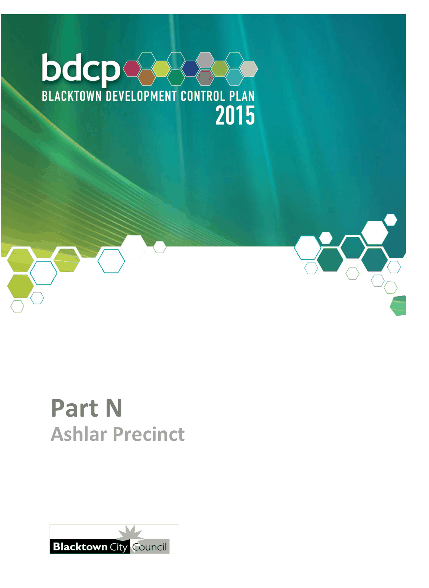

# Blacktown Development Control Plan 2015 - Part N Ashlar Precinct

> This chapter is split into 3 section file(s), one per numbered heading, in the order they appear in the PDF.

Source PDF: [Part-N-Ashlar-Precinct.pdf](Part-N-Ashlar-Precinct.pdf)

> [Picture on page 1: a picture, saved as a picture (images/part-n-ashlar-precinct-page-1-1.gif, 150 dpi).]

### Ashlar Precinct – Draft DCP

### Part N

### Ashlar Precinct

### Table of Contents

| 1 | Introduction ............................................................................................................... 4 1.1 Structure of this Part ....................................................................................... 4 1.2 Land to which this Part applies ...................................................................... 4 1.3 Relationship to Blacktown Development Control Plan ................................. 4 1.4 General objectives ........................................................................................... 5 |
|---|---|
| 2 | Urban design ............................................................................................................. 7 2.1 Concept master plan ....................................................................................... 7 2.2 Public open space ......................................................................................... 11 2.3 Access and linkages ...................................................................................... 13 2.4 Safety and surveillance ................................................................................. 16 |
| 3 | Built form ................................................................................................................. 18 3.1 Architectural character .................................................................................. 18 3.2 Privacy ............................................................................................................ 19 3.3 Landscaping ................................................................................................... 19 3.4 Fencing ........................................................................................................... 19 3.5 Detached dwellings ....................................................................................... 20 3.6 Dual occupancy ............................................................................................. 21 3.7 Semi-detached dwellings .............................................................................. 22 3.8 Attached dwellings ........................................................................................ 23 3.9 Multi dwelling housing .................................................................................. 24 3.10 Secondary dwellings ..................................................................................... 26 3.11 Residential flat buildings and shop top housing ......................................... 26 3.12 Neighbourhood shops ................................................................................... 27 |
| Figures |  |
| Figure 1.1 Land to which this Part of the Blacktown DCP applies .............................. 6 |  |
| Figure 2.1 Concept master plan ..................................................................................... 9 |  |
| Figure 2.2 Key design elements ................................................................................... 10 |  |
| Figure 2.3 Open space .................................................................................................. 12 |  |
| Figure 2.4 Street hierarchy ........................................................................................... 15 |  |
| Figure 2.5 Typical street sections ................................................................................ 16 |  |

#### Tables

| Table 2.1 | Street hierarchy principles.......................................................................... 13 |
|---|---|
| Table 2.2 | Road design requirements ......................................................................... 14 |
| Table 3.1 | Fencing ........................................................................................................ 20 |
| Table 3.2 | Detached dwellings ..................................................................................... 21 |
| Table 3.3 | Dual occupancy ........................................................................................... 22 |
| Table 3.4 | Semi-detached dwellings ............................................................................ 23 |
| Table 3.5 | Attached dwellings ...................................................................................... 24 |
| Table 3.6 | Multi dwelling housing ................................................................................ 25 |
| Table 3.7 | Secondary dwellings ................................................................................... 26 |
| Table 3.8 | Residential flat buildings and shop top housing ...................................... 27 |

<!-- sections -->
## Sections

1. [1 Introduction](01-1-introduction.md)
2. [2 Urban design](02-2-urban-design.md)
3. [3 Built form](03-3-built-form.md)
