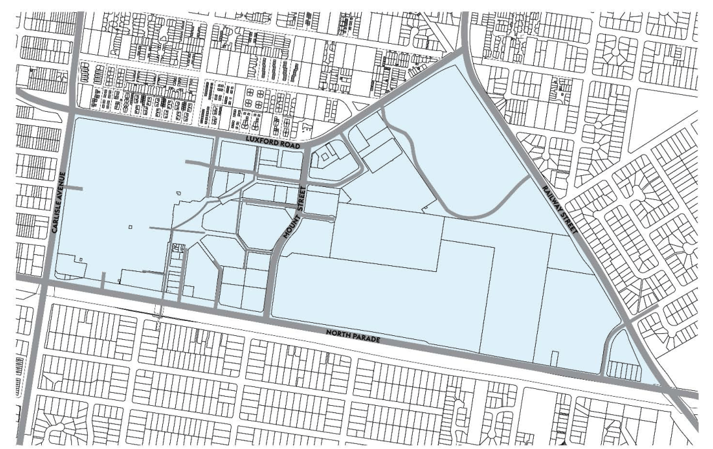

## 1. Context (cont.)

(b)	 the building concerned is at least 3 or more storeys (not including levels below ground level (existing) or levels that are less than 1.2 metres above ground level (existing) that provide for car parking), and

(c) 	 the building concerned contains at least 4 or more dwellings.”

ii.	 Under SEPP 65, all applications must:

•	 have a Design Verification Statement demonstrating how the Design Quality Principles of SEPP 65 have been achieved

• 	 have a statement that the development has been designed by a registered architect

• 	 demonstrate how the development complies with the objectives and design criteria in the NSW Apartment Design Guide published by the NSW Government.

### 1.6 Land to which this Part applies

This Part of the DCP applies to land within the Mount Druitt CBD as shown in Figure 1: Mount Druitt CBD.

> [Picture on page 3: a picture, saved as a picture (images/part-o-mount-druitt-cbd-page-3-14.gif, 150 dpi).]

#### Figure 1: Land to which this Part applies in the Mount Druitt CBD

### 1.7 Context

#### 1.7.1 Metropolitan and District context

The Greater Sydney Region Plan: a metropolis of three cities and the Central City District Plan recognises Mount Druitt as a Strategic Centre in metropolitan Sydney. The NSW Government defines Strategic Centres as places that attract investment, business activity and jobs close to people’s homes to support the productivity and liveability of a 30-minute city. Strategic Centres include:

• high levels of private sector investment

• 	 co-location of a wide mix of land uses, including residential

• high levels of amenity and walkability and being cycle friendly

• areas identified for commercial uses.

#### 1.7.2 Local context

The Blacktown Local Strategic Planning Statement recognises that the Mount Druitt Strategic Centre is serviced by higher order retail, commercial, residential, transport and community facilities, and is a place for arts and cultural expression, and a place to retain and enhance identity and community pride. It seeks to promote urban renewal and growth opportunities in employment, education and high density residential, supported by open space, community uses and public domain improvements.

Council has prepared an urban design study of the Strategic Centre that considered land uses, building heights, and connectivity and permeability throughout the centre. It identified the need to reinforce a north-south axis of pedestrian connectivity linking to the train station and Dawson Mall, with an east-west link through the CBD and bordering the recreational public spaces with active building frontages. It was developed based on the following principles:

• Principle 1 - Expand and link pedestrian spaces along the east-west axis between the town square to the town centre reserve

• Principle 2 - Increase mixed use residential development around the east-west public space to maximise outlook, aspect and access for future residents

• Principle 3 - Identify Gateway Sites for landmark buildings that visually signify the CBD

• Principle 4 - Extend the network of streets and roads to open up dead-end streets and provide vehicular and pedestrian connection through the CBD

• Principle 5 - Provide active street frontages along critical streets and lanes.

• Principle 6 - Encourage mixed use residential development.

The urban design study resulted in changes to Blacktown Local Environmental Plan 2015 that:

• 	 rationalised the land use zones to focus on a mixed use residential centre

• 	 increased building heights across the CBD

• 	 identified gateway sites to enable bonus heights

• 	 introduced architectural design excellence provisions.

This Part of Blacktown Development Control Plan 2015 expands and complements that work by providing detailed development objectives and controls that will guide the future development of the Mount Druitt Strategic Centre.
